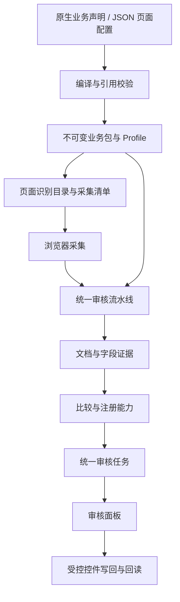

# 功能职责与重构验收

本次整理以现有审核行为为基准：报废置换、车源和过户继续使用各自已确认的规则；一致性审核保留未配置状态。目标是让普通业务变化落在业务声明中，让特殊算法有明确的扩展入口，让通用执行代码不需要认识具体业务字段。

## 功能与代码归属

以下路径均相对仓库根目录。

| 功能 | 要完成的工作 | 主要归属及边界 |
| --- | --- | --- |
| 页面识别 | 确定业务、地区、版本和当前审核步骤 | 后端 `businesses/page_catalog.py` 生成元数据；扩展 `platform/browser/identity/` 消费路径、激活页签和对应面板。字段采集不再接收无实际作用的业务类型参数 |
| 业务配置 | 一处声明字段、材料、路由、证据优先级、规则和写回权限 | `businesses/packs/` 是不可变业务模型；`businesses/configuration/` 把 JSON 配置编译到同一模型，不执行模型或浏览器操作 |
| 上传完整性 | 判断要求的图片是否上传，支持方案之间任选、方案内全部提供 | `businesses/material_presence.py` 只消费图片和分类事实；下载或字段识别失败不会抹掉明确的上传事实 |
| 证据完整性 | 判断材料页码、字段来源和识别质量是否满足审核要求 | `businesses/completeness.py`，与上传展示分开；原有调用入口保留 |
| 页面采集 | 读取控件原值、字段目录、图片地址及歧义诊断 | 扩展 `collection/page-field-collector.ts` 处理 DOM；`catalog/field-definitions.ts` 管理当前声明、别名索引和兼容兜底；`collection/image-assets.ts` 只生成图片元数据 |
| 材料识别 | 管理分类、专属提取、超时和受控重读 | `integrations/recognition/extraction.py`；`projection.py` 独立完成提取结果、字段路由和原图区域映射，不修改队列或调用模型 |
| 字段比较 | 保留原始证据，统一处理归一化、缺失、冲突和不确定性 | `evidence/collection.py`、`evidence/comparison/`；不依赖任务展示或 HTTP 响应 |
| 规则和能力 | 执行业务算法、外部核验、材料检查并产出标准结果 | Handler 在业务目录登记；`capabilities/` 负责契约和执行保护。规则不直接操作页面 |
| 流程编排 | 按阶段运行识别、比较、规则和最终建议 | `runtime/workflow/graph.py` 组织生命周期；`state.py` 定义共享状态；`capability_execution.py` 规划和执行能力，不依赖图或展示层 |
| 审核任务 | 把证据与规则结论投影到有序的字段条目，避免重复展示 | `presentation/task_factory.py` 统一任务结构；`field_tasks.py` 处理字段投影、目录顺序和缺失控件；`routing.py` 合并任务类别、展示与写回策略 |
| 页面写回 | 区分文本、日期和下拉框，检查身份和原值，写入后回读、定位、高亮 | 扩展 `actions/page-field-writer.ts` 是公共执行器；业务只提供允许字段、动作值、联动等待和最终定位目标 |
| 车型查询与整块回填 | 离线筛选候选，人工选定后回填规格参数 | 后端 `integrations/vehicle_models.py` 只读离线 SQLite；扩展车型查询、会话和回填协调器保持独立，通用写回器不再引用车型契约或 `vehicle.model` |
| 异步作业 | 调度逐图识别、取消、过期清理和最终汇总 | `runtime/jobs/manager.py` 持有生命周期与锁；`jobs/progress.py` 从批次生成进度视图；`runtime/scheduling/` 保留公平调度实现 |
| 审核面板 | 发起采集、轮询任务、展示证据，触发受控动作 | 扩展 `features/review/`；不复制后端判定算法。内容脚本负责宿主页消息协调，图片元数据和控件执行交给专用模块 |
| 配置 Agent | 收集配置证据、编辑草稿、试采、回放、确认和保存 | `forj_configuration_agent` 是独立应用；通过 `integrations/review_kernel` 访问允许的内核接口。审核内核不反向依赖 Agent |
| HTTP 与应用装配 | 处理协议、鉴权、错误映射和依赖生命周期 | 两个服务各自的 `interfaces/`、`bootstrap/`；不在路由里添加页面业务分支 |

这些边界以职责和依赖为准。并发调度、配置提交恢复等已有完整状态约束的模块保留其内部实现；不为统一文件大小而拆散事务或锁的边界。

## 配置如何进入执行

配置编译入口依次完成五项工作：

1. 验证显式模板继承关系、业务身份和分区。
2. 编译字段、字段拥有的证据路由和检查绑定。删除字段时同步清理其路由。
3. 编译材料、提取种子及提取白名单，并保留没有被本次声明覆盖的材料策略。
4. 编译启用的能力，检查字段依赖和检查结果的生产者。
5. 装配业务包，统一校验材料引用、投影、身份字段及写回权限，再生成 Profile。

编译过程不修改模板和全局业务表。不同请求仍通过原有上下文隔离机制选择声明，避免多个业务互相影响。

## 接到新任务时修改哪里

| 新要求 | 首选修改入口 | 通常无需修改 |
| --- | --- | --- |
| 新增/删除字段、调整标签或页面定位 | JSON `fields` / `remove_fields`，或业务包的字段声明 | 流程图、任务面板、HTTP、调度器 |
| 换材料来源、调整证据优先级和比较方式 | 字段 `evidence`、`authority`、比较模式及 normalizer | 模型客户端、任务路由、内容脚本 |
| 调整必传材料或登记证页码 | JSON 材料声明；复杂上传组合使用现有原生 `MaterialPresenceGroup` 声明 | 上传评估算法、作业管理器 |
| 新地区、新版本、修改路径或页签名称 | 地区/版本/页面身份声明 | 页面判断算法、字段控件代码 |
| 组合已有规则 | 启停规则、字段检查绑定和能力声明 | LangGraph 节点注册、通用执行器 |
| 新业务算法 | 写一个专用 Handler，登记规则目录，再由业务声明启用 | 通用流程、任务协议、调度器 |
| 新下拉框或日期组件 | 浏览器控件适配器及其模拟用例 | 证据比较、材料路由、每个业务的重复回填实现 |
| 新的联动字段组 | 专用功能协调器提供动作顺序、等待字段和定位目标 | 公共写回器中的业务字段分支 |

当前 JSON Schema 支持的范围以 `businesses/configuration/schema.py` 和能力目录为准。存在原生业务能力，不代表配置 Agent 可以自行生成任意新算法或条件。超出声明能力时，应增加有测试的注册能力，再开放配置入口。

## 本次确认清理和合并的内容

- 删除始终为空的 `WRITABLE_TARGETS` 映射及其标签匹配、候选扫描和库存补偿分支。保留空的 `writableTargets` 消息字段，以兼容现有协议消费者。
- 删除字段采集中不参与判断的 `businessType` 参数；采集只依赖当前清单。候选采集的多个可选参数改为有名称的选项对象。
- 删除没有消费者的任务结论文案常量、单纯转发 Profile 属性的辅助函数。
- 删除识别映射中永远为 `None` 的来源字段占位及对应的不可达分支。原始不确定性仍在文档中保留，由公共证据入口传播。
- 任务构造集中在一个模块，字段投影不再通过多层回调传入同一个构造函数。
- 合并重复的组合字段索引、进度计算、采集响应字段和已回填身份基准恢复逻辑。
- 车型联动等待、最终定位字段与展示名称由车型协调器传入，通用写回器不导入车型模型。
- 修正配置继承丢失上传完整性分组的问题；字段变化不再令模板上传策略静默消失。

兼容字段、材料别名、服务不可用时的采集兜底、业务上下文映射和未配置业务入口都有现存消费者，予以保留。不能只凭名字包含 `legacy` 就认定为死代码。

## 必须保持的行为

- 报废置换依然根据路径识别；共享一致性地址上的审核步骤依据激活页签和对应面板识别。
- 上传完整性展示与识别结论分开；身份证方案要求正反两面。
- 页面空控件、缺失控件和歧义控件区别处理；缺失或歧义不能伪装成可写目标。
- 字段任务跟随实际页面顺序，声明的缺失字段仍保留复核提示。
- 正常字段也允许审核员使用可靠候选回填；是否存在待处理事项与是否允许写回分开。
- 文本、日期和下拉框分别处理，选项 ID 和实际控件值均需回读。
- 页面切换、记录变化、旧采集、原值变化、控件替换及并发写入继续受到原有保护。
- 车型使用离线数据和页面范围，两个查询条件取交集，候选由操作人员选择，整块规格参数逐项回读。
- 过户保留当前 17 个审核字段；两种发票代码及新车发票类型继续排除。
- 配置提交仍经过试采/回放、修订绑定、确认和原子提交；本次不改变这些流程。

## 验证入口

- `tests/unit/businesses/test_page_configuration.py`：声明生成采集、提取、路由和真实审核；继承、删除和上传分组保留。
- `tests/integration/test_workflow.py`：阶段顺序及能力消费真实、成功、非不确定输出。
- `tests/unit/presentation/`：字段任务、投影、目录、缺失控件和最终建议。
- `tests/unit/integrations/test_agent_service.py`：识别、重读、页码、派生字段和原图区域。
- `tests/unit/runtime/test_jobs.py`、`test_fair_scheduler.py`：批次复用、公平调度、取消和进度终态。
- 扩展 `page-field-collector*`、`page-field-writer`、`exact-select`、`vehicle-model*`、`transfer-review*` 用例：真实生产模块下的模拟 DOM、完整内容脚本消息和面板交互。
- `scripts/ci/check_architecture.py` 与 `check-extension-architecture.mjs`：限制反向依赖，防止通用流程、任务构造器和写回器重新包含具体业务。

本次验收结果：后端 959 项、扩展 407 项、配置界面 13 项测试通过；Python Ruff、编译检查、前端 lint 和两侧架构检查通过；扩展开发版/发布版及配置界面构建通过。最后的静态方法整理另经 93 项流程和任务展示测试验证。

隔离 Chromium 加载实际构建后的内容脚本和 Vue/Ant 模拟页面，通过 22 个场景，包含过户 17 字段采集、空值回填、中文日期、定位高亮、原值过期、切换步骤保护及材料完整性展示。使用合成数据和本地拦截响应，没有提交真实业务数据。

测试通过表示这些用例覆盖的行为成立，不表示已在真实业务页面提交审核。
