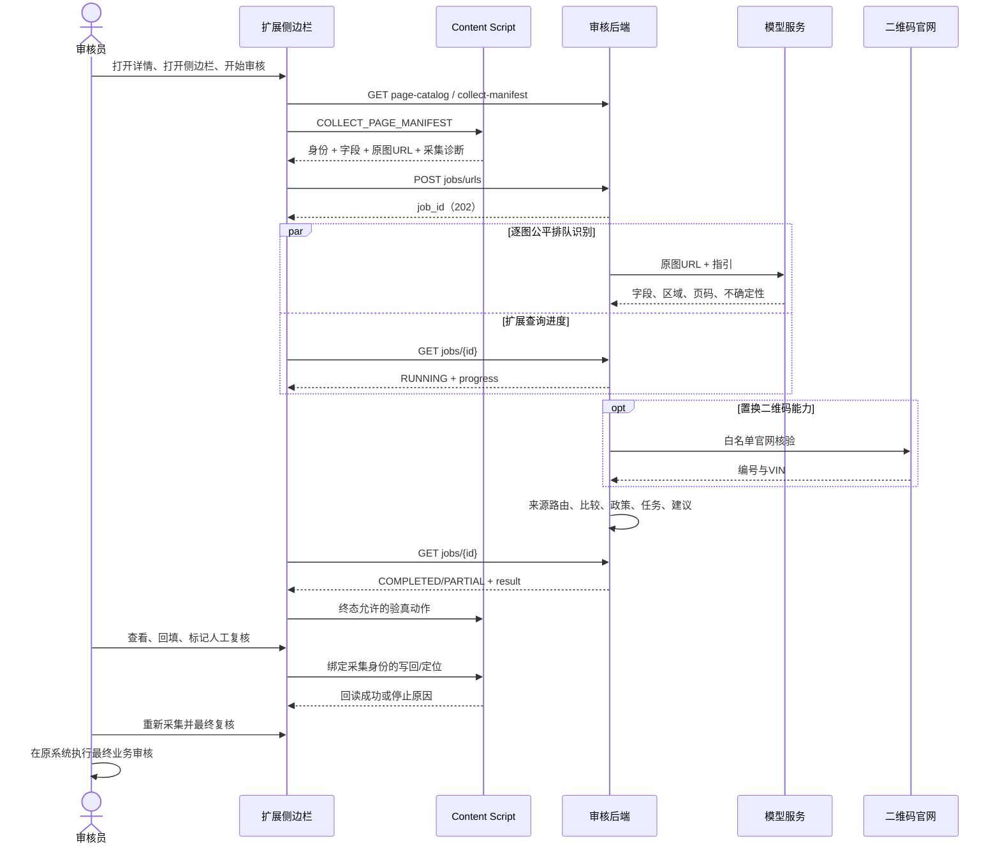
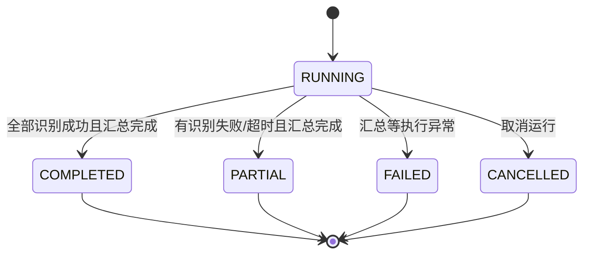
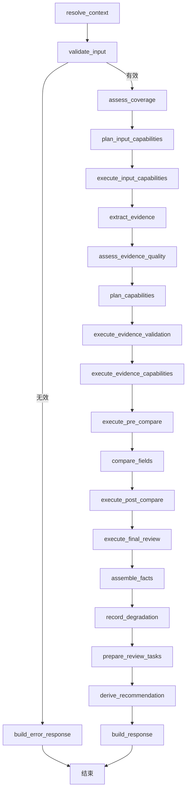

# 现有业务完整流程与复现指南

> 源码核对日期：2026-10-14。对象：FORJ Review Assistant 当前工作区，包括现有未提交改动。
> 本文记录已实现行为，供业务理解、排障和后续 AI 复现。政策日期是代码配置值，不表示对外政策已重新核定。

配套文件：[完整配置与协议快照](业务流程配置快照.json)、[快照导出脚本](../../scripts/dev/export-business-snapshot.py)。快照包含全部注册 Profile、完整业务包声明、采集清单、业务包、审核 JSON Schema、识别结果 Schema 和源码 SHA-256，不包含密钥、真实申请数据或原图。复现时要同时阅读本文和快照；中文流程说明不能替代字段键、来源选择器、定位参数等精确配置。

阅读导航：[业务总览](#1-阅读范围与完成边界) → [跨端操作](#3-一次审核人的操作与跨端时序) → [页面采集](#4-页面识别和采集的精确流程) → [任务与超时](#6-异步任务超时和失败) → [识别主图](#7-材料识别事实和审核主图) → [置换](#10-报废置换青岛与长春完整业务) / [车源](#11-车源审核完整业务) / [过户](#12-过户审核完整业务) → [复现验收](#16-给后续-ai-的复现步骤与验收标准) → [全量配置附录](#附录-a-业务声明全量对照)。

## 1. 阅读范围与完成边界

### 1.1 现有业务总表

| 业务 | 请求身份：business_type / region / profile_version | page_id | 管理端路径 | 当前能力 |
| --- | --- | --- | --- | --- |
| 青岛报废置换 | scrap_replacement / qingdao / 1.0 | scrap_replacement:qingdao | /scrap-replace-qingdao | 材料识别、字段核对、报废证明二维码、主体一致性、青岛政策、验真动作 |
| 长春报废置换 | scrap_replacement / changchun / 1.0 | scrap_replacement:changchun | /scrap-replace-changchun | 共用置换流程，采用长春政策 |
| 车源审核 | vehicle_source / default / 1.0 | vehicle_source:default | /vehicle-source | 行驶证、登记证或铭牌、字段核对、车型三项规则 |
| 过户审核 | transfer / default / 1.0 | transfer:default | /consistency-qingdao、/consistency-changchun | 登记证和二手车发票、买家双来源、开票时序、验真动作 |
| 一致性审核 | consistency / default / 1.0 | 当前未声明 | 与过户共用上述两路径 | rules_configured=false，提示人工复核，没有配置好的自动审核规则 |

四个已配置 Profile 不代表四套重复实现：置换两地区共用一个业务包；车源和过户各有一个业务包。一致性是现行未配置入口。旧的停用过户占位配置已删除，当前 `TRANSFER_PACK` 已注册。新的普通页面可通过声明式配置接入，见[声明式页面配置](../指南/声明式页面配置.md)。

### 1.2 三种“结束”必须分别记录

1. **审核任务结束**：后端完成识别和规则汇总，job 到 COMPLETED 或 PARTIAL；FAILED、CANCELLED 也是任务终态。COMPLETED 只说明执行完成，不表示申请通过。
2. **助手中展示项目处理结束**：待处理项目被人工标记后计数为 0；这是当前组件中的处置记录，不改后端 comparison、recommendation，也不提交原业务。
3. **原业务审核结束**：审核员在原管理系统执行其审核、保存或提交操作。此仓库没有实现原系统最终业务提交、补贴发放、车辆上架或过户办理；这些后续行为不能从本代码推断。

当前工作台固定只有 **待处理、全部字段、页面外核验** 三个分类。材料完整性页签、汇总卡和 MATERIAL-GROUP 已移除。后端仍检查材料缺失、登记证页码、来源不足和识别不确定，保留报告及原始检查，并参与最终建议；不能把“移除展示”复现成“关闭后台材料检查”。报废置换的挂靠字段及 AFFILIATION 检查按展示策略隐藏，后台兼容规则仍执行。

### 1.3 文件基线的使用方式

- `业务流程配置快照.json` 的 `git_head` 是参考提交；本次基线包含未提交修改，仅 checkout 该提交不能还原本次行为。
- `source_sha256` 用来核对实际文件是否变化，不包含源码正文。完整复现还需要对应源码、锁文件和运行环境；只持有快照可以还原配置语义，不能重建所有 DOM 操作实现。
- 当前真实部署若不同于本机，应通过其 `/api/review/page-catalog`、`collect-manifest` 核对；本文没有宣称服务器已部署本次工作区。
- 旧设计、旧文档和代码注释只作辅助。过户同日开票、URL 任务的部分结果、材料展示等容易受旧描述误导，本文按实际分支说明。

## 2. 运行环境与参与程序

### 2.1 组件职责

| 组件 | 输入 | 负责的行为 | 主要状态存放处 |
| --- | --- | --- | --- |
| 原管理端页面 | 原申请记录、表单、材料图片 | 原业务记录和最终审核提交 | 原系统；本仓库不实现其服务端 |
| 扩展侧边栏 | 当前页采集结果、后端响应 | 选择业务、启动/轮询、工作台、人工回填入口 | React 内存 |
| Content Script | DOM、catalog、manifest、页面消息 | 页面识别、字段/原图 URL 采集、身份守卫、定位和写回 | 当前页面内的 DOM 映射与采集令牌 |
| 扩展 background | Chrome 扩展事件 | 侧边栏打开行为 | Chrome runtime |
| 审核后端 | ReviewRequest 与原图 URL | 模型提取、来源路由、比较、能力、任务和建议 | job 在进程内；可选日志落盘 |
| DashScope 兼容模型服务 | 图片 URL + 提取指引 | 分类、读取材料字段、区域、不确定标记、二维码文本 | 外部模型服务 |
| 二维码官网 | 已确认白名单 URL | 提供报废回收证明编号、VIN | 外部官网 |

### 2.2 常规本地启动

在仓库根目录安装、构建；后端要求 Python ≥3.11 且 <3.13，扩展要求 Node ≥22.18.0。后端依赖 FastAPI、Pydantic、LangGraph、httpx、OpenCV、NumPy 和 ZXing-C++，前端用 React/TypeScript/Vite；精确依赖取 uv.lock / package-lock.json。后端环境变量由本地环境或 `.env` 提供，不把真实密钥写入文档、样例或提交文件。

```powershell
# 在仓库根目录执行
uv sync
npm --prefix apps/extension ci
npm --prefix apps/extension run build
.\scripts/dev/start-agent.ps1
```

`scripts/dev/start-agent.ps1` 默认 `127.0.0.1:8010`，使用后端 `.venv` 中 Python 启动 `forj_review_assistant.main:app`，默认热重载；稳定复现可加 `-NoReload`。在 Chrome 扩展管理页加载 `apps/extension/dist`，随后刷新已有管理端页面，使其取得本次 Content Script。

模型必要配置是 `DASHSCOPE_API_KEY`；模型及兼容地址等默认值见 `src/forj_review_assistant/config/settings.py`，当前默认模型 `qwen3.7-plus`。缺少模型配置时服务可启动、健康检查可正常，但识别不能据此视作可用。普通材料由模型读取原图 URL，模型服务必须能访问该 URL；浏览器登录成功不等于模型有浏览器的 Cookie。

`npm run build` 是 development 构建，默认访问本机 8010。`build:public` 是公开构建，默认访问 `http://175.178.6.214:18110`；两者输出到同一 dist。`VITE_AGENT_BASE_URL` 可在构建时覆盖目标地址。不要直接编辑 dist。

生产示例 `docker-compose.server.yml` 将容器 8010 映射到宿主 18110，限制 2 核、1GB、根文件系统只读，日志写挂载卷，时区 Asia/Shanghai。识别全局/单任务并发为 16/8，汇总并发 2；未设置这些环境变量的后端默认为 12/6、汇总 2。启动检查 `/health` 只能确认进程存活，不能代替材料识别和规则验收。

## 3. 一次审核：人的操作与跨端时序

### 3.1 标准操作顺序

1. 审核员打开原管理系统的具体记录详情，保证表单与材料区域已加载，保持该记录为当前操作对象。
2. 打开扩展侧边栏。组件挂载及业务选择变化时预采集，用于展示识别业务和资料情况。
3. 自动识别唯一业务。识别不明确时可以人工选择；人工选择与确定的自动身份矛盾时拒绝，不能靠强制切业务越过守卫。
4. 点击开始审核。扩展再次采集当前页，建立这次独立的 collectionId、页面身份、字段值、原图 URL 与 DOM 映射。
5. 后端创建 URL job，逐图识别，扩展展示图片处理数量、识别/汇总阶段和失败图并轮询。收到终态结果后显示审核任务。
6. 自动动作只在成功取得终态快照后处理；当前动作是发票号码旁的一键验真。它不是原业务最终审核提交。
7. 审核员检查待处理条目，查看材料与页面原值，必要时定位原图、回填候选值或人工输入值，并核对原页面。
8. 人工标记本项复核后，它离开待处理列表；回填成功本身不会自动把该项结论改成 MATCH。
9. 回填过字段后点击“重新采集并最终复核”，重新建立身份及值快照，完整重跑规则。人工标记不会作为后端通过依据。
10. 原系统的最终审核、保存、提交由审核员执行；按原系统要求确认。助手的“展示项目已处理”不能替代此步骤。



### 3.2 并发操作与旧结果隔离

`use-review-workflow.ts` 用 activeRun 防止同一侧边栏重复启动，用预采集版本和采集 token 防止旧采集覆盖新状态。失败、重置、切业务、组件卸载和总等待超时时，尽力 DELETE 已创建 job。后端取消运行队列和汇总协程，忽略迟到结果；取消失败并不能改变新任务的身份。

侧边栏与 Content Script 是两个 JavaScript runtime。采集时 Content Script 应用 manifest，侧边栏取得结果后也应用同一份清单用于标签和字段配置。只更新其中一侧会出现标签和写回清单不一致。

## 4. 页面识别和采集的精确流程

### 4.1 目录、采集清单、业务身份

1. 侧边栏调用 `chrome.tabs.query({active:true,currentWindow:true})` 取得 tab。
2. 从后端读取整个 page-catalog，再并发读取目录中业务对应的 collect-manifest。目录读取边界为 10 秒；失败使用内置识别表。manifest 不可用时清空已应用清单并使用内置采集定义，不能继续拿上次业务清单。
3. 将目录、多个采集清单及人工选择一并发给 Content Script。它先识别业务，再选业务/地区/版本相符的 manifest。
4. URL 按路径段或完整前缀匹配，避免 `/vehicle-source-other` 被误认成 `/vehicle-source`。
5. 路径只对应一个身份时直接选，不强制要求页面 anchors。路径由多业务共用时，只有该身份所有 anchors 都出现才算命中，且必须唯一；没有或多个命中都停止猜测。
6. 没有路径候选时，可按全目录 anchors 唯一命中兜底。共享地址歧义不能静默退到另一个内置业务。
7. 人工选择与唯一自动身份不一致时返回识别错误；无法自动识别时，有效人工选择可作为身份。默认地区业务的路径带“青岛/长春”不意味着请求 region 应改为 qingdao/changchun。

共享一致性路径的区分词：

| 身份 | 必须全部出现的 anchors |
| --- | --- |
| transfer/default | 审核过户凭证、过户发票买家名称、转入地车管所 |
| consistency/default | 新车信息、车辆所有人类型、新车挂靠 |

“过户”两个字或“发票号码”不够唯一，一致性页面中也可能有“过户详情”。后端再执行路由一致性检查：只对 `admin.forjtruck.com` 的已知路径验证 business/region 是否在候选集合内；共享地址允许多个业务身份，不凭地址二次猜成唯一业务。其他域名或未知路径当前不作这项路由拦截。

Profile 由业务、地区、版本、必要时 page_id 解析：精确身份优先，然后仅允许显式 default 地区 fallback；同业务同地区同版本有多个页面时必须给 page_id。不存在的业务版本不能任意退到最新版本。

### 4.2 字段采集

采集对象是页面实际值和逻辑控件，不是整页文字交给模型推断。常规采集优先 `.my-page-modal` 中最后一份 `.largeForm`，否则使用相应详情节点或传入 document；写回时另优先最后可见 modal/drawer/dialog 内的 form。复现不要把采集器和写回器的 root 选择误写成完全相同。

控件扫描包括 input、textarea、select、role=combobox、aria-controls/aria-owns input 和 contenteditable。排除隐藏、搜索筛选、审核状态/进度/结果、验真按钮及忽略的挂靠控件。已知只读字段仍可进入审核目录，editable=false；未知只读控件不当作待审核输入。

label 顺序取有效关联：`label[for]`、表单项标签、包裹 label、aria-label、name。取第一个有效关联，避免把多个文本拼成宽泛 label。下拉优先取当前中文展示选项，不把内部 code 当业务值。页面分区从局部祖先文案判断，最多向上 8 级并在 BODY/HTML 前停下，避免同时吸收旧车和新车标题。

除了控件，表格、description、结构化文本、inline 和相邻文本补充静态值；含活控件的 wrapper 不能把全段文字当值。字段候选评分与定位如下：

| 规则 | 当前处理 |
| --- | --- |
| locator_id / locator_name | 声明后必须精确命中，不满足直接排除 |
| occurrence | 无专用 locator 时按本次详情同 label/section 的控件第 N 次定位，N 从 1 开始 |
| 别名 | 精确 10000 分，包含 5000 分；别名属于多个字段减 1000 |
| 分区 | 明确但不匹配则排除；同分区加 500；重复别名且 unknown 分区则排除 |
| 来源 | control 400、table 350、structured 300、inline 200、adjacent 100 |
| 最高分并列 | 即使值相同也记 ambiguous_fields，不选择 DOM 目标 |
| 未匹配 | 记 unmatched_labels；不能伪造页面值 |

当前还有置换开票日期兜底：未取得 `invoice.invoice_date` 时，从带日期值的开票日期/发票日期候选中优先 new_vehicle，再 unknown 分区选择；只在候选唯一时保存 DOM 目标。此兜底不能推广成所有字段都能无歧义地自动匹配。

返回两种结构：`pageFields` 是 canonical field → value；`reviewFields` 是按页面逻辑控件顺序的目录，带 label/value/controlType/editable/section/order。一个 form item 只算一控件；多个逻辑控件映射同 canonical field 时，目录的 field 清空，保留原标签供人工。车源/过户开启 `review_declared_fields_only`，只声明字段进入后端审核目录；置换未开启，未知可编辑控件可能形成 FIELD-DOM 人工任务。

字段表中 `required` 是审核必需，不等于页面 UI 星号；`reviewable=false` 是辅助输入；`writable=true` 只是配置允许，还要通过实际控件、身份和原值检查。

### 4.3 图片采集、分区、选图

1. 遍历 `document.images`，再按 DOM 顺序扫描标题文本，维护当前 businessScope 和组标题。
2. 在同分区累计 groupOrder，生成如 `old_vehicle-01` 的 imageId；保留原 DOM image index，不能把筛选后第几张图当原 index。
3. 类型提示来自 manifest 关键词及图片自己的小标题；优先明确物理材料，之后才使用固定槽位。铭牌匹配要早于泛化登记证提示。
4. URL 使用 `image.currentSrc || image.src`，保留签名查询参数；HTTP(S) 才能进入识别。blob/data 等不上传正文，记录 collectionError。
5. 排除不可见、aria-hidden、role=presentation、空上传槽、other 分区及 logo/icon/avatar 等装饰图。已知材料类型、材料关键词、面积 ≥ 40000 满足之一就可成为候选；不能只因图片小就排除明确材料。
6. 排序分值为分区 10000000 + 已知类型 1000000 + 关键词 100000 + min(area,99999)，同分按 DOM index。
7. 先按 `(scope,type,groupTitle)` 预留覆盖，再用高分候选补满，最多 16 张。超过上限返回 imageOverflow 提醒可能漏审，不静默认定资料完整。
8. 图片元数据包括 URL、scope、hint、组顺序、位置、imageId 和 collectionError；普通材料不下载、不裁切、不压缩、不上传 base64。二维码解码是专门的内存读取例外。

材料必须已在 DOM 中且加载可见；折叠、分页、懒加载区域不会凭空采集。图片 ID 与索引是本次页面证据定位身份，不是长期文件 ID。

### 4.4 采集令牌与页面身份

- pageInstanceId 在 Content Script 实例生存期生成随机 UUID。
- collectionId 为 pageInstanceId 加采集序号；新采集使旧 token 过期。过期采集返回 staleCollection，不能更新 DOM 映射。
- pageFingerprint 是有值身份锚点的 JSON 数组，不是哈希；至少需要一个强 record identifier，姓名相同本身不能证明是同单。
- DOM 元素不经 JSON 传给侧边栏。Content Script 保存字段节点、采集原值、控件对象快照、image 节点及采集 URL。
- 侧边栏保留 sourceTabId。定位/回填绑定 tab、URL、pageInstanceId、fingerprint、collectionId；只拿相同 URL 不能跨单写入。
- 写某个身份字段时，排除该字段比较后仍需另一个未变化的强标识。待写 VIN 不能自己证明待写对象身份。
- 连续回填保存最初原值和最新已回读值，身份守卫按已验证写入调整；页面外人工改值仍会触发停止。

## 5. 扩展消息与 HTTP 协议

### 5.1 两套协议的边界

扩展页面消息携带页面操作身份，审核 HTTP 请求主要携带业务上下文及采集证据。不要把 collectionId 误当后端 job_id，也不要依赖后端验证 DOM 节点对象。

| 扩展消息 | 用途 | 输出/约束 |
| --- | --- | --- |
| COLLECT_PAGE_MANIFEST | 按 catalog/manifest 采字段和原图地址 | PageData、诊断、可定位标识，DOM 留 content |
| APPLY_PAGE_FIELD_VALUE | 单字段回填 | 字段、值、expectedValue、页面身份；回读结果 |
| APPLY_PAGE_FIELD_GROUP_VALUE | 组合字段回填 | 多目标字段、共同值、expectedValues；全部预检及回滚 |
| FOCUS_REVIEW_IMAGE | 原图定位 | 采集 imageId；节点失联时按采集 URL 重新定位 |
| VERIFY_INVOICE | 当前发票号码旁一键验真 | 身份、号码原值和控件对象守卫 |

实际消息常量见扩展协议代码和 content.ts；上表名称要与该文件核对，不能自行创造后台通用“任意点击”消息。

| HTTP | 行为 | 备注 |
| --- | --- | --- |
| GET /health | 健康 | 不测试模型质量 |
| GET /api/review/schema | 请求/响应 JSON Schema | 响应协议版本 2.0；字段别名兼容驼峰和蛇形 |
| GET /api/review/page-catalog | 全页面身份目录 | 识别发生在取业务清单之前 |
| GET /api/review/collect-manifest | 字段、分区、材料、图片提示、写入策略 | 可指定 business_type、region、profile_version、page_id |
| POST /api/review/jobs/urls | 创建 URL 审核任务 | 正常扩展入口；202 返回 job_id、created_at |
| POST /api/review/jobs | 兼容任务入口 | 同样提交 URL 清单，不是上传通道 |
| GET /api/review/jobs/{id} | 查进度/终态 | 不存在、过期、重启后通常 404 |
| DELETE /api/review/jobs/{id} | 取消 | 终态保留原结果；未找到 404 |
| POST /api/review/assist | 同步审核兼容入口 | 非当前扩展默认流程 |

旧 stream/images/complete 上传协议不在当前链路内。生产访问限制由部署层和扩展权限配合；审核 `main.py` 本身未实现配对或 Bearer 认证中间件。

### 5.2 请求样例与完整契约

下面是过户请求结构样例，数值均为合成占位；省略了其余必需字段，因此用于理解结构，不是通过样例。完整字段、默认值、枚举和校验以配套快照 `review_contract_schema` 为准。

```json
{
  "page_url": "https://admin.forjtruck.com/consistency-qingdao",
  "business_type": "transfer",
  "region": "default",
  "profile_version": "1.0",
  "page_id": "transfer:default",
  "selection_mode": "AUTO",
  "page_fields": {
    "transfer.vin": "SYNTHETICVIN000001",
    "transfer.invoice_date": "2026-10-13",
    "application.source_published_at": "2026-10-12 09:00:00"
  },
  "review_fields": [
    {"field":"transfer.vin","label":"识别车架号","value":"SYNTHETICVIN000001","control_type":"text","editable":true,"order":1,"section":"transfer"}
  ],
  "images": [
    {"index":0,"src":"https://example.invalid/registration.png","image_id":"transfer-01","business_scope":"transfer","category_hint":"registration_certificate","document_type_hint":"registration_certificate","group_title":"审核过户凭证","group_order":1}
  ],
  "collection_diagnostics": {"ambiguous_fields":[],"image_overflow":false,"collection_issues":[]}
}
```

ImageInput 需要 index ≥ 0，groupOrder ≥ 1（有值时）；后台要求 image_id/index 各自不重复，最大 16 张。带 collectionError 的图直接计入失败；否则必须有有效 HTTP(S) recognition_source。生产样例不能使用 example.invalid。

响应主要结构：`protocol_version`、`trace_id`、`presentation`、业务身份、recommendation/risk/summary、comparisons、qr_checks、cross_checks、review_tasks、material_completeness、retry_summary、capability_plan/results、evidence_facts、page_actions、兼容 page_fill_intent。ReviewTask 的 MATCH 必须 requires_reviewer_action=false；非 MATCH 必须为 true。PAGE_FIELD 任务要有 page_field；ASSISTANT 任务不能有 page_field，用 page_target_field(s) 作为操作目标。

## 6. 异步任务、超时和失败

### 6.1 创建、逐图调度、汇总

后端先验证请求路由和 Profile，再验证图片数、图片 ID、索引和 URL。深拷贝 request，生成 UUID job_id；trace_id 缺省采用 job_id。job 存进进程内 dict，带线程锁、done Event、batch 和 pending_count。

collectionError 的图片立即合入 failed，不排队。有效图片逐张提交到 FairAsyncScheduler，按 job 公平轮转并同时限制全局和单任务并发；一单不能独占全部识别槽。每图完成合并 batch、更新进度、pending_count 减一。pending=0 且未汇总过时，只启动一次 finalize；0 张有效图片也会进入汇总。

汇总调度和识别调度分开。URL job 已完成的 batch 传给 `assist_with_batch_async(initial_batch=...)`，主图不能第二次调用模型识别同一批材料。进度刷新目前只更新 progress，不在每图完成后持续生成 ReviewResponse；前端兼容 partial result 不意味着现有 URL 后端逐图提供可操作审核结论。

### 6.2 状态机



phase 单独表达 PREPARING、RECOGNIZING、FINALIZING、COMPLETED、FAILED、CANCELLED。PARTIAL 是终态，正常其 phase 为 COMPLETED。progress 有 total/submitted/completed/failed/timed_out；processed 为成功、失败、超时总数。快照 groups 当前固定 old_vehicle/new_vehicle，仅对应置换图片分区，不是所有业务动态分组；当前 ReviewProgress UI 使用总进度、阶段和失败图列表。识别100%时可能仍 FINALIZING，不等于规则完成。任一图片失败/超时或 processed < total 导致 PARTIAL，业务字段冲突不把 job 变成 FAILED。

| 边界 | 当前值与语义 |
| --- | --- |
| 扩展每次创建/查询 HTTP + JSON 读取 | 15 秒，有 AbortController 和 Promise race |
| 扩展轮询间隔 | 1 秒 |
| 扩展轮询等待上限 | 120 秒；到时退出等待并尽力取消，不表示后端已完成；采集、清单请求、创建和动作耗时另计 |
| Agent 单图识别 | 50 秒；本次 extract_async 总 deadline 55 秒，URL job 每图各调一次，排队时间另计 |
| 模型客户端 HTTP | 60 秒；更外层识别 deadline 可先中止 |
| 语义重读 | 最多 1 次；阈值 0.7；剩余不足 2 秒不再重读 |
| 普通能力默认 | 30 秒、0 次 registry 重试；声明可覆盖 |
| scrap_certificate_qr 能力 | 60 秒；registry 重试为 0；内部网页重试另算 |
| 本地二维码图片读取 | 每次读取 4 秒、最多 2 次重定向、8,000,000 字节；原生解码在线程执行 |
| 官网单次核验 | 8 秒整体、最多 2 次重定向、2,000,000 字节；仅特定暂时 HTTP 状态最多追加 1 次 |
| job TTL | 距 updated_at 600 秒；create/get 触发清理；服务重启任务丢失 |

任务不是持久审计档案。跨多个后端进程或实例不能假定 dict 共享，创建和查询落到不同进程会查不到；复现默认使用同一后端实例。普通审核 job 不持久化到数据库。

终态仅 COMPLETED/PARTIAL 可用结果执行无授权 page_actions；RUNNING 的最后快照不允许自动动作。FAILED/CANCELLED 抛出相应错误；轮询超时有末次快照时返回它，并给仅供参考/未生成结论提示，没有末次快照时报“未返回进度”。pollReviewJob 函数默认60秒，但本UI显式传120秒；不要只按工具函数默认值复现。COMPLETED 且缺 result 的异常响应当前没有专门缺结果错误提示，只无审核内容与动作，不能把空结果解释为通过。后端日志完成后设置 done，取消后的迟到回调不写入状态。

## 7. 材料识别、事实和审核主图

### 7.1 每图识别分支

已知材料 hint 或可信槽位命中专属 policy 时，直接一次 `extract_fields`；未知类型先分类，分类置信度 ≥ 0.70 且类型受当前材料政策目录支持时，才执行专属提取。分类调用和提取调用是两次，不能用“每图一次模型调用”描述全部情况。

已知提示会受该业务 declared_material_types 限制；未知分类分支查 DOCUMENT_POLICIES，当前实现不能概括成所有分类路径都额外执行同一业务类型过滤。材料上下文和字段路由仍由 active pack 约束，不能把别的业务字段直接混进本业务。

提取请求原图 URL，temperature=0、enable_thinking=false、response_format=json_object；提示由材料声明的字段白名单和 scoped_guidance 组成。模型输出包括 document_type、fields、confidence、evidence_regions、uncertain_fields、qr_codes；登记证页码通过声明字段进入 recognized_documents.covered_pages。

无效 JSON/schema/structure、错材料类型、低置信度、不确定字段或无有效字段可触发一次语义重读。重读仍使用同原图 URL，附待核对字段/区域指引，不在本地裁图。超时记 timed_out；运行失败记 failed；二次类型仍不符记 failed。保留 retry attempts，不能用重读历史掩盖不确定结果。

确定性代码做字段白名单过滤、派生字段与 route_fields。Observation 保留 source_id、image_id/index、scope、document_type、group_order、source_field、confidence、derived_from、区域和 uncertain；同值去重保留重读/不确定标记，不同值都保留，不能为了与页面相符删掉材料冲突值。

`batch_observations` 按文档 ID/index、原始字段和路由目标传播 uncertain，按 qwen 第二次 attempt 标记 retried。使用 readable_value 的规则排除“未知、无法确认、N/A”、问号/星号等不可读内容，保留其原文供人工查看。重读区域按“原图归一化区域”解释，box 形状是 [x1,y1,x2,y2]，不当页面 CSS 像素；普通 QwenExtraction 对 JSON 区域主要检查四数值结构，未严格校验0–1范围或矩形顺序。当前原图定位主要定位图片节点，不代表自动打开局部裁图。

### 7.2 LangGraph 主图



| 节点 | 核心输入/处理/输出 |
| --- | --- |
| resolve_context / validate_input | 保留已选择的 Profile，校验请求和页面身份；错误分支立即结束 |
| assess_coverage | 采集材料的 COLLECTED 检查 |
| plan_input_capabilities / execute_input_capabilities | 提取节点前的 INPUT_COVERAGE 能力 |
| extract_evidence | 整批入口执行识别；URL 作业复用 initial_batch |
| assess_evidence_quality | 根据识别结果评估 EXTRACTED 完整性 |
| plan_capabilities | 保留输入阶段结果，根据实际证据规划后续能力 |
| execute_evidence_validation | EVIDENCE_VALIDATION，内置材料完整性汇总 |
| execute_evidence_capabilities / execute_pre_compare | EVIDENCE 和 PRE_COMPARE，补充核验与字段证据 |
| compare_fields | 从统一证据入口比较并生成组合检查，不构造响应 |
| execute_post_compare / execute_final_review | 后置与最终复核，累积前序检查、事实和动作 |
| assemble_facts / record_degradation | 只汇总来源事实与所有阶段的失败原因 |
| prepare_review_tasks / derive_recommendation | 生成任务，并据实际检查与限制生成建议 |
| build_response | 最后装配协议 2.0 响应 |

详细阶段和扩展位置见[主图与能力](../概念/规则主图与能力.md)。材料完整性已迁到 EVIDENCE_VALIDATION；INPUT_COVERAGE 在图内提取节点前执行。比较字段证据必须在比较前产生；后置规则可产出供最终复核使用的中间事实。

能力 spec 描述 kind/stage、input/output facts、dependencies、timeout、retries、failure_policy；binding 描述 enabled/required/parameters，显式 binding.required 覆盖 spec。Planner 的 producer output 只是预期产出；执行前还验证实际 input fact 是否存在，不能把“计划会产出”当作“已经产出”。必需依赖缺失 BLOCKED，可选缺失 SKIPPED。

Registry 只执行 READY，限制耗时，隔离单能力异常。SAFE_DEGRADE/SKIP 可跳过；BLOCK 阻塞；其他转 FAILED 并产人工核验 check。返回能力标识必须与声明一致。外部失败的 error code 和限制经主图汇总，其他字段仍可核验，不能整单伪装 PASS。

### 7.3 材料覆盖：后台保留的检查

COLLECTED 检查材料图是否采到且无 collectionError、必审字段歧义、图片溢出、采集异常。EXTRACTED 检查识别材料类型、最低份数、实际登记证页码、field_sources.all_of、未明确字段。替代材料组在采集和识别阶段分别判断，不能只因页面有一个“登记证”小标题就确认第 1/2 页齐全。

缺失原因优先区分 image_unreadable、recognition_failed、recognition_uncertain、page_field_missing、evidence_not_extracted；材料缺失与无法确认不是同一事实。enforce 模式产生 MATERIAL-COMPLETENESS 原始检查，供最终建议使用。当前展示路由不把该检查转为任务，前端还过滤历史 MATERIAL category 或 MATERIAL-* ID；这些兼容字段不应重新成为第四个分类。

## 8. 字段判定、规则投影和结果展示

### 8.1 规范化与来源策略

比较保留原值用于展示，另生成规范化值。所有非空输入先 NFKC、去首尾和全部空白；再执行字段声明 normalizer。字段后缀为 .owner/.buyer_name/.seller_name 才额外去主体标点和尾部信用代码注记；不能仅因为 normalizer 名为 party_name 就对所有字段套这步（例如市场名不属于上述后缀）。精确算法见 `fields/normalize.py`，各字段声明在附录与快照。

| normalizer | 声明处理（经过公共预处理后） |
| --- | --- |
| text / party_name | 不追加变换；party后缀的处理已在公共阶段执行 |
| identifier / plate | 仅统一大写，保留原有其他非空白符号，不等于VIN去符号 |
| vin | 去易混/不确定字符说明尾注，大写，只保留 isalnum 字符；不把I换1、O换0 |
| invoice_number | 去开头“数电号码/发票号码/发票代码”标签，大写，只保留 isalnum |
| vehicle_type | 包含牵引车归牵引车；含载货汽车/载货车/货车归载货汽车；其余原值 |
| engine_model | 去CJK汉字、空白、半角/全角横线并大写，保留型号内部点号与字符差异 |
| fuel_type | 混动词优先→混合动力；天然气/LNG/CNG→天然气；明确电能/纯电/新能源集合→新能源；其余原值 |
| amount | 去¥/￥/逗号/元，Decimal规范小数并将负零归0；无法解析保留原文 |
| date | 完整匹配年/月/日格式并验证实际日历，转YYYY-MM-DD；不支持或非法保留原文，后续时效/规则再判断 |
| default / 未声明 | 按明确字段键和后缀走兼容分派，否则公共文本值；不猜新的normalizer |

只比较允许来源的 observation。页面值不能替代缺失材料，其他类型图片不能冒充规定材料。DERIVED / PAGE_AUXILIARY 字段是否直接审核由声明及路由决定；SYSTEM 以页面非空值为准，不参与材料一致性。

普通聚合先处理识别不确定（策略启用）、无有效值、唯一来源为页面、必需页面值缺失；这些情况为 REVIEW_REQUIRED。规定材料类型不齐且现有所有规范化值相同，也为 REVIEW_REQUIRED；若现有值已不同，来源缺失不会掩盖冲突，仍为 CONFLICT。唯一非页面来源按 single_evidence 策略决定；多来源规范化值全部相同为 MATCH，否则 CONFLICT。`allow_single_evidence=true` 指可以只有一个材料来源，不指仅页面值就能通过。false 且有多个声明材料时要求相应材料类型齐备。

权威链的链首是唯一基准：链首缺失→人工；链首多个不同规范化值→CONFLICT；再处理 uncertain、页面缺失、必需来源缺失。其他来源按自身 full 或 suffix8 窗口与链首比较。缺少链首不会退下一级；不能拿“多数相同”推翻权威基准。普通聚合中的多数 reference 仅供差异高亮使用，也不是投票通过机制。

日期时效检查作用于页面值：`date_window_problem` 在字段原 MATCH 时降为 REVIEW_REQUIRED，并追加说明；已有 CONFLICT 保留。车源审核日期按 UTC+8 当天确定，不依赖部署机所在时区。

### 8.2 字段、组合、规则、页面外任务

字段 comparison 的 REVIEW_REQUIRED 展示为 INSUFFICIENT。多检查合并时严重度 CONFLICT > INSUFFICIENT > MATCH。规则根据明确 field_check_bindings 投影到页面字段，不能按中文标题猜归属；有目标且投影成功就避免重复独立卡，无可用字段目标仍保留页面外检查。

组合字段先检查多个页面控件是否一致，再与材料指定字段比较；一个组合任务可绑定多个 page_target_fields，回填采用同值、多控件预检及回滚。当前组合包括置换发票代码/号码、置换新车 VIN/OCR VIN、过户发票代码/号码。原始 comparisons 仍保留，组合展示不是删除原证据。

任务以页面目录与显式绑定装配，再排序、去重、合并 QR-GROUP，应用业务隐藏策略。报废置换 hidden_fields 是旧/新车挂靠，hidden_check_prefixes 是 AFFILIATION-。兼容 page_fill_intent 保留，不等于前端仍存在挂靠采集/展示/自动填写入口。

### 8.3 工作台与人工处置

| 分类/操作 | 当前行为 |
| --- | --- |
| 待处理 | 可见任务中 requires_reviewer_action 且未人工标记的项目 |
| 全部字段 | 可见 FIELD 项；包括组合和已处理项 |
| 页面外核验 | 可见 EXTERNAL / BUSINESS_RULE 项；0 项也固定显示页签 |
| 顶部自动通过/人工处理/待处理数 | 全部基于统一可见任务集，隐藏材料任务不能漏进计数 |
| 查看候选 | 页面原始值、各材料原文、差异红色区间、来源、小标题、不确定标记、原图 |
| 回填候选/人工输入 | 需要 writable、有效 PageData 和身份；按钮不直接改机器结论 |
| 标记人工复核 | 本组件 decisions 记 MARKED_EXCEPTION；离开待处理；不发送后端通过决定 |
| 重新采集并最终复核 | 新 collectionId、新页面原值、再次识别与审核；旧本地处置随组件实例重建 |
| 页面失效 | 停止写入，展示原因；提供重新采集复核入口 |

recommendation 从完整 findings 派生：有 finding → REVIEW_REQUIRED，无 finding → PASS。confidence 仅展示，不自行批准。字段工作台 PASS 风险 LOW；有冲突类 finding 为 HIGH，其余人工原因 MEDIUM。隐藏检查和后台材料诊断仍可使最终建议要求复核，所以“可见待处理 0”不能等同“整单 PASS”。当前字段工作台没有整单最终建议大卡片。

## 9. 受控回填、原图定位与自动验真

### 9.1 单字段回填

1. 侧边栏取本次 pageFields 原值作 expectedValue，将字段、候选/人工值、采集身份发送到 sourceTabId。
2. Content Script 验证页面 URL/实例/令牌/身份，字段在 manifest 写入白名单，目标属于本次采集，控件对象没有重载更换。
3. Writer 再验证节点连接、可见、未禁用/只读、控件类型允许，值非空，当前值与 expectedValue 相等。金额比较允许等价小数形式；其他按规定文本归一。
4. native input/textarea 用原型 value setter 并派发冒泡 input/change；native select 只选唯一中文 label。自定义下拉只在 aria-controls/aria-owns 关联 listbox 中选唯一 exact label，最多三轮等待，每轮约 50ms，不扫描任意相似选项。
5. 等待约 50ms，再次核对身份和节点，回读规范化值。回读不等尝试恢复原值并回读；身份已变化时停止进一步写入，不为了回滚写到新记录。
6. 成功滚动、聚焦、高亮目标并返回 FILLED。Content Script 更新已验证写入记录及原值快照，侧边栏同步页面值，保留机器原结果直到重审。

字段配置 writable、Profile 控件类型、页面实际 editable、身份、控件唯一和原值必须同时满足。置换控件类型配置为空表示历史“不限制”，但 writer 并不因此支持所有复合控件；车源/过户仅 text、textarea、number。日期/下拉等不在这两业务白名单的控件应人工在原页改。

FIELD_VALUE_CHANGED 表示采集后值已改；不能直接强制覆盖，应核对当前值或重新采集。FIELD_TARGET_CHANGED 表示节点换过；没有足够独立强标识也停止写。已有人工修改可能需要整次重审，不能通过后端正确结论跳过 DOM 守卫。

### 9.2 组合字段回填

先核对每个目标：找到、属于本次 collectionId、在白名单、同一控件对象、控件允许、原值相符。任一失败零写入。全部预检通过再顺序写入；途中失败按已写目标反向恢复原值，最后逐一回读；身份失效时停止回滚，明确提示人工核对已写字段。不能把“组合回填”复现成两次互不关联的单字段请求。

### 9.3 原图定位

imageId 映射采集时 DOM image 和原图 URL，身份有效才能滚动到该图。节点断开时仅按采集 URL 重新查 img，找不到则返回失败；不重新猜同类型第几张图。展示缩略图继续使用原图 URL，所以签名失效仍可能使预览失败。

### 9.4 发票一键验真

后端 verify_invoice 只检查业务声明触发字段的**原始 comparison 为 MATCH**，产 requires_authorization=false 的 PageActionIntent，不产验真结果 check。置换触发 invoice.invoice_no，过户触发 transfer.invoice_no。它不要求整单 PASS；两个页面号码控件的组合任务冲突时，原始号码 comparison 仍可能 MATCH，因此也可能提出验真动作。

扩展只在终态 COMPLETED/PARTIAL 执行已注册无授权动作，同一 executeAll 内按 action_id 去重。未知动作或需要确认动作都给提示，不静默任意执行。当前前端只注册 verify_invoice。

Content Script 校验页面身份、采集号码、当前值及控件快照。Writer 仅在发票号码最近 form item 内寻找唯一可见可操作“一键验真”按钮，禁止整页兜底。点击成功只返回“已点击一键验真”，没有抓取官方验真响应并替代人工判定，更没有执行原管理系统最终审批。

## 10. 报废置换：青岛与长春完整业务

### 10.1 开始前准备和页面输入

打开对应地区的置换详情。页面包括报废车辆、更新车辆、申请/主体信息与材料区；按中文别名和 old/new 分区采集，不能把重复“车架号”“所有人”交叉配对。

19 个必审键详见附录 A.1：旧车类型、交车日期、回收证明编号、VIN、号牌、所有人、发动机型号；新车燃料、发票代码/号码/含税金额/日期、VIN、号牌、所有人、注册日期；终端证件号、客户名称、终端手机号。另有 owner_type、OCR VIN、产地、申请号等辅助声明。手机号为 SYSTEM，材料不比；其他字段按自己的来源，不能所有字段套一张发票。

材料最低要求是旧车行驶证、旧车登记证第 1/2 页、旧车报废证明、新车行驶证、新车登记证第 1/2 页、新车机动车销售发票。身份证和营业执照是主体关系辅助证据；是否需要它们由实际主体组合决定。

| 分区 | groupOrder 固定槽位 | 默认材料解释 |
| --- | --- | --- |
| old_vehicle | 1 / 2 / 3 | 行驶证 / 登记证 / 报废证明 |
| new_vehicle | 1 / 2 / 3 | 行驶证 / 登记证 / 发票 |

槽位用于图片没有可靠自己标题时的提示，不替代材料真实提取。登记证一张可拼两页，页码由识别实际内容确定。身份证和营业执照按自己的类型及 scope_independent 路由，不能把它们当车辆资料的某个槽。

### 10.2 材料阅读和字段路由

报废证明读取真实交车日期、完整回收证明编号、VIN/号牌/所有人/类型；不拿印制日期代替交车日期。旧登记证读取发动机型号等；新登记证读取相应车辆身份与注册信息。机动车销售发票读取产地等票面字段，只提取票面数电发票号码，代码从号码确定性适配，证据保留 derived_from；完整阅读指引见附录材料表。

材料 vehicle.* 经 scope 路由到 old_vehicle.* / new_vehicle.*；新车发票购买方等路由到新车所有人和客户相关字段；具体一对多路由和 transform 在附录 A.1，禁止按同名自动全局复制。

旧车 VIN 的基准是 **qr_page 官网完整 VIN**；页面必须全号一致；行驶证/登记证使用后 8 位窗口。报废证明 OCR VIN 不进入该字段常规 authority 链，但二维码能力会对官网与 OCR 证据检查冲突，不能说它在所有核验中完全无作用。官网基准缺失时即使纸面几个 VIN 相同也人工复核。新车 VIN 页面值与 OCR 页面值形成组合任务，材料来源按新车 policy。

### 10.3 报废证明二维码全流程

1. 优先候选是 allowed_scopes 内报废证明 hint 或已识别报废证明；fallback 是旧车区或相关提示图。明确 new_vehicle 等分区不得被重新解释成旧车证明。
2. 优先使用该图模型产出的 qr_codes；无文档或无二维码也进入本地解码，模型超时不阻止本地兜底。带 collectionError 的图不额外读取。
3. 本地对每候选原图 URL 读取到内存，OpenCV 解码图像；ZXing-C++ 优先读码，异常或无结果再用 OpenCV QRCodeDetector multi/single。不存盘，不把图送另一个解码服务。
4. 只允许官网主机 `qclt.mofcom.gov.cn`，拒绝 userinfo 和非许可端口。旧 HTTP 官方二维码访问前升级为 HTTPS，始终校验证书；官网旧 cipher 使用兼容 SSL context，仍非关闭证书验证。
5. 官网重定向每一跳重新验证 HTTPS 和白名单。解析常见 HTML 标签及嵌入 JSON，提取 certificate_no、vin；两字段都有才算官网读取 MATCH。
6. 暂时性网络异常、超时及 429/500/502/503/504 可最多再试一次；连接异常后的重试使用独立且校验证书的 TLS 1.2 兼容客户端，其他重试复用原客户端。证书失败、非法网址、超限、缺关键字段等不重试，保留明确原因转人工，不捏造官网值。每次请求记录脱敏失败类型、HTTP 状态和耗时，详见[二维码官网访问排查](二维码官网访问排查.md)。
7. preferred 候选处理后，一旦有 domain_valid 核验，停止再扫 fallback；有二维码结果时不展示其他候选的空解码。完全失败最多保留一项缺码人工提示。
8. 官网字段进入 qr_page observation 和 QR 检查。业务比较校验页面/材料编号及 VIN；工作台把关联二维码检查合为 QR-GROUP，展示域名、访问情况、官网字段和原图。

官网网页字段读取 MATCH 与所有业务字段 MATCH 是两件事；官网能打开但字段与申请冲突，最终仍要求人工。

### 10.4 主体、地区和车型规则

**所有人一致性 OWNER-CONSISTENCY-001**：先比较页面旧/新车所有人归一化值；缺页面值为 INSUFFICIENT，不一致即 CONFLICT。页面一致再核对材料侧。当前材料路由常见旧侧行驶证+报废证明、新侧行驶证+发票，正常同值去重为四类逻辑组；不同读值仍保留，实际条数可以多于四。任一侧没有可读材料为 INSUFFICIENT；两侧都有时，任何可读材料与页面不同为 CONFLICT，全部相同为 MATCH。此规则自身没有 uncertain 否决分支，识别不确定仍由字段比较/材料诊断约束最终建议。它是独立页面外核验，无页面回填目标。

**后台主体关系 affiliation_subject**：从所有人名、营业执照、身份证及页面辅助主体信息识别个人/公司。个人通常要求可靠姓名与身份证正反面配对；公司需要唯一可靠营业执照。相同个人、相同公司、不同公司的法人关系、公司与个人的法人关系分别检查；缺证或多值不明确转不足，明确关系不符转冲突。个人名按中文 2–4 字等模式、公司后缀及执照匹配判类型，不能泛化成任意名字都能自动判断。产生的挂靠/主体辅助检查和填写意图保留后台兼容，当前前端隐藏，不提供恢复入口。

**日期政策**：两个地区当前开票日期和旧车交车日期都要求落在 2026-01-01 至 2026-12-31（含边界）。政策检查使用明确可靠材料事实，来源不唯一/uncertain 为 INSUFFICIENT。超范围当前也是 INSUFFICIENT，不能复现为系统直接拒绝申请。POLICY-INVOICE-DATE 投影 invoice.invoice_date，POLICY-DISPOSAL-DEADLINE 投影 old_vehicle.recycle_date。

| 地区差异 | 青岛 | 长春 |
| --- | --- | --- |
| 新车发票产地 | 从新车销售发票读取 new_vehicle.origin，包含“青岛”符合；明确异地产地 CONFLICT；读不到可靠唯一值 INSUFFICIENT | 同样逻辑，关键词“长春” |
| 新车发票产地展示 | POLICY-NEW-ORIGIN 独立页面外政策项 | 同样为独立页面外政策项 |
| 轻型车辆复核 | 旧车材料类型原文命中“轻型”时产 INSUFFICIENT，并入 old_vehicle.type | review keywords 为空，不产这条轻型检查 |
| 日期区间 | 2026 全年 | 2026 全年 |
| 页面/身份 | 青岛 path、region、page_id | 长春 path、region、page_id |

### 10.5 结束与异常处置

审核员逐项核对旧车、新车、申请字段以及 QR、主体一致性、新车发票产地等页面外任务。缺材料/模糊先检查原图与来源；明确填错才受控回填。代码/号码、新车 VIN/OCR VIN 以组合操作回填；改后重采集重跑。二维码失败时查看已确认官网链接或原图人工核验，不能用纸面同号冒充官网成功。

本业务自动验真仅检查新车发票号码原始 comparison；手机号不做材料比对；隐藏挂靠/后台材料检查可能继续影响建议。最终原业务审批由原系统审核员完成。

## 11. 车源审核完整业务

### 11.1 开始、采集和材料

打开 `/vehicle-source` 的具体车源详情，业务 region=default。字段仅按声明审核：12 个必审比对字段加 vehicle.model 的车型规则，通常形成 13 个页面字段任务。售价、发布人、主机厂、底价等其他控件不自动加入审核。

12 字段是车辆类型、号牌、VIN、发动机号码、行驶证车辆类型、品牌型号、使用性质、注册日期、发证日期、所有人、燃料种类、发动机型号。vehicle.model 为页面车型文本；vehicle.power_kw / emission 等是材料辅助事实。全部字段别名及 locator 见附录 A.2。

只采“证件照”等有效车辆材料区，businessScope=vehicle；车况承诺书和车况照片属于 other，排除。没有置换那套固定槽位，依每张图片小标题和材料识别确定类型。

必须有行驶证，补充材料二选一：登记证实际第 1/2 页，或车辆铭牌；两者属于 vehicle_supplement 替代组。有铭牌可满足登记证替代项；登记证只有未确认页码不能仅按标题满足识别阶段替代要求。

### 11.2 字段判定细则

- 行驶证正反可拼同图：VIN、发动机号码、号牌、品牌型号、使用性质、两种日期、所有人等按票面真实栏读取。
- 行驶证“发动机号码”与登记证/铭牌“发动机型号”不同，不能互相替代；品牌型号保留完整品牌+代码。
- VIN authority 链首为行驶证完整号；页面全号；登记证/铭牌后 8 位。行驶证基准缺失转人工。
- 品牌型号以行驶证完整值为基准；发动机型号以登记证/铭牌相应来源策略比较，归一时去中文品牌和连接符。
- 发证日期额外要求 `审核日 - 90天 <= 页面日期 <= 审核日`，含边界，审核日按 UTC+8。未来、过期、无法解析转复核；不是固定要求某个自然季度。
- fuel 独立核验；下述车型规则没有核验驱动形式。

### 11.3 vehicle.model 的三项检查

| 检查 | 页面解析 | 材料解析和判定 |
| --- | --- | --- |
| 马力 POWER | `2–4位数字 + 马力` | 发动机型号 `-(2–3位数字)E数字`，两位乘10、三位原数；功率 kW×1.36 round。功率优先带 kW 数，再使用末尾数，不能误取排量。每个候选均需差≤10马力 **或** ≤页面马力×5% |
| 整车型号 CODE | 第一个符合 `[（(]([A-Za-z0-9][A-Za-z0-9\-]{4,})[）)]` 的括号型号 | 去非字母数字并大写；相等，或较短串≥8且相互包含，可匹配。材料多个不同规范化型号先判内部 CONFLICT，不能用包含匹配抹平材料分歧 |
| 排放 EMISSION | 国一至国六中文/罗马数字；常见国四/五/六 | 材料明确印刷排放值优先展示；否则发动机最后有效 E4/E5/E6 后缀推导。多个标准矛盾 CONFLICT；解析缺失/来源不足 INSUFFICIENT；值匹配但来源 uncertain 仍 INSUFFICIENT |

这些 checks 按绑定投影到 vehicle.model，一条车型任务内展示各来源与各子检查理由。页面车型控件不存在/无法投影时仍保留独立页面外规则，不为了固定 13 条而丢掉检查。有效投影后页面外 tab 可能 0 项，但仍显示。

### 11.4 处置与结束

审完字段，重点核对行驶证 VIN/品牌、发动机号码与型号区别、90天发证时效和车型三项来源。只在可写 text/textarea/number 控件回填；车型文本可人工在助手输入，再回填/回读。材料不足补清晰行驶证、两页登记证或铭牌，再重新采集重审。job COMPLETED 可能仍有车型冲突；车辆是否上架由原系统最终审核决定。

## 12. 过户审核完整业务

### 12.1 进入共享页面和准备材料

在 `/consistency-qingdao` 或 `/consistency-changchun` 打开实际“审核过户凭证”详情，必须出现过户专属 anchors。请求 business=transfer、region=default、page_id=transfer:default；两城市当前共用这套规则。不要选 consistency 来绕过过户规则。

采集 14 个必审字段：车牌、识别车架号、开票日期、买家名称、买家证件号、发票代码、发票号码、含税金额、卖方名称、卖方证件号、厂牌型号、转入地车管所、二手车市场、市场税号。另采顶部 `application.source_published_at`，只读辅助、不独立生成审核字段任务，但必须供开票时序规则使用。声明外字段不审核。

材料必须有登记证第 1/2/3/4 页和二手车销售统一发票，没有行驶证/铭牌替代组。页数按所有识别图实际 covered_pages 合并，一张拼图可含两页；不按上传次序猜页码。

### 12.2 登记证阅读位置

| 目标 | 正确读取 | 不能替代的位置 |
| --- | --- | --- |
| transfer.plate_no | 第1页最近转移登记摘要的机动车登记编号 | 上方首次注册登记编号 |
| transfer.vin | 第2页第9项车辆识别代号/车架号 | 发动机号、发动机型号、车辆型号 |
| transfer.buyer_name | 第3/4页转让登记中日期最晚一条的买方 | 第1页上一手所有人、较早转让登记的卖方 |
| transfer.buyer_id | 上述最新转让登记的身份证明号码本身 | “居民身份证”等名称、上一手证件号 |
| registration.covered_pages | 页脚实际印刷页码数组 | 图片第几张、用户上传顺序 |

“最近一条”是材料提取指引要求；不是后端获取整个登记历史数据库再排序。模型读错历史条目时应保留冲突并人工核对，不能因与发票不一致自动换读另一条来迎合页面。

### 12.3 二手车发票读取位置

发票号码取右上完整号码；只读取开票日期；买/卖方名称及同一行单位代码/身份证号；车牌照号和车架号；完整厂牌型号；转入地车辆管理所；车价合计的小写金额；“二手车市场”那一栏的市场名称及税号，不能取“经营、拍卖单位”税号。票面没有发票代码，不要求模型编造：从 transfer.invoice_no 确定性派生 transfer.invoice_code。

### 12.4 比较、买家来源和开票时序

车牌和 VIN 允许登记证、二手车发票来源；买家名称/证件号 `allow_single_evidence=false`，要求登记证与发票两材料类型都取得可靠值，再和页面比较。只页面+发票相同而缺登记证买家不能 MATCH；已有来源互相不同仍优先保留实际冲突，不因缺来源而改成通过。其他发票字段单材料来源即可与页面核对。厂牌型号完整原文走 identifier，不复用车源车型三项规则。

`TRANSFER-INVOICE-DATE` 用**页面** transfer.invoice_date 与顶部车源发布时间，解析到日期，忽略时分秒。当前实际判定：

```text
任一有效日期缺失             => INSUFFICIENT
开票日期 <= 车源发布日期      => CONFLICT
开票日期 >  车源发布日期      => MATCH
```

例如发布 `2026-10-12 09:00:00`，开票 `2026-10-12` 为 CONFLICT，`2026-10-13` 为 MATCH。函数注释有同日讨论，但实际 `<=` 分支不允许同日，复现以该分支为准。此规则不使用材料日期替代页面日期；页面/材料日期相等由独立字段 comparison 负责。时序检查投影到 transfer.invoice_date，不能覆盖材料冲突。

### 12.5 代码号码组合、验真、结束

FIELD-TRANSFER-INVOICE-CODE-NO 将页面 code/no 合为一项，对比材料 invoice_no。选择一个数电号码共同回填两个控件，执行组合守卫和回滚。号码原始 comparison MATCH 时提议一键验真，binding 把该能力 required 明确设为 false，优先于静态 spec 的 true。

本业务仅 text/textarea/number 支持自动回填；日期控件仍在审核，但不在写入控件白名单时人工修改。处理最新买家、开票顺序和字段冲突后重新采集完整复核，再由审核员在原系统提交过户审核。当前没有报废二维码或置换地区政策。

## 13. 一致性审核人工入口

此入口由共享地址及“新车信息、车辆所有人类型、新车挂靠”识别，rules_configured=false，没有 pack/必审字段/已配置能力。manifest API 对未声明材料清单可返回 404，扩展使用内置采集定义，但它不能因此自动获得一致性业务判定能力。

同步 assist 在服务层直接返回 MANUAL_REVIEW、REVIEW_REQUIRED 和未配置说明，sections 为空、识别完成计数为 0，不走正常主图。URL job 的逐图调度入口当前没有在排队前排除未配置 Profile：若采集带有效图片，仍可能先调用 extract_image_async，最终 finalize 返回未配置人工响应。不能笼统宣称“任何一致性请求绝不会调用模型”。原业务自动规则未配置是最终语义，图片识别成功也不能把它视作自动通过。

审核员按原页面人工核验并提交；若需要自动化接入，通过业务包开发并完成回归及实际页面验收后才成为已配置入口。不能把用户人工选业务当作自动规则配置。

## 14. 新增业务与维护声明

现有审核规则集中在 `src/forj_review_assistant/businesses/packs/`。新增页面或业务应按照[新增业务与页面](../指南/新增业务与页面.md)修改业务声明、注册表及必要的页面适配器，并验证采集清单、字段路由、审核规则、身份守卫和受控写回。完成前后端测试后，再按部署指南发布。

## 15. 异常矩阵与人工恢复路径

| 触发/症状 | 系统实际处理 | 人/工程恢复方式 |
| --- | --- | --- |
| 详情未开/标题不完整/共享地址双命中 | 无唯一身份，不猜业务 | 打开正确详情、刷新/展开后重采；必要时有效人工选择 |
| 手选业务与页面唯一身份冲突 | 拒绝采集/审核 | 纠正选择和页面，不改配置绕过 |
| 版本/地区/page_id 不存在 | 后端 422 | 核对catalog、扩展目标服务与部署版本 |
| 后端目录不可用 | 前端内置兜底，不能保证新配置识别 | 恢复连接再采，不沿用上一业务清单 |
| field并列候选/重复DOM/未知section | 记歧义/缺失，不保存错误目标 | 对照局部分区、locator和occurrence，修正确切采集声明 |
| 超过16张/折叠图片未加载 | overflow或没有进入候选 | 展开资料并确认覆盖；不能以数量上限代替材料要求 |
| blob/data、失效签名、模型无法访问URL | collectionError或识别失败 | 重新加载原图取得有效HTTP(S)URL；人工查看，别上传旧协议 |
| 模型JSON错/低置信度/模糊 | 受限语义重读；仍不确定人工 | 核对原图，補清晰材料后完整重采 |
| 模型无密钥/外部限流 | limitations/失败或未完成计数 | 修复运行环境/并发配额后重试，不能伪造识别 |
| 一张失败其他成功 | 最终PARTIAL，保留已完成证据 | 按缺失字段和失败图处置，PARTIAL不自动PASS |
| job404/后端重启/TTL | 任务失效提示 | 新建任务；旧job不持久恢复 |
| 120秒客户端等待结束 | 退出等待并尽力取消，停止自动动作 | 查看网络/排队/外部服务，重新审核或人工 |
| QR非法域/官网不可访问/字段不全 | 人工QR检查，不用假官网字段 | 原图或确认官网人工核验，查decode/网页重试诊断 |
| 权威链首缺失、多材料来源不齐 | REVIEW_REQUIRED/INSUFFICIENT | 补指定来源，不能降级投票通过 |
| 真实值不同 | CONFLICT，保留每来源原文和差异 | 先核对原图与所属记录，再决定页面是否需修正 |
| 回填期间切单/节点重载/值已变 | 停止写入，具体错误码 | 重新采集，不强制复用旧值或DOM目标 |
| 组合回填中途失败 | 身份有效时反向回滚并回读 | 按提示核对已写字段；失效时不继续写 |
| 找不到唯一验真按钮 | 不点击任意其他按钮 | 在原页人工验真，修正近邻定位若页面变更 |
| 人工标记后 pending=0 | 仅当前可见处置完成 | 改字段后重审，原系统继续正式审批 |

## 16. 给后续 AI 的复现步骤与验收标准

### 16.1 推荐复现顺序

1. 取得本次对应工作区源码及锁文件；核对快照的源码 hash、Profile 身份及业务包声明。读取本文1–9节理解公共流程，再读目标业务节和附录。
2. 先复现**确定性规则层**：用合成 ReviewRequest + AgentBatchResult/observations/recognized_documents，调用审核服务 initial_batch 分支。材料证据必须带 scope/type/source_field/source_id/image_id/index、uncertain、实际 covered_pages；QR独立用受控 mock。不把page值复制到全部材料充当读取结果。
3. 再复现**浏览器DOM层**：用现有采集/写回测试fixtures，覆盖真实form wrapper、分区、同名控件、只读、中文下拉、图片标题/顺序及独立强身份。运行采集得到实际 PageData，不手填伪造所有字段。
4. 再复现**完整HTTP任务层**：启动同一后端实例、创建URL任务、查询直至终态，核对分组计数和最终 recommendation，确认汇总复用batch、不重复识别。
5. 最后用授权可访问的实际页面/测试材料做**模型+原页验证**：在本地开发扩展检查采集值、真实提取、原图定位、允许回填及验真近邻，不执行原系统最终审批来替代流程验证。
6. 若接入新业务，按第 14 节维护代码声明，分别验证审核规则和允许的页面操作。
7. 记录业务身份、源码hash、模型配置名、样本来源、结果、失败/不确定性、人工处置与最终提交边界。失败样本是复现必要部分，不只留通过截图。

### 16.2 最小场景矩阵

| 范围 | 至少覆盖的场景 | 期望要点 |
| --- | --- | --- |
| 公共路由 | 唯一路径、共享页唯一/0/2 anchors命中、人工冲突、错误地区 | 只唯一识别；错误身份422；default地区不猜城市 |
| 公共采集 | 同别名不同section、并列候选同值、只读已知、中文下拉、图片>16 | 不跨区；同值并列仍歧义；只读可审核不可写；overflow保留 |
| 公共识别 | 已知直提、未知分类、错类型、JSON错、uncertain、超时、取消 | 语义重读次数受限；错误不冒充成功；取消迟到隔离 |
| 后台材料 | 缺材料、缺页、不确定页码、替代组满足/不满足 | 报告与建议保留，无材料页签/卡/任务 |
| 置换VIN/二维码 | 官网链首缺失、全号/后8位匹配、非法域、官网VIN与OCR冲突 | 链首缺失不能投票通过；官网读取成功仍需业务比对 |
| 置换政策 | 2026起止边界、2025/2027、青岛/长春新车发票产地、青岛轻型 | inclusive；越界人工；异地产地冲突；长春不产轻型项 |
| 车源 | 登记证/铭牌替代、发证日T/T-90/T-91/T+1、马力容差、型号内部多值、排放uncertain | 时效边界；三项独立投影；不确定匹配仍不足 |
| 过户 | 最新/历史买家、缺登记3/4页、缺一类买家来源、同日/次日开票 | 最近条目；双来源必需；同日CONFLICT，次日MATCH |
| 工作台 | 隐藏任务、页外0项、人工标记、回填后重审 | 三固定tabs；计数统一；人工标记不改后端建议 |
| 写回 | 强身份改写无独立锚、值变化、节点更换、下拉歧义、组合第二写失败 | 拒绝或恢复；不跨单写；失败提示可追溯 |
| 自动验真 | 原始号码MATCH但整单/组合冲突、RUNNING超时、按钮重复 | 触发按原始comparison；RUNNING不点；重复按钮拒绝 |
| 一致性 | 同步未配置、URL带图片、实际人工出口 | MANUAL_REVIEW，不把提取等同自动审核 |

### 16.3 源码测试入口与运行方法

测试名称可用 `rg --files tests apps/extension/tests` 查当前文件，不将本文中的例子作为实际测试已运行的证明。重要现有覆盖：后端 test_material_completeness、test_qr_decode、test_qr_verification、test_fair_scheduler、字段聚合/业务包/主图相关测试；前端采集、写回、身份、任务显示、轮询和协议测试。

```powershell
# 在仓库根目录执行
uv run pytest tests -q
uv run ruff check src tests scripts
npm --prefix apps/extension test
npm --prefix apps/extension run lint
npm --prefix apps/extension run build
```

本次文档工作只进行了源码调研、声明导出和文档一致性检查，没有启动真实单据审核、调用付费模型、执行原系统提交或重新部署服务。此前材料展示改动的前后端测试结果不能当作本文每条业务场景的真实页面验证。

## 17. 代码入口地图与维护方式

| 需要修改/理解的边界 | 源码入口（相对仓库根目录） |
| --- | --- |
| 页面目录、Profile、业务路由 | src/forj_review_assistant/businesses/page_catalog.py、profiles.py、registry.py、context_validation.py |
| 业务唯一声明 | src/forj_review_assistant/businesses/packs/scrap_replacement.py、vehicle_source.py、transfer.py、model.py |
| 材料阅读与路由 | src/forj_review_assistant/businesses/materials.py、routing.py；src/forj_review_assistant/integrations/recognition/extraction.py、client.py |
| 材料覆盖和字段策略 | src/forj_review_assistant/businesses/completeness.py、material_policies.py、field_policies.py |
| 模型及deadline | src/forj_review_assistant/config/settings.py；src/forj_review_assistant/integrations/recognition/extraction.py、client.py |
| 调度与任务 | src/forj_review_assistant/runtime/jobs/manager.py；src/forj_review_assistant/runtime/scheduling/fair_scheduler.py |
| 主图/规划/能力 | src/forj_review_assistant/runtime/workflow/graph.py、planner.py；src/forj_review_assistant/capabilities/registry.py、specs.py |
| 字段比较/组合/差异 | src/forj_review_assistant/evidence/comparison/aggregate.py、composite_fields.py、evidence_values.py；src/forj_review_assistant/evidence/fields/normalize.py |
| 业务规则 | src/forj_review_assistant/businesses/rules/replacement_policy.py、owner_consistency.py、affiliation.py、vehicle_type_light_duty.py、vehicle_model.py、transfer_invoice_date.py、invoice_verification.py |
| 二维码 | src/forj_review_assistant/integrations/qr/web_verifier.py、decoder.py；src/forj_review_assistant/businesses/rules/scrap_certificate_qr.py |
| 任务/建议展示 | src/forj_review_assistant/presentation/routing.py、tasks.py、advice.py；src/forj_review_assistant/presentation/response.py |
| 采集与识别页面 | apps/extension/src/entrypoints/content.ts、page-field-collector.ts、image-candidates.ts、business-scope.ts、business-detector.ts、collect-manifest.ts、page-catalog.ts；apps/extension/src/platform/browser/adapters |
| 写入与身份 | apps/extension/src/platform/browser/actions/page-field-writer.ts、page-identity.ts；apps/extension/src/platform/extension/page-action-registry.ts |
| UI/网络生命周期 | apps/extension/src/features/review/model/use-review-workflow.ts、reviewClient.ts、reviewJobs.ts；components/EvidenceReviewWorkbench.tsx、reviewSteps.ts、types/review.ts |

### 17.1 一次执行的定位证据

排障按采集→模型→主图/能力→任务→写回的顺序保留证据，记录 trace_id/job_id、业务/地区/版本/page_id 与 collectionId，避免拿两次采集的值互相比。普通审核不存永久会话，需要明确保存调试所需的受控请求/响应。

| 位置/事件 | 可核对内容 |
| --- | --- |
| 页面 Console `[ReviewAgent][collect]` start/business/fields/images | URL、路径候选、缺anchors、清单是否应用、控件数、未匹配/歧义、选图ID及类型提示 |
| 侧边栏 Console `[ReviewAgent][panel]` | 实际收到的采集诊断、请求失败状态；不能仅看页面Console |
| HTTP job快照 | 识别阶段、成功/失败/超时ID、总计数、最终result和规则建议 |
| 后端模型call日志 | stage/image_id、耗时、模型用量、rate_limited、result；查429与超时不同出口 |
| review workflow / node completed / capability completed | trace_id、profile、节点耗时、能力状态/attempts/check数；部分模块使用模块logger，INFO可见性取实际日志配置 |
| review decision | 业务/地区/版本、recommendation及检查统计，区分字段冲突和执行失败 |
| review job timing | job_id、images、recognize_ms、finalize_ms、total_ms、peak_rss_mb；非Linux峰值可能-1 |
| 页面 Console `[ReviewAgent][write]` 和回填响应 | 组合每目标缺失原因、ok/code、回读/回滚结果；看到FILLED仍需人工核对原页 |

后端 `REVIEW_LOG_DIR` 配置后追加 `review-agent.log`，按天轮转保留30份，控制台仍保留；目录不可写只告警并继续服务。模型/业务日志不是永久原始材料仓库，也不是最终审批记录。更详细操作见 [日志与排查](日志与排查.md)。

### 17.2 更新流程文档和快照

维护本文时：先改变唯一业务声明和实现→导出当前完整快照→核对定义 compile 往返→更新业务字段、材料表、状态边界和场景矩阵→做对应层验证。不要只改 Markdown 某个字段而让快照保留旧语义。

快照重导出（仓库根目录）：

```powershell
& .venv/Scripts/python.exe scripts/dev/export-business-snapshot.py
```

也可从实际服务读取精确定义，例如本机青岛：

```powershell
```

运行快照导出不会自动更新下面的可读表；字段/材料变化后需同步表。附录由同一份源码声明转换，提供常用信息；全部 bool 默认、source selector 的 required_page/group_order 等精确细节仍完整保留在 JSON。

## 附录 A. 业务声明全量对照

下面列全部声明字段（包括非必审和辅助），完整材料阅读指引、图片组/槽位、材料字段路由、来源要求、能力绑定、规则投影、组合字段、身份锚点和展示策略。`—` 表示未声明，空控件类型集合是历史“不限制”。字段表的“单材料可用”不表示只有页面即可通过。

<!-- GENERATED BUSINESS DECLARATION TABLES: snapshot 1.0 -->

### A.1 报废置换共用声明（青岛/长春）

共 27 个声明字段、19 个 required 字段、6 种材料类型、14 条显式路由；material_policy=enforce；review_declared_fields_only=false。

#### 页面字段与定位声明

| 字段键 | 业务名称 | 页面别名（依声明顺序） | 业务section / page_section | required / reviewable / writable | locator_id / locator_name / occurrence |
| --- | --- | --- | --- | --- | --- |
| old_vehicle.type | 报废车辆类型 | 报废车辆类型 | old_vehicle / old_vehicle | 是 / 是 / 是 | — / — / 1 |
| old_vehicle.recycle_date | 报废交车日期 | 报废交车日期、报废车日期 | old_vehicle / old_vehicle | 是 / 是 / 是 | — / — / 1 |
| scrap_certificate.certificate_no | 报废证明编号 | 报废证明编号、回收证明编号 | old_vehicle / old_vehicle | 是 / 是 / 是 | — / — / 1 |
| old_vehicle.vin | 报废车辆车架号 | 报废车辆车架号、旧车车架号、车架号 | old_vehicle / old_vehicle | 是 / 是 / 是 | — / — / 1 |
| old_vehicle.plate_no | 报废车辆车牌号 | 报废车辆车牌号、旧车车牌号、车牌号 | old_vehicle / old_vehicle | 是 / 是 / 是 | — / — / 1 |
| old_vehicle.owner | 报废车辆所有人 | 报废车辆所有人、旧车所有人、车辆所有人、所有人 | old_vehicle / old_vehicle | 是 / 是 / 是 | — / — / 1 |
| old_vehicle.engine_model | 报废发动机型号 | 报废发动机型号、发动机型号 | old_vehicle / old_vehicle | 是 / 是 / 是 | — / — / 1 |
| new_vehicle.fuel_type | 新车燃料类型 | 新车燃料类型 | new_vehicle / new_vehicle | 是 / 是 / 是 | — / — / 1 |
| invoice.code | 发票代码 | 发票代码 | new_vehicle / new_vehicle | 是 / 是 / 是 | — / — / 1 |
| invoice.invoice_no | 发票号码 | 发票号码 | new_vehicle / new_vehicle | 是 / 是 / 是 | — / — / 1 |
| invoice.amount | 开票金额 | 开票金额 | new_vehicle / new_vehicle | 是 / 是 / 是 | — / — / 1 |
| invoice.invoice_date | 开票日期 | 开票日期、发票日期 | new_vehicle / new_vehicle | 是 / 是 / 是 | — / — / 1 |
| new_vehicle.vin | 新车车架号 | 新车车架号、车架号 | new_vehicle / new_vehicle | 是 / 是 / 是 | — / — / 1 |
| new_vehicle.plate_no | 新车车牌号 | 新车车牌号、车牌号 | new_vehicle / new_vehicle | 是 / 是 / 是 | — / — / 1 |
| new_vehicle.owner | 新车所有人 | 新车所有人、车辆所有人、所有人 | new_vehicle / new_vehicle | 是 / 是 / 是 | — / — / 1 |
| new_vehicle.registration_date | 注册日期 | 注册日期 | new_vehicle / new_vehicle | 是 / 是 / 是 | — / — / 1 |
| new_vehicle.origin | 新车发票产地 | — | new_vehicle / unknown | 否 / 否 / 否 | — / — / 1 |
| application.terminal_certificate_no | 终端证件号 | 终端证件号 | new_vehicle / new_vehicle | 是 / 是 / 是 | — / — / 1 |
| application.customer_name | 客户名称 | 客户名称 | new_vehicle / unknown | 是 / 是 / 是 | — / — / 1 |
| application.terminal_phone | 终端客户手机号 | 终端客户手机号 | new_vehicle / new_vehicle | 是 / 是 / 是 | — / — / 1 |
| application.id | 申请单ID | 申请单ID、申请单编号 |  / unknown | 否 / 是 / 否 | — / — / 1 |
| application.submitted_at | 申请时间 | 申请时间 |  / unknown | 否 / 否 / 否 | — / — / 1 |
| application.owner_type | 车辆所有人类型 | 车辆所有人类型 |  / unknown | 否 / 是 / 是 | — / — / 1 |
| application.dealer_name | 经销商 | 经销商 |  / old_vehicle | 否 / 否 / 否 | — / — / 1 |
| page_ocr.new_vehicle_vin | OCR新车车架号 | OCR新车车架号 |  / unknown | 否 / 是 / 是 | — / — / 1 |
| old_vehicle.affiliation | 报废车挂靠 | — |  / unknown | 否 / 是 / 是 | — / — / 1 |
| new_vehicle.affiliation | 新车挂靠 | — |  / unknown | 否 / 是 / 是 | — / — / 1 |

#### 字段证据政策

| 字段键 | mode | 允许材料sources | normalizer | 单材料可用 / uncertain需复核 / 页面必需 | material_field / max_age_days |
| --- | --- | --- | --- | --- | --- |
| old_vehicle.type | PARALLEL | vehicle_license、registration_certificate、scrap_certificate | vehicle_type | 是 / 是 / 是 | — / — |
| old_vehicle.recycle_date | SINGLE_SOURCE | scrap_certificate | date | 是 / 是 / 是 | — / — |
| scrap_certificate.certificate_no | SINGLE_SOURCE | scrap_certificate | default | 是 / 是 / 是 | — / — |
| old_vehicle.vin | PARALLEL | vehicle_license、registration_certificate | vin | 是 / 是 / 是 | — / — |
| old_vehicle.plate_no | SINGLE_SOURCE | vehicle_license | plate | 是 / 是 / 是 | — / — |
| old_vehicle.owner | PARALLEL | vehicle_license、scrap_certificate | party_name | 是 / 是 / 是 | — / — |
| old_vehicle.engine_model | SINGLE_SOURCE | registration_certificate | default | 是 / 是 / 是 | — / — |
| new_vehicle.fuel_type | SINGLE_SOURCE | registration_certificate | default | 是 / 是 / 是 | — / — |
| invoice.code | SINGLE_SOURCE | invoice | default | 是 / 是 / 是 | — / — |
| invoice.invoice_no | SINGLE_SOURCE | invoice | default | 是 / 是 / 是 | — / — |
| invoice.amount | SINGLE_SOURCE | invoice | amount | 是 / 是 / 是 | — / — |
| invoice.invoice_date | SINGLE_SOURCE | invoice | date | 是 / 是 / 是 | — / — |
| new_vehicle.vin | PARALLEL | vehicle_license、registration_certificate、invoice | vin | 是 / 是 / 是 | — / — |
| new_vehicle.plate_no | SINGLE_SOURCE | vehicle_license | plate | 是 / 是 / 是 | — / — |
| new_vehicle.owner | PARALLEL | vehicle_license、invoice | party_name | 是 / 是 / 是 | — / — |
| new_vehicle.registration_date | SINGLE_SOURCE | vehicle_license | date | 是 / 是 / 是 | — / — |
| new_vehicle.origin | — | — | default | 是 / 是 / 是 | — / — |
| application.terminal_certificate_no | SINGLE_SOURCE | invoice | default | 是 / 是 / 是 | — / — |
| application.customer_name | SINGLE_SOURCE | invoice | party_name | 是 / 是 / 是 | — / — |
| application.terminal_phone | SYSTEM | — | default | 是 / 是 / 是 | — / — |
| application.id | — | — | default | 是 / 是 / 是 | — / — |
| application.submitted_at | — | — | default | 是 / 是 / 是 | — / — |
| application.owner_type | SYSTEM | — | default | 是 / 是 / 是 | — / — |
| application.dealer_name | — | — | default | 是 / 是 / 是 | — / — |
| page_ocr.new_vehicle_vin | — | — | default | 是 / 是 / 是 | new_vehicle.vin / — |
| old_vehicle.affiliation | DERIVED | — | default | 是 / 是 / 是 | — / — |
| new_vehicle.affiliation | DERIVED | — | default | 是 / 是 / 是 | — / — |

section_required=true 的字段：old_vehicle.vin、old_vehicle.plate_no、old_vehicle.owner、new_vehicle.vin、new_vehicle.plate_no、new_vehicle.owner。mode 为空的声明可能是页面辅助/规则输入，不据本表自动生成材料比对。material_field 非空时运行时克隆该材料字段政策。

#### 有序权威链

每个字段链首始终是比较基准，即使其 required 标志为 false 也不能缺失后退位。

| 字段 | 链序号 | source | document_types | label | match | required |
| --- | --- | --- | --- | --- | --- | --- |
| old_vehicle.vin | 1 | qr_page | — | 二维码官网 | full | 否 |
| old_vehicle.vin | 2 | page | — | 申请页面 | full | 是 |
| old_vehicle.vin | 3 | image | ["vehicle_license","registration_certificate"] | 行驶证或登记证 | suffix8 | 否 |

#### 材料最低覆盖与替代要求

| 类型 | scope | 显示名称 | minimum_count | required_pages | alternative_group |
| --- | --- | --- | --- | --- | --- |
| vehicle_license | old_vehicle | 旧车行驶证 | 1 | — | — |
| registration_certificate | old_vehicle | 旧车登记证第 1、2 页 | 1 | [1,2] | — |
| scrap_certificate | old_vehicle | 报废证明 | 1 | — | — |
| vehicle_license | new_vehicle | 新车行驶证 | 1 | — | — |
| registration_certificate | new_vehicle | 新车登记证第 1、2 页 | 1 | [1,2] | — |
| invoice | new_vehicle | 新车发票 | 1 | — | — |

field_sources.all_of 专用清单：当前为空；字段自身 sources、allow_single_evidence 和 authority 仍约束来源，不表示材料可省略。

#### 全部材料阅读指引

**scrap_certificate — 报废机动车回收证明**

默认提取字段：vehicle.type、old_vehicle.recycle_date、scrap_certificate.certificate_no、vehicle.vin、vehicle.plate_no、vehicle.owner。

默认指引：分别读取车辆类型、交车日期、回收证明编号、车辆识别代号、号牌号码和车辆所有人。交车日期必须读取‘交车日期’后的真实日期；回收证明编号必须读取证明上的完整编号。

| 关键词hints | allowed_scopes | scope_independent | scoped_vehicle_fields | slots | derived_field | scoped_names |
| --- | --- | --- | --- | --- | --- | --- |
| ["报废证明","回收证明","报废车辆资料","旧车资料"] | ["old_vehicle"] | 否 | ["vin","plate_no","owner","type","registration_date","fuel_type"] | [["old_vehicle",3]] | — | — |

**vehicle_license — 机动车行驶证或车辆资料**

默认提取字段：vehicle.type、vehicle.vin、vehicle.plate_no、vehicle.owner、vehicle.registration_date。

默认指引：读取车辆类型、车辆识别代号、号牌号码、车辆所有人和注册日期。车辆识别代号不得读取车辆型号；号牌号码不得读取档案编号；注册日期不得读取发证日期或检验有效期。不要判断车辆属于旧车还是新车。

| scope | 提取字段 |
| --- | --- |
| old_vehicle | ["vehicle.type","vehicle.vin","vehicle.plate_no","vehicle.owner"] |
| new_vehicle | ["vehicle.vin","vehicle.plate_no","vehicle.owner","vehicle.registration_date"] |

old_vehicle 专用指引：读取正面车辆类型、号牌号码、所有人和车辆识别代号。车辆类型保留票面完整原文。号牌号码不能读取档案编号或条形码数字；车辆识别代号不能读取车辆型号；发动机号码不是发动机型号，不要输出。

new_vehicle 专用指引：读取正面号牌号码、所有人、车辆识别代号和注册日期。注册日期只读取‘注册日期’，不得使用发证日期、检验有效期或强制报废期代替；号牌号码不能读取档案编号或条形码数字；车辆识别代号不能读取车辆型号。

| 关键词hints | allowed_scopes | scope_independent | scoped_vehicle_fields | slots | derived_field | scoped_names |
| --- | --- | --- | --- | --- | --- | --- |
| ["行驶证","旧车资料","新车资料","报废车辆资料"] | — | 否 | ["vin","plate_no","owner","type","registration_date","fuel_type"] | [["old_vehicle",1],["new_vehicle",1]] | — | — |

**registration_certificate — 机动车登记证书**

默认提取字段：vehicle.owner、vehicle.vin、vehicle.engine_model、vehicle.type、vehicle.fuel_type、vehicle.registration_date、registration.covered_pages。

默认指引：读取机动车所有人、车辆识别代号、车辆类型、燃料种类和注册登记机动车信息栏第12项‘发动机型号’。不要把发动机号码、车辆型号或其他编号当成发动机型号。同时读取图片内明确印刷的页脚页码，registration.covered_pages 只输出图片中实际可见的页码数字数组，例如页脚同时出现‘第1页’和‘第2页’时输出 [1,2]；不要按上传顺序推测。

| scope | 提取字段 |
| --- | --- |
| old_vehicle | ["vehicle.vin","vehicle.engine_model","vehicle.type","registration.covered_pages"] |
| new_vehicle | ["vehicle.vin","vehicle.fuel_type","registration.covered_pages"] |

old_vehicle 专用指引：读取注册登记机动车信息栏中的车辆类型、车辆识别代号和第12项‘发动机型号’，第11项‘发动机号码’绝不能作为发动机型号。车辆识别代号不能读取车辆型号。同时只按图片页脚实际印刷的‘第X页’输出 registration.covered_pages，不按上传顺序猜测。

new_vehicle 专用指引：读取注册登记信息栏的车辆识别代号，以及注册登记机动车信息栏第13项‘燃料种类’。燃料种类保留票面原文；车辆识别代号不能读取车辆型号、发动机号码或合格证号。新车所有人只从新车行驶证和机动车销售发票购买方名称取得，登记证所有人不作为新车所有人证据。同时只按图片页脚实际印刷的‘第X页’输出 registration.covered_pages，不按上传顺序猜测。

| 关键词hints | allowed_scopes | scope_independent | scoped_vehicle_fields | slots | derived_field | scoped_names |
| --- | --- | --- | --- | --- | --- | --- |
| ["登记证书","机动车登记证","旧车资料","新车资料"] | — | 否 | — | [["old_vehicle",2],["new_vehicle",2]] | — | — |

**invoice — 机动车销售发票**

默认提取字段：invoice.invoice_no、invoice.amount、invoice.invoice_date、new_vehicle.origin、invoice.terminal_certificate_no、vehicle.vin、vehicle.owner。

默认指引：读取发票号码、价税合计（小写）、开票日期、产地、车辆识别代号、购买方名称、购买方统一社会信用代码；不提取销货单位电话。模型不要输出 invoice.code；数电号码到页面发票代码的兼容由系统完成。invoice.amount 必须读取票面价税合计（小写）的实际金额，不能输出字段名称、不含税价、税额或大写金额。

| scope | 提取字段 |
| --- | --- |
| new_vehicle | ["invoice.invoice_no","invoice.amount","invoice.invoice_date","new_vehicle.origin","invoice.terminal_certificate_no","vehicle.vin","vehicle.owner"] |

new_vehicle 专用指引：识别机动车销售统一发票。invoice.invoice_no 只读取票面‘数电号码’或‘发票号码’后的完整号码；模型不要输出 invoice.code，发票代码页面兼容由系统处理。invoice.amount 只读取‘价税合计（小写）’，不得读取不含税价、增值税税额或中文大写金额；invoice.invoice_date 只读取开票日期；new_vehicle.origin 只读取产地；vehicle.vin 只读取车辆识别代号/车架号码，不读取合格证号。vehicle.owner 只读取购买方名称，不读取销货单位名称；invoice.terminal_certificate_no 只读取购买方的统一社会信用代码/身份证号码，不得读取销货单位纳税人识别号、电话、账号、税号、主管税务机关代码、吨位、限乘人数或其他数字。

| 关键词hints | allowed_scopes | scope_independent | scoped_vehicle_fields | slots | derived_field | scoped_names |
| --- | --- | --- | --- | --- | --- | --- |
| ["发票","新车资料"] | ["new_vehicle"] | 否 | ["vin","plate_no","owner","type","registration_date","fuel_type"] | [["new_vehicle",3]] | ["invoice.invoice_no","invoice.code"] | — |

**business_license — 营业执照**

默认提取字段：business_license.company_name、business_license.legal_representative、business_license.unified_social_credit_code。

默认指引：只读取企业名称、法定代表人或负责人、统一社会信用代码。

| 关键词hints | allowed_scopes | scope_independent | scoped_vehicle_fields | slots | derived_field | scoped_names |
| --- | --- | --- | --- | --- | --- | --- |
| ["营业执照"] | — | 是 | — | — | — | — |

**identity_card — 居民身份证**

默认提取字段：identity_card.name、identity_card.side。

默认指引：判断图片是身份证正面还是反面，identity_card.side 只能输出 FRONT 或 BACK。正面只读取姓名；反面不输出姓名。不要读取或输出身份证号码、住址、民族、出生日期或签发机关。

| 关键词hints | allowed_scopes | scope_independent | scoped_vehicle_fields | slots | derived_field | scoped_names |
| --- | --- | --- | --- | --- | --- | --- |
| ["身份证"] | — | 是 | — | — | — | — |

#### 页面图片分组与扫描标题

| label | scope | title | occurrence |
| --- | --- | --- | --- |
| 报废车辆资料 | old_vehicle | 报废车辆资料 | 0 |
| 报废车辆信息 | old_vehicle | 报废车辆信息 | 0 |
| 报废车资料 | old_vehicle | 报废车资料 | 0 |
| 旧车资料 | old_vehicle | 旧车资料 | 0 |
| 新车资料 | new_vehicle | 新车资料 | 0 |
| 新车及发票信息 | new_vehicle | 新车及发票信息 | 0 |
| 新车及发票资料 | new_vehicle | 新车及发票资料 | 0 |
| 发票资料 | new_vehicle | 发票资料 | 0 |
| 营业执照 | business_license | 营业执照 | 0 |
| 身份证正面 | identity | 身份证正面 | 0 |
| 身份证反面 | identity | 身份证反面 | 0 |
| 身份证 | identity | 身份证 | 0 |
| 其他图片 | other | 其他图片 | 0 |

occurrence=0 为不按次数限定；带正数时按声明出现次序关联，不能混同 field occurrence 的默认1。

#### 全部显式材料字段路由

`{scope}` 由采集/识别分区展开；scope 为空表示不固定某单一分区，transform 为空为直接路由。派生字段还会由 derived_field 生成，不一定在显式 routes 中重复列出。

| document_type | scope | source_field | targets | transform | group_order |
| --- | --- | --- | --- | --- | --- |
| registration_certificate | — | vehicle.vin | ["{scope}.vin"] | — | — |
| registration_certificate | old_vehicle | vehicle.type | ["{scope}.type"] | — | — |
| registration_certificate | new_vehicle | vehicle.fuel_type | ["{scope}.fuel_type"] | — | — |
| registration_certificate | new_vehicle | vehicle.registration_date | ["{scope}.registration_date"] | — | — |
| scrap_certificate | — | old_vehicle.recycle_date | ["old_vehicle.recycle_date"] | — | — |
| scrap_certificate | — | scrap_certificate.certificate_no | ["scrap_certificate.certificate_no"] | — | — |
| registration_certificate | old_vehicle | vehicle.engine_model | ["{scope}.engine_model"] | — | — |
| registration_certificate | old_vehicle | old_vehicle.engine_model | ["old_vehicle.engine_model"] | — | — |
| invoice | — | invoice.invoice_no | ["invoice.invoice_no"] | — | — |
| invoice | — | invoice.amount | ["invoice.amount"] | — | — |
| invoice | — | invoice.invoice_date | ["invoice.invoice_date"] | — | — |
| invoice | — | new_vehicle.origin | ["new_vehicle.origin"] | — | — |
| invoice | — | invoice.terminal_certificate_no | ["application.terminal_certificate_no"] | — | — |
| invoice | new_vehicle | vehicle.owner | ["new_vehicle.owner","application.customer_name"] | — | — |

#### 实际 Profile 能力和绑定

**qingdao / 1.0 / scrap_replacement:qingdao**

| capability_id | stage | kind | enabled | 实际required | dependencies | input_facts | output_facts | timeout秒 / retries / failure_policy | parameters |
| --- | --- | --- | --- | --- | --- | --- | --- | --- | --- |
| material_completeness | EVIDENCE_VALIDATION | MATERIAL | 是 | 是 | — | — | — | 30 / 0 / MANUAL_REVIEW | — |
| scrap_certificate_qr | EVIDENCE | EXTERNAL | 是 | 是 | ["old_vehicle"] | — | — | 60 / 0 / MANUAL_REVIEW | — |
| affiliation_subject | FINAL_REVIEW | RULE | 是 | 是 | — | — | — | 30 / 0 / MANUAL_REVIEW | — |
| verify_invoice | POST_COMPARE | RULE | 是 | 否 | — | — | — | 30 / 0 / SAFE_DEGRADE | — |
| owner_consistency | POST_COMPARE | RULE | 是 | 是 | — | — | — | 30 / 0 / MANUAL_REVIEW | — |
| vehicle_type_light_duty | POST_COMPARE | RULE | 是 | 是 | — | — | — | 30 / 0 / MANUAL_REVIEW | — |
| qingdao_replacement_policy | POST_COMPARE | RULE | 是 | 是 | — | — | — | 30 / 0 / MANUAL_REVIEW | — |

**changchun / 1.0 / scrap_replacement:changchun**

| capability_id | stage | kind | enabled | 实际required | dependencies | input_facts | output_facts | timeout秒 / retries / failure_policy | parameters |
| --- | --- | --- | --- | --- | --- | --- | --- | --- | --- |
| material_completeness | EVIDENCE_VALIDATION | MATERIAL | 是 | 是 | — | — | — | 30 / 0 / MANUAL_REVIEW | — |
| scrap_certificate_qr | EVIDENCE | EXTERNAL | 是 | 是 | ["old_vehicle"] | — | — | 60 / 0 / MANUAL_REVIEW | — |
| affiliation_subject | FINAL_REVIEW | RULE | 是 | 是 | — | — | — | 30 / 0 / MANUAL_REVIEW | — |
| verify_invoice | POST_COMPARE | RULE | 是 | 否 | — | — | — | 30 / 0 / SAFE_DEGRADE | — |
| owner_consistency | POST_COMPARE | RULE | 是 | 是 | — | — | — | 30 / 0 / MANUAL_REVIEW | — |
| vehicle_type_light_duty | POST_COMPARE | RULE | 是 | 是 | — | — | — | 30 / 0 / MANUAL_REVIEW | — |
| changchun_replacement_policy | POST_COMPARE | RULE | 是 | 是 | — | — | — | 30 / 0 / MANUAL_REVIEW | — |

#### 字段规则投影、组合、身份和展示

| check_id | 目标字段 |
| --- | --- |
| AFFILIATION-AUX-CUSTOMER-NAME | application.customer_name |
| POLICY-INVOICE-DATE | invoice.invoice_date |
| POLICY-DISPOSAL-DEADLINE | old_vehicle.recycle_date |
| VEHICLE-TYPE-LIGHT-DUTY | old_vehicle.type |

页面组合字段完整声明：

```json
[
  {
    "check_id": "FIELD-INVOICE-CODE-NO",
    "label": "发票代码/号码",
    "primary_field": "invoice.code",
    "secondary_field": "invoice.invoice_no",
    "material_field": "invoice.code",
    "primary_label": "发票代码",
    "secondary_label": "发票号码"
  },
  {
    "check_id": "FIELD-NEW-VEHICLE-VIN",
    "label": "新车车架号",
    "primary_field": "new_vehicle.vin",
    "secondary_field": "page_ocr.new_vehicle_vin",
    "material_field": "new_vehicle.vin",
    "primary_label": "新车车架号",
    "secondary_label": "OCR新车车架号"
  }
]
```

| 参数 | 声明 |
| --- | --- |
| page_interaction | 是 |
| identity_anchors | ["application.id","old_vehicle.vin","new_vehicle.vin","old_vehicle.owner","new_vehicle.owner"] |
| record_identity_fields | ["application.id","old_vehicle.vin","new_vehicle.vin"] |
| writable_control_kinds | — |
| page_action_ids | ["fill_affiliation_fields"] |
| invoice_verification_field | invoice.invoice_no |
| presentation | {"hidden_fields":["old_vehicle.affiliation","new_vehicle.affiliation"],"hidden_check_prefixes":["AFFILIATION-"]} |
| retry_policy | {"semantic_retry_count":1,"confidence_threshold":0.7,"minimum_retry_window_seconds":2.0,"qr_web_retry_count":1} |

### A.2 车源审核

共 16 个声明字段、12 个 required 字段、3 种材料类型、23 条显式路由；material_policy=enforce；review_declared_fields_only=true。

#### 页面字段与定位声明

| 字段键 | 业务名称 | 页面别名（依声明顺序） | 业务section / page_section | required / reviewable / writable | locator_id / locator_name / occurrence |
| --- | --- | --- | --- | --- | --- |
| vehicle.type | 车辆类型 | 车辆类型 | vehicle / unknown | 是 / 是 / 是 | — / — / 1 |
| vehicle.plate_no | 车牌号码 | 车牌号码、号牌号码 | vehicle / unknown | 是 / 是 / 是 | — / — / 1 |
| vehicle.vin | VIN | VIN、车架号、车辆识别代号 | vehicle / unknown | 是 / 是 / 是 | — / — / 1 |
| vehicle.engine_no | 发动机号 | 发动机号、发动机号码 | vehicle / unknown | 是 / 是 / 是 | — / — / 1 |
| vehicle.license_vehicle_type | 行驶证车辆类型 | 行驶证车辆类型 | vehicle / unknown | 是 / 是 / 是 | — / — / 1 |
| vehicle.brand_model | 品牌型号 | 品牌型号 | vehicle / unknown | 是 / 是 / 是 | — / — / 1 |
| vehicle.usage_nature | 使用性质 | 使用性质 | vehicle / unknown | 是 / 是 / 是 | — / — / 1 |
| vehicle.registration_date | 注册日期 | 注册日期 | vehicle / unknown | 是 / 是 / 是 | — / — / 1 |
| vehicle.issue_date | 发证日期 | 发证日期 | vehicle / unknown | 是 / 是 / 是 | — / — / 1 |
| vehicle.owner | 所有人 | 所有人 | vehicle / unknown | 是 / 是 / 是 | — / — / 1 |
| vehicle.model | 车型 | 车型 | vehicle / unknown | 否 / 是 / 是 | — / — / 1 |
| vehicle.fuel_type | 燃料种类 | 燃料种类 | vehicle / unknown | 是 / 是 / 是 | — / — / 1 |
| vehicle.engine_model | 发动机型号 | 发动机型号 | vehicle / unknown | 是 / 是 / 是 | — / — / 1 |
| vehicle.model_code | 整车型号 | — | vehicle / unknown | 否 / 是 / 否 | — / — / 1 |
| vehicle.power_kw | 发动机功率 | — | vehicle / unknown | 否 / 是 / 否 | — / — / 1 |
| vehicle.emission_standard | 排放标准 | — | vehicle / unknown | 否 / 是 / 否 | — / — / 1 |

#### 字段证据政策

| 字段键 | mode | 允许材料sources | normalizer | 单材料可用 / uncertain需复核 / 页面必需 | material_field / max_age_days |
| --- | --- | --- | --- | --- | --- |
| vehicle.type | PARALLEL | vehicle_license、registration_certificate | vehicle_type | 是 / 是 / 是 | — / — |
| vehicle.plate_no | SINGLE_SOURCE | vehicle_license | plate | 是 / 是 / 是 | — / — |
| vehicle.vin | PARALLEL | vehicle_license、registration_certificate、vehicle_nameplate | vin | 是 / 是 / 是 | — / — |
| vehicle.engine_no | SINGLE_SOURCE | vehicle_license | identifier | 是 / 是 / 是 | — / — |
| vehicle.license_vehicle_type | SINGLE_SOURCE | vehicle_license | text | 是 / 是 / 是 | — / — |
| vehicle.brand_model | PARALLEL | vehicle_license、registration_certificate、vehicle_nameplate | identifier | 是 / 是 / 是 | — / — |
| vehicle.usage_nature | SINGLE_SOURCE | vehicle_license | text | 是 / 是 / 是 | — / — |
| vehicle.registration_date | SINGLE_SOURCE | vehicle_license | date | 是 / 是 / 是 | — / — |
| vehicle.issue_date | SINGLE_SOURCE | vehicle_license | date | 是 / 是 / 是 | — / 90 |
| vehicle.owner | SINGLE_SOURCE | vehicle_license | party_name | 是 / 是 / 是 | — / — |
| vehicle.model | — | — | default | 是 / 是 / 是 | — / — |
| vehicle.fuel_type | PARALLEL | vehicle_license、registration_certificate | fuel_type | 是 / 是 / 是 | — / — |
| vehicle.engine_model | PARALLEL | registration_certificate、vehicle_nameplate | engine_model | 是 / 是 / 是 | — / — |
| vehicle.model_code | — | — | default | 是 / 是 / 是 | — / — |
| vehicle.power_kw | — | — | default | 是 / 是 / 是 | — / — |
| vehicle.emission_standard | — | — | default | 是 / 是 / 是 | — / — |

section_required=true 的字段：无。mode 为空的声明可能是页面辅助/规则输入，不据本表自动生成材料比对。material_field 非空时运行时克隆该材料字段政策。

#### 有序权威链

每个字段链首始终是比较基准，即使其 required 标志为 false 也不能缺失后退位。

| 字段 | 链序号 | source | document_types | label | match | required |
| --- | --- | --- | --- | --- | --- | --- |
| vehicle.vin | 1 | image | ["vehicle_license"] | 行驶证 | full | 是 |
| vehicle.vin | 2 | page | — | 申请页面 | full | 否 |
| vehicle.vin | 3 | image | ["registration_certificate","vehicle_nameplate"] | 登记证书或车辆铭牌 | suffix8 | 否 |
| vehicle.brand_model | 1 | image | ["vehicle_license"] | 行驶证 | full | 是 |
| vehicle.brand_model | 2 | page | — | 申请页面 | full | 否 |
| vehicle.brand_model | 3 | image | ["registration_certificate","vehicle_nameplate"] | 登记证书或车辆铭牌 | full | 否 |
| vehicle.engine_model | 1 | image | ["registration_certificate","vehicle_nameplate"] | 登记证书或车辆铭牌 | full | 是 |
| vehicle.engine_model | 2 | page | — | 申请页面 | full | 否 |

#### 材料最低覆盖与替代要求

| 类型 | scope | 显示名称 | minimum_count | required_pages | alternative_group |
| --- | --- | --- | --- | --- | --- |
| vehicle_license | vehicle | 机动车行驶证 | 1 | — | — |
| registration_certificate | vehicle | 机动车登记证书第 1、2 页 | 1 | [1,2] | vehicle_supplement |
| vehicle_nameplate | vehicle | 车辆铭牌 | 1 | — | vehicle_supplement |

field_sources.all_of 专用清单：当前为空；字段自身 sources、allow_single_evidence 和 authority 仍约束来源，不表示材料可省略。

#### 全部材料阅读指引

**vehicle_license — 机动车行驶证**

默认提取字段：vehicle.plate_no、vehicle.vin、vehicle.engine_no、vehicle.type、vehicle.brand_model、vehicle.usage_nature、vehicle.registration_date、vehicle.issue_date、vehicle.owner、vehicle.fuel_type。

默认指引：识别机动车行驶证正反面，正反面可能拼在同一张图中。分别读取号牌号码、车辆识别代号、发动机号码、车辆类型、品牌型号、使用性质、注册日期、发证日期、所有人和燃料种类。

| scope | 提取字段 |
| --- | --- |
| vehicle | ["vehicle.plate_no","vehicle.vin","vehicle.engine_no","vehicle.type","vehicle.brand_model","vehicle.usage_nature","vehicle.registration_date","vehicle.issue_date","vehicle.owner","vehicle.fuel_type"] |

vehicle 专用指引：读取正面号牌号码、车辆识别代号、发动机号码、车辆类型、使用性质、品牌型号、注册日期、发证日期、所有人和燃料种类。车辆识别代号不得读取车辆型号或发动机号码；号牌号码不得读取档案编号或条形码数字；车辆类型保留票面完整原文；注册日期只读取‘注册日期’，不得使用发证日期或检验有效期代替。‘品牌型号’栏按票面完整原文读取，品牌名和型号代码一起写入 vehicle.brand_model。行驶证上只有‘发动机号码’，没有‘发动机型号’，不要把发动机号码当作发动机型号，也不要用它拼出车辆型号。

| 关键词hints | allowed_scopes | scope_independent | scoped_vehicle_fields | slots | derived_field | scoped_names |
| --- | --- | --- | --- | --- | --- | --- |
| ["行驶证","行驶证正面","行驶证反面","证件照","车源资料","车辆资料"] | — | 否 | — | — | — | [["vehicle","机动车行驶证"]] |

**registration_certificate — 机动车登记证书**

默认提取字段：vehicle.vin、vehicle.model_code、vehicle.brand_model、vehicle.fuel_type、vehicle.emission_standard、vehicle.power_kw、registration.covered_pages。

默认指引：识别机动车登记证书第 1、2 页，读取车辆识别代号、车辆型号、车辆品牌、发动机型号、燃料种类、排量或功率，以及页脚实际印刷的页码。

| scope | 提取字段 |
| --- | --- |
| vehicle | ["vehicle.vin","vehicle.engine_model","vehicle.model_code","vehicle.brand_model","vehicle.fuel_type","vehicle.emission_standard","vehicle.power_kw","registration.covered_pages"] |

vehicle 专用指引：读取注册登记机动车信息栏的车辆识别代号、车辆型号、车辆品牌、‘发动机型号’和‘燃料种类’，以及排量或功率栏的千瓦数。登记证书没有‘品牌型号’栏目，vehicle.brand_model 必须由‘车辆品牌’栏直接接上‘车辆型号’栏组成，中间不加空格或符号（车辆品牌‘解放牌’＋车辆型号‘CA4250P66M25T1A1E6’→‘解放牌CA4250P66M25T1A1E6’）。vehicle.model_code 只输出‘车辆型号’栏的型号代码本身，不含中文品牌名。第 11 项‘发动机号码’绝不能作为发动机型号；车辆识别代号不能读取车辆型号。排放标准只在证件明确印刷‘国四/国五/国六’或‘Ⅳ/Ⅴ/Ⅵ’时写入 vehicle.emission_standard。registration.covered_pages 只输出图片页脚实际印刷的页码数组，例如页脚同时出现‘第1页’和‘第2页’时输出 [1,2]，不要按上传顺序推测。

| 关键词hints | allowed_scopes | scope_independent | scoped_vehicle_fields | slots | derived_field | scoped_names |
| --- | --- | --- | --- | --- | --- | --- |
| ["登记证书","机动车登记证","登记证","证件照","车源资料","车辆资料"] | — | 否 | — | — | — | — |

**vehicle_nameplate — 车辆铭牌**

默认提取字段：vehicle.vin、vehicle.model_code、vehicle.brand_model、vehicle.power_kw、vehicle.emission_standard。

默认指引：识别车身或驾驶室内的车辆铭牌，读取车辆识别代号、整车型号、发动机型号、发动机功率和排放标准。

| scope | 提取字段 |
| --- | --- |
| vehicle | ["vehicle.vin","vehicle.engine_model","vehicle.model_code","vehicle.brand_model","vehicle.power_kw","vehicle.emission_standard"] |

vehicle 专用指引：读取铭牌上打刻或印刷的车辆识别代号、整车型号、发动机型号、发动机功率（千瓦）和排放标准。铭牌没有页码和轴数，不要为不存在的栏目写入字段；车辆识别代号不能读取底盘号以外的其他编号；排放标准只在铭牌明确标注‘国四/国五/国六’或‘Ⅳ/Ⅴ/Ⅵ’时写入；vehicle.model_code 只读取整车型号代码本身，不含中文品牌名。vehicle.brand_model 按铭牌印刷的品牌与整车型号原样拼接，中间不加空格或符号。

| 关键词hints | allowed_scopes | scope_independent | scoped_vehicle_fields | slots | derived_field | scoped_names |
| --- | --- | --- | --- | --- | --- | --- |
| ["车辆铭牌","铭牌","证件照","车源资料","车辆资料"] | — | 否 | — | — | — | — |

#### 页面图片分组与扫描标题

| label | scope | title | occurrence |
| --- | --- | --- | --- |
| 证件照 | vehicle | 证件照 | 0 |
| 行驶证 | vehicle | 行驶证 | 0 |
| 行驶证信息 | vehicle | 行驶证信息 | 0 |
| 行驶证资料 | vehicle | 行驶证资料 | 0 |
| 登记证书 | vehicle | 登记证书 | 0 |
| 机动车登记证书 | vehicle | 机动车登记证书 | 0 |
| 车辆铭牌 | vehicle | 车辆铭牌 | 0 |
| 铭牌 | vehicle | 铭牌 | 0 |
| 车源资料 | vehicle | 车源资料 | 0 |
| 车源信息 | vehicle | 车源信息 | 0 |
| 车辆资料 | vehicle | 车辆资料 | 0 |
| 车身与车籍信息 | vehicle | 车身与车籍信息 | 0 |
| 补充信息 | vehicle | 补充信息 | 0 |
| 车况承诺书 | other | 车况承诺书 | 0 |
| 车况照片 | other | 车况照片 | 0 |
| 其他资料 | other | 其他资料 | 0 |
| 其他图片 | other | 其他图片 | 0 |

occurrence=0 为不按次数限定；带正数时按声明出现次序关联，不能混同 field occurrence 的默认1。

#### 全部显式材料字段路由

`{scope}` 由采集/识别分区展开；scope 为空表示不固定某单一分区，transform 为空为直接路由。派生字段还会由 derived_field 生成，不一定在显式 routes 中重复列出。

| document_type | scope | source_field | targets | transform | group_order |
| --- | --- | --- | --- | --- | --- |
| vehicle_license | vehicle | vehicle.plate_no | ["vehicle.plate_no"] | — | — |
| vehicle_license | vehicle | vehicle.vin | ["vehicle.vin"] | — | — |
| vehicle_license | vehicle | vehicle.engine_no | ["vehicle.engine_no"] | — | — |
| vehicle_license | vehicle | vehicle.brand_model | ["vehicle.brand_model"] | — | — |
| vehicle_license | vehicle | vehicle.usage_nature | ["vehicle.usage_nature"] | — | — |
| vehicle_license | vehicle | vehicle.registration_date | ["vehicle.registration_date"] | — | — |
| vehicle_license | vehicle | vehicle.issue_date | ["vehicle.issue_date"] | — | — |
| vehicle_license | vehicle | vehicle.owner | ["vehicle.owner"] | — | — |
| vehicle_license | vehicle | vehicle.fuel_type | ["vehicle.fuel_type"] | — | — |
| registration_certificate | vehicle | vehicle.vin | ["vehicle.vin"] | — | — |
| registration_certificate | vehicle | vehicle.engine_model | ["vehicle.engine_model"] | — | — |
| registration_certificate | vehicle | vehicle.model_code | ["vehicle.model_code"] | — | — |
| registration_certificate | vehicle | vehicle.brand_model | ["vehicle.brand_model"] | — | — |
| registration_certificate | vehicle | vehicle.fuel_type | ["vehicle.fuel_type"] | — | — |
| registration_certificate | vehicle | vehicle.emission_standard | ["vehicle.emission_standard"] | — | — |
| registration_certificate | vehicle | vehicle.power_kw | ["vehicle.power_kw"] | — | — |
| vehicle_nameplate | vehicle | vehicle.vin | ["vehicle.vin"] | — | — |
| vehicle_nameplate | vehicle | vehicle.engine_model | ["vehicle.engine_model"] | — | — |
| vehicle_nameplate | vehicle | vehicle.model_code | ["vehicle.model_code"] | — | — |
| vehicle_nameplate | vehicle | vehicle.brand_model | ["vehicle.brand_model"] | — | — |
| vehicle_nameplate | vehicle | vehicle.power_kw | ["vehicle.power_kw"] | — | — |
| vehicle_nameplate | vehicle | vehicle.emission_standard | ["vehicle.emission_standard"] | — | — |
| vehicle_license | vehicle | vehicle.type | ["vehicle.type","vehicle.license_vehicle_type"] | — | — |

#### 实际 Profile 能力和绑定

**default / 1.0 / vehicle_source:default**

| capability_id | stage | kind | enabled | 实际required | dependencies | input_facts | output_facts | timeout秒 / retries / failure_policy | parameters |
| --- | --- | --- | --- | --- | --- | --- | --- | --- | --- |
| material_completeness | EVIDENCE_VALIDATION | MATERIAL | 是 | 是 | — | — | — | 30 / 0 / MANUAL_REVIEW | — |
| vehicle_model_consistency | POST_COMPARE | RULE | 是 | 是 | — | — | — | 30 / 0 / MANUAL_REVIEW | — |

#### 字段规则投影、组合、身份和展示

| check_id | 目标字段 |
| --- | --- |
| VEHICLE-MODEL-POWER | vehicle.model |
| VEHICLE-MODEL-CODE | vehicle.model |
| VEHICLE-MODEL-EMISSION | vehicle.model |

页面组合字段完整声明：

```json
[]
```

| 参数 | 声明 |
| --- | --- |
| page_interaction | 是 |
| identity_anchors | ["vehicle.vin","vehicle.plate_no","vehicle.owner"] |
| record_identity_fields | ["vehicle.vin"] |
| writable_control_kinds | ["text","textarea","number"] |
| page_action_ids | ["fill_review_fields"] |
| invoice_verification_field | — |
| presentation | {"hidden_fields":[],"hidden_check_prefixes":[]} |
| retry_policy | {"semantic_retry_count":1,"confidence_threshold":0.7,"minimum_retry_window_seconds":2.0,"qr_web_retry_count":1} |

### A.3 过户审核

共 15 个声明字段、14 个 required 字段、2 种材料类型、17 条显式路由；material_policy=enforce；review_declared_fields_only=true。

#### 页面字段与定位声明

| 字段键 | 业务名称 | 页面别名（依声明顺序） | 业务section / page_section | required / reviewable / writable | locator_id / locator_name / occurrence |
| --- | --- | --- | --- | --- | --- |
| transfer.plate_no | 车牌号 | 车牌号 | transfer / unknown | 是 / 是 / 是 | — / — / 1 |
| transfer.vin | 识别车架号 | 识别车架号 | transfer / unknown | 是 / 是 / 是 | — / — / 1 |
| transfer.invoice_date | 开票日期 | 开票日期 | transfer / unknown | 是 / 是 / 是 | — / — / 1 |
| transfer.buyer_name | 过户发票买家名称 | 过户发票买家名称 | transfer / unknown | 是 / 是 / 是 | — / — / 1 |
| transfer.buyer_id | 证件号 | 证件号 | transfer / unknown | 是 / 是 / 是 | — / — / 1 |
| transfer.invoice_code | 发票代码 | 发票代码 | transfer / unknown | 是 / 是 / 是 | — / — / 1 |
| transfer.invoice_no | 发票号码 | 发票号码 | transfer / unknown | 是 / 是 / 是 | — / — / 1 |
| transfer.amount | 开票金额(含税) | 开票金额(含税)、开票金额（含税） | transfer / unknown | 是 / 是 / 是 | — / — / 1 |
| transfer.seller_name | 卖方名称 | 卖方名称 | transfer / unknown | 是 / 是 / 是 | — / — / 1 |
| transfer.seller_id | 卖方证件号 | 卖方证件号 | transfer / unknown | 是 / 是 / 是 | — / — / 1 |
| transfer.model | 厂牌型号 | 厂牌型号 | transfer / unknown | 是 / 是 / 是 | — / — / 1 |
| transfer.destination_authority | 转入地车管所 | 转入地车管所 | transfer / unknown | 是 / 是 / 是 | — / — / 1 |
| transfer.market | 二手车市场 | 二手车市场 | transfer / unknown | 是 / 是 / 是 | — / — / 1 |
| transfer.market_tax_no | 纳税人识别号 | 纳税人识别号 | transfer / unknown | 是 / 是 / 是 | — / — / 1 |
| application.source_published_at | 车源发布时间 | 车源发布时间 | transfer / unknown | 否 / 否 / 否 | — / — / 1 |

#### 字段证据政策

| 字段键 | mode | 允许材料sources | normalizer | 单材料可用 / uncertain需复核 / 页面必需 | material_field / max_age_days |
| --- | --- | --- | --- | --- | --- |
| transfer.plate_no | PARALLEL | registration_certificate、used_car_invoice | plate | 是 / 是 / 是 | — / — |
| transfer.vin | PARALLEL | registration_certificate、used_car_invoice | vin | 是 / 是 / 是 | — / — |
| transfer.invoice_date | SINGLE_SOURCE | used_car_invoice | date | 是 / 是 / 是 | — / — |
| transfer.buyer_name | PARALLEL | registration_certificate、used_car_invoice | party_name | 否 / 是 / 是 | — / — |
| transfer.buyer_id | PARALLEL | registration_certificate、used_car_invoice | identifier | 否 / 是 / 是 | — / — |
| transfer.invoice_code | SINGLE_SOURCE | used_car_invoice | invoice_number | 是 / 是 / 是 | — / — |
| transfer.invoice_no | SINGLE_SOURCE | used_car_invoice | invoice_number | 是 / 是 / 是 | — / — |
| transfer.amount | SINGLE_SOURCE | used_car_invoice | amount | 是 / 是 / 是 | — / — |
| transfer.seller_name | SINGLE_SOURCE | used_car_invoice | party_name | 是 / 是 / 是 | — / — |
| transfer.seller_id | SINGLE_SOURCE | used_car_invoice | identifier | 是 / 是 / 是 | — / — |
| transfer.model | SINGLE_SOURCE | used_car_invoice | identifier | 是 / 是 / 是 | — / — |
| transfer.destination_authority | SINGLE_SOURCE | used_car_invoice | text | 是 / 是 / 是 | — / — |
| transfer.market | SINGLE_SOURCE | used_car_invoice | party_name | 是 / 是 / 是 | — / — |
| transfer.market_tax_no | SINGLE_SOURCE | used_car_invoice | identifier | 是 / 是 / 是 | — / — |
| application.source_published_at | — | — | default | 是 / 是 / 是 | — / — |

section_required=true 的字段：无。mode 为空的声明可能是页面辅助/规则输入，不据本表自动生成材料比对。material_field 非空时运行时克隆该材料字段政策。

#### 材料最低覆盖与替代要求

| 类型 | scope | 显示名称 | minimum_count | required_pages | alternative_group |
| --- | --- | --- | --- | --- | --- |
| registration_certificate | transfer | 机动车登记证书第 1、2、3、4 页 | 1 | [1,2,3,4] | — |
| used_car_invoice | transfer | 二手车销售统一发票 | 1 | — | — |

field_sources.all_of 专用清单：当前为空；字段自身 sources、allow_single_evidence 和 authority 仍约束来源，不表示材料可省略。

#### 全部材料阅读指引

**registration_certificate — 机动车登记证书**

默认提取字段：transfer.plate_no、transfer.vin、transfer.buyer_name、transfer.buyer_id、registration.covered_pages。

默认指引：识别机动车登记证书第 1、2 页和第 3、4 页，读取车牌号、车辆识别代号、买方名称与证件号码，以及页脚实际印刷的页码。

| scope | 提取字段 |
| --- | --- |
| transfer | ["transfer.plate_no","transfer.vin","transfer.buyer_name","transfer.buyer_id","registration.covered_pages"] |

transfer 专用指引：读取机动车登记证书。**登记证书上有多次历史登记，一律取最近一次，不要取最早的那条。**transfer.plate_no 只读取第 1 页「转移登记摘要信息栏」里的机动车登记编号（最近一次转移登记后的号牌），不要读取同页上方「注册登记摘要信息栏」里第一次上牌时的登记编号。transfer.vin 读取第 2 页「注册登记机动车信息栏」第 9 项「车辆识别代号/车架号」，不要读取车辆型号、发动机号或发动机型号。transfer.buyer_name 和 transfer.buyer_id 只读取第 3、4 页「登记栏」的「转让登记」部分：一本登记证书上可能有多条转让登记，**只取转让登记日期最晚的那一条**（当前这一次过户的买方），更早的一条是本次交易的卖方，不要读它；transfer.buyer_id 读取该条「身份证明名称/号码」栏的号码本身，不要连「居民身份证」「统一社会信用代码」这些名称一起输出。第 1 页的「机动车所有人」是上一手车主，不是买家，不要写进 transfer.buyer_name。registration.covered_pages 只输出图片页脚实际印刷的页码数组（第 1、2 页那张图输出 [1,2]），不按上传顺序推测。

| 关键词hints | allowed_scopes | scope_independent | scoped_vehicle_fields | slots | derived_field | scoped_names |
| --- | --- | --- | --- | --- | --- | --- |
| ["登记证书","机动车登记证","登记证","过户资料"] | — | 否 | — | — | — | — |

**used_car_invoice — 二手车销售统一发票**

默认提取字段：transfer.invoice_date、transfer.invoice_no、transfer.amount、transfer.buyer_name、transfer.buyer_id、transfer.seller_name、transfer.seller_id、transfer.model、transfer.plate_no、transfer.vin、transfer.destination_authority、transfer.market、transfer.market_tax_no。

默认指引：识别二手车销售统一发票，读取发票号码、开票日期、买方与卖方名称及证件号码、车牌照号、车架号、厂牌型号、转入地车辆管理所名称、车价合计（小写）、二手车市场及其纳税人识别号。

| scope | 提取字段 |
| --- | --- |
| transfer | ["transfer.invoice_date","transfer.invoice_no","transfer.amount","transfer.buyer_name","transfer.buyer_id","transfer.seller_name","transfer.seller_id","transfer.model","transfer.plate_no","transfer.vin","transfer.destination_authority","transfer.market","transfer.market_tax_no"] |

transfer 专用指引：读取二手车销售统一发票（电子）。transfer.invoice_no 读取票面右上角「发票号码」后的完整号码；**不要输出 transfer.invoice_code**，票面没有「发票代码」这一栏，页面上那个值由系统从数电号码适配。transfer.invoice_date 只读取「开票日期」，不要使用备注或其他日期。transfer.buyer_name 读取「买方单位/个人」；transfer.buyer_id 读取「买方单位/个人」同行右侧的「单位代码/身份证号码」，只输出号码本身，不要连「居民身份证」「统一社会信用代码」一起输出。transfer.seller_name 读取「卖方单位/个人」，transfer.seller_id 读取同行右侧的「单位代码/身份证号码」。transfer.plate_no 读取「车牌照号」；transfer.vin 读取「车架号/车辆识别代号」，不要读取厂牌型号。transfer.model 读取「厂牌型号」栏的完整原文，品牌名和型号代码一起输出。transfer.destination_authority 读取「转入地车辆管理所名称」。transfer.amount 读取「车价合计」的**小写**金额，不要输出大写金额、不含税价或税额，也不要输出货币符号以外的文字。transfer.market 读取「二手车市场」栏的名称；transfer.market_tax_no 只读取「二手车市场」那一栏的纳税人识别号，不要读取「经营、拍卖单位」那一栏（通常为空）。

| 关键词hints | allowed_scopes | scope_independent | scoped_vehicle_fields | slots | derived_field | scoped_names |
| --- | --- | --- | --- | --- | --- | --- |
| ["二手车发票","二手车销售统一发票","过户发票","过户资料"] | — | 否 | — | — | ["transfer.invoice_no","transfer.invoice_code"] | [["transfer","二手车销售统一发票"]] |

#### 页面图片分组与扫描标题

| label | scope | title | occurrence |
| --- | --- | --- | --- |
| 过户资料 | transfer | 过户资料 | 0 |
| 过户凭证 | transfer | 过户凭证 | 0 |
| 身份证正面 | other | 身份证正面 | 0 |
| 身份证反面 | other | 身份证反面 | 0 |
| 营业执照 | other | 营业执照 | 0 |
| 其他图片 | other | 其他图片 | 0 |

occurrence=0 为不按次数限定；带正数时按声明出现次序关联，不能混同 field occurrence 的默认1。

#### 全部显式材料字段路由

`{scope}` 由采集/识别分区展开；scope 为空表示不固定某单一分区，transform 为空为直接路由。派生字段还会由 derived_field 生成，不一定在显式 routes 中重复列出。

| document_type | scope | source_field | targets | transform | group_order |
| --- | --- | --- | --- | --- | --- |
| registration_certificate | transfer | transfer.plate_no | ["transfer.plate_no"] | — | — |
| registration_certificate | transfer | transfer.vin | ["transfer.vin"] | — | — |
| registration_certificate | transfer | transfer.buyer_name | ["transfer.buyer_name"] | — | — |
| registration_certificate | transfer | transfer.buyer_id | ["transfer.buyer_id"] | — | — |
| used_car_invoice | transfer | transfer.invoice_date | ["transfer.invoice_date"] | — | — |
| used_car_invoice | transfer | transfer.invoice_no | ["transfer.invoice_no"] | — | — |
| used_car_invoice | transfer | transfer.amount | ["transfer.amount"] | — | — |
| used_car_invoice | transfer | transfer.buyer_name | ["transfer.buyer_name"] | — | — |
| used_car_invoice | transfer | transfer.buyer_id | ["transfer.buyer_id"] | — | — |
| used_car_invoice | transfer | transfer.seller_name | ["transfer.seller_name"] | — | — |
| used_car_invoice | transfer | transfer.seller_id | ["transfer.seller_id"] | — | — |
| used_car_invoice | transfer | transfer.model | ["transfer.model"] | — | — |
| used_car_invoice | transfer | transfer.plate_no | ["transfer.plate_no"] | — | — |
| used_car_invoice | transfer | transfer.vin | ["transfer.vin"] | — | — |
| used_car_invoice | transfer | transfer.destination_authority | ["transfer.destination_authority"] | — | — |
| used_car_invoice | transfer | transfer.market | ["transfer.market"] | — | — |
| used_car_invoice | transfer | transfer.market_tax_no | ["transfer.market_tax_no"] | — | — |

#### 实际 Profile 能力和绑定

**default / 1.0 / transfer:default**

| capability_id | stage | kind | enabled | 实际required | dependencies | input_facts | output_facts | timeout秒 / retries / failure_policy | parameters |
| --- | --- | --- | --- | --- | --- | --- | --- | --- | --- |
| material_completeness | EVIDENCE_VALIDATION | MATERIAL | 是 | 是 | — | — | — | 30 / 0 / MANUAL_REVIEW | — |
| transfer_invoice_date | POST_COMPARE | RULE | 是 | 是 | — | — | — | 30 / 0 / MANUAL_REVIEW | — |
| verify_invoice | POST_COMPARE | RULE | 是 | 否 | — | — | — | 30 / 0 / SAFE_DEGRADE | — |

#### 字段规则投影、组合、身份和展示

| check_id | 目标字段 |
| --- | --- |
| TRANSFER-INVOICE-DATE | transfer.invoice_date |

页面组合字段完整声明：

```json
[
  {
    "check_id": "FIELD-TRANSFER-INVOICE-CODE-NO",
    "label": "发票代码/号码",
    "primary_field": "transfer.invoice_code",
    "secondary_field": "transfer.invoice_no",
    "material_field": "transfer.invoice_no",
    "primary_label": "发票代码",
    "secondary_label": "发票号码"
  }
]
```

| 参数 | 声明 |
| --- | --- |
| page_interaction | 是 |
| identity_anchors | ["transfer.vin","transfer.plate_no"] |
| record_identity_fields | ["transfer.vin"] |
| writable_control_kinds | ["text","textarea","number"] |
| page_action_ids | ["fill_review_fields"] |
| invoice_verification_field | transfer.invoice_no |
| presentation | {"hidden_fields":[],"hidden_check_prefixes":[]} |
| retry_policy | {"semantic_retry_count":1,"confidence_threshold":0.7,"minimum_retry_window_seconds":2.0,"qr_web_retry_count":1} |

### A.4 无规则一致性 Profile

```json
{
  "business_type": "consistency",
  "region": "default",
  "version": "1.0",
  "page_id": "",
  "configured": false,
  "unconfigured_message": "一致性审核规则尚未配置，请人工复核",
  "page_interaction": false,
  "required_fields": [],
  "capabilities": [],
  "bindings": [],
  "material_policy": null,
  "field_check_bindings": [],
  "page_actions": [],
  "retry_policy": {
    "semantic_retry_count": 1,
    "confidence_threshold": 0.7,
    "minimum_retry_window_seconds": 2.0,
    "qr_web_retry_count": 1
  }
}
```

## 附录 B. 复现交付物检查清单

- 已实现业务与未配置入口分别标明，原系统最终审批边界明确。
- 每业务的完整字段/别名/定位/来源/权威链/材料指引/路由/能力/规则投影/组合/身份/展示均可在本文和同版 JSON 找到。
- 普通识别、二维码本地读取、官网访问、写回/验真分别有边界和失败出口。
- job终态、recommendation、前端人工处置及正式业务结束没有混用。
- 配置方案、样本试跑、工程验证、真实验收、本机启用、服务器发布、定义恢复和整版回滚各有明确前后条件。
- 后续变更更新 JSON 和对应可读表，保留源文件hash及真实验收记录；不拿旧计划代替现行实现。

