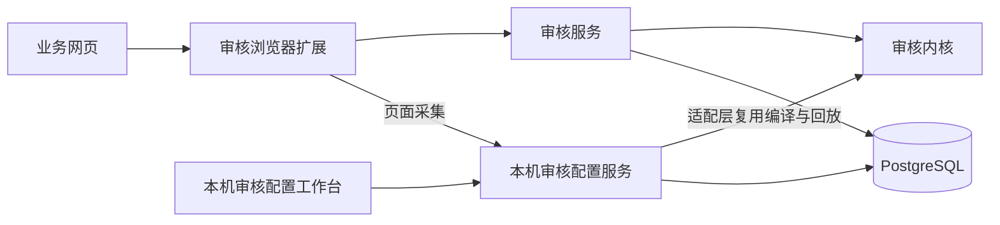

# 项目结构

## 项目定位与模块关系

`forj-review` 是 FORJ 审核辅助系统的工程名称。审核辅助面向审核员，审核配置面向维护页面审核方式的人员。两个功能各有前端和后端，放在同一仓库中维护。



配置工作台调用本机配置服务，审核扩展可以调用服务器审核服务。配置服务通过包内 `integrations/review_kernel` 复用允许的审核接口，审核服务不反向依赖配置服务。

## 根目录各做什么

```text
forj-review/
├── apps/
│   ├── review-extension/          审核浏览器扩展，Vue + TypeScript
│   └── review-config-web/         审核配置工作台，Vue + TypeScript
├── src/
│   ├── forj_review_service/       审核服务，Python
│   ├── forj_review_config_service/ 审核配置服务，Python
│   └── forj_review_database/      两后端共享的数据库配置、ORM 模型、连接与迁移契约
├── packages/configuration-contracts/ 两个前端共享的纯类型
├── examples/page-config/          可运行的脱敏页面配置和回放样例
├── tests/                        Python 测试、合成数据及测试数据库支持
├── scripts/
│   ├── dev/                     本地开发、导出和配置发布工具
│   ├── ci/                      架构检查与容器验证
│   └── release/                 发布打包入口及实现
├── deploy/
│   ├── Dockerfile               Docker 镜像构建源
│   └── server/                  首次上传的固定脚本、Compose、模板及 postgres/ 实例模板
├── release/                      server/ 后端包、extension/ 扩展包
├── docs/                         固定分类的当前说明、业务规则及模板
├── AGENTS.md                     AI 开发入口，细则归开发规范
├── .github/                      自动化检查、协作与安全规范
├── pyproject.toml、uv.lock        Python 项目信息、入口与依赖锁
└── package.json                  两个前端的统一命令入口
```

本机实际目录为 `D:\fjkj\software\workspace\forj-review`，与 IDEA 显示名和工程名称一致。

以下是本机配置或运行产物，不属于业务模块：

| 路径 | 用途 |
| --- | --- |
| `.env.database` | 两服务共用的私密数据库连接；不提交、不打包 |
| 各后端包内 `.env` | 各自的模型参数和密钥；不提交、不打包 |
| `logs/` | 审核服务本机日志 |
| `.review-config/` | 配置服务日志、运行锁、人工登记的验收样例、数据库配置备份；会话本身在 PostgreSQL |
| `.tmp/` | 可重新生成的验证和打包临时产物 |
| `.venv/`、`node_modules/` | 安装的 Python、前端依赖 |
| `dist/`、`__pycache__/`、各工具缓存 | 构建和检查产物 |
| `.idea/` | IDEA 本机设置，含私密数据库连接配置，不提交 |
| `docs/开发计划/` | 本机开发计划入口与临时待办，整个目录不提交 |

文档按开发、使用、数据、运维、业务、模板分类，职责清单见[文档导航](../README.md)，实际开发方式见[开发规范](开发规范.md)。

`deploy/server/` 直接维护首次部署的固定文件，无需生成或导出。`package-server.cmd` 只向 `release/server/` 输出一个后端压缩包，不复制或更新固定文件。`release/extension/` 只放浏览器扩展安装包。交付产物均忽略提交，真实密码文件不进入压缩包或版本控制。部署步骤维护在 `docs/运维/部署运维.md`，固定目录的 README 仅提供上传入口。临时日志、检查缓存和一次性迁移脚本不属于项目源码。

## 审核服务：从请求到建议

目录位于 `src/forj_review_service/`。

| 目录 | 职责 | 典型入口 |
| --- | --- | --- |
| `interfaces/` | 接收 HTTP 请求、处理 CLI 参数 | `interfaces/http/`、`interfaces/cli.py` |
| `bootstrap/` | 创建应用、装配依赖、启动和关闭资源 | `bootstrap/application.py` |
| `runtime/` | 审核编排、作业生命周期、调度、数据库配置加载 | `runtime/workflow/graph.py`、`runtime/jobs/manager.py` |
| `businesses/` | 通用声明模型、业务规则与完整页面配置编译 | `businesses/packs/`、`businesses/rules/` |
| `businesses/page_config/` | 完整页面数据契约、独立编译、字段维护与结构化版本状态 | `schema.py`、`compiler.py`、`state.py`、`kernel.py` |
| `evidence/` | 证据归集、规范化、多来源比较与最终决策 | `collection.py`、`comparison/`、`decision.py` |
| `capabilities/` | 通用能力契约、注册、超时和失败保护 | 能力执行基础设施 |
| `integrations/` | 模型、二维码网站、PostgreSQL 连接与车型目录 | `recognition/`、`qr/`、`database.py` |
| `contracts/` | 请求、证据、检查和任务的数据结构 | `review.py`、`recognition.py` |
| `presentation/` | 把后端证据和检查投影成有序任务 | `field_tasks.py`、`routing.py` |
| `config/` | 环境和数据库连接参数解析 | `settings.py`、`database.py` |
| `observability/` | 决策摘要、日志格式、轮转和请求关联 | `decision.py`、日志及 HTTP 中间件 |

`evidence/decision.py` 统一汇总检查与页面异常，决定 PASS 或 REVIEW_REQUIRED；`presentation/advice.py` 仅将确定性判断装配成建议文案。未映射控件、页面歧义及系统字段异常仍参与整单判断。`presentation` 负责生成前端要展示的数据，HTTP 只负责输入输出和错误映射。审核 `runtime` 同时承担工作流、任务调度和生命周期，配置 `application` 承担会话用例编排，目录按职责命名，不要求机械统一。`capabilities` 是通用执行机制，`businesses/rules` 是具体业务算法。`material_presence.py` 检查上传事实，`completeness.py` 检查证据完整性，两者不能因名称相近合并。

## 审核配置服务：从要求到配置版本

目录位于 `src/forj_review_config_service/`。

| 目录 | 职责 |
| --- | --- |
| `application/` | 会话用例、草稿变更、验证、聊天与工具执行协调 |
| `workflow/` | 配置助手的状态与流程图 |
| `tools/` | 提供给助手的工具契约、参数和端口 |
| `integrations/conversation/` | 模型客户端 |
| `integrations/configuration_store/` | PostgreSQL 会话、采集、事件与页面快照存储 |
| `integrations/review_kernel/` | 通过 `snapshot.py` 复用审核编译、回放和版本核对；`postgres.py` 管理数据库快照适配，`storage.py` 明确允许的仓储接口 |
| `integrations/database.py` | 数据库连接、事务及执行器互斥锁 |
| `interfaces/`、`contracts/` | HTTP/CLI 入口、配置协议 |
| `config/`、`bootstrap/` | 环境参数、应用装配与生命周期 |

Agent 用来描述服务内部的推理和工具循环，Service 用来描述对外运行的后端。不是所有含 `agent` 的类和协议都需要改名。

## 两个前端

扩展位于 `apps/review-extension/src/`：`entrypoints` 连接 Chrome 内容脚本与后台；`features/review` 管理审核调用、状态和界面；`features/configuration-capture` 采集配置现场；`platform/browser` 处理页面识别、DOM 采集和写回；`platform/extension` 处理浏览器通信；`shared` 放共用类型和工具；`app` 组装界面。

配置工作台位于 `apps/review-config-web/src/`：`api` 调用配置接口，`browser` 委托扩展执行试采集，`model` 管理工作台状态，`features` 放会话、检查面板和范围选择组件，`app` 组装界面与布局，`ui` 放基础组件。样式分别归入基础、布局、会话、检查面板、采集对话框及响应式文件，入口保留导入顺序。

业务策略通过不可变的 `BusinessContext` 显式传递。Profile 在业务入口解析后生成上下文，字段归一化、证据比较和展示共享这份策略；运行期不依赖 ContextVar 切换业务映射。新增业务时应传入对应上下文，不修改全局策略表。

能力仅使用 `CapabilitySpec` 描述执行契约、`CapabilityBinding` 描述业务启用与参数。普通规则和外部能力直接注册处理函数，不为单个函数编译子图。真正的多步骤流程分别位于 `integrations/recognition/workflow.py`（分类、提取、评估、定向重读、证据投影）和 `integrations/qr/workflow.py`（候选、解码、官网核验、候选推进）；每个服务实例只编译一次，单次调用状态相互独立，批次并发仍由调度层管理。

两个服务的运行存储统一使用 SQLAlchemy AsyncEngine、AsyncSession 和声明式 ORM 模型，底层为 psycopg 3。公共持久化基础设施位于 `forj_review_database`，各服务的适配层负责业务仓储。页面配置直接进入内存内核，事务外完成编译校验，再在短事务中按修订号提交配置和回执。会话、事件和 LangGraph 检查点的权威写入均先验证执行器的数据库持锁连接；连接失效后停止任务并拒绝旧实例写入，接管与在途写事务通过同一事务锁排序。文件导入导出只在本地开发工具边界使用。细节见[数据库设计](../数据/数据库设计.md)。

两个前端只共享 `packages/configuration-contracts` 的纯类型，不能互相导入组件、状态或运行逻辑。

## 修改功能时从哪里开始

下表提供排查入口，最终修改位置须根据因果链判断。先按[开发规范](开发规范.md)明确前后端及模块职责，不能仅凭错误出现的位置决定修复层次。

| 需求 | 首选入口 |
| --- | --- |
| 字段标签、材料来源、页面路径、版本变化 | 数据库页面版本、字段、材料及发布关系；生产目录不保存页面默认数据 |
| 新增一种业务判断 | `businesses/rules/` 及能力注册目录 |
| 判断冲突、证据不足或多来源优先级 | `evidence/comparison/` |
| 审核流程、取消、并发和任务过期 | `runtime/workflow/`、`jobs/`、`scheduling/` |
| 字段任务缺失、重复、顺序不对 | 核对配置、采集和响应；任务生成问题查 `presentation/`，响应正确再查扩展展示 |
| 页面取值、下拉框或日期回填不正确 | 核对采集及动作数据；页面交互问题查扩展 `platform/browser/`，数据/提议问题查后端生产方 |
| 车型候选与整块规格回填 | 后端 `integrations/vehicle_models.py`；扩展车型功能协调器 |
| 配置聊天、草稿或保存恢复 | 配置服务 `application/`、`workflow/`、存储适配层 |
| 连接数据库失败 | 各服务 `config/database.py` 和 `integrations/database.py` |

## 命名与依赖约束

项目标识统一使用 `forj-review`，各模块按职责命名：

| 对象 | 固定名称 |
| --- | --- |
| 审核后端 / 配置后端 Python 包 | `forj_review_service` / `forj_review_config_service` |
| 审核扩展 / 配置前端目录 | `review-extension` / `review-config-web` |
| 审核容器 / 镜像 | `forj-review-service` / `forj-review-service:main` |
| Compose 项目 / 审核服务 | `forj-review` / `review-service` |
| 服务器部署目录 | `/home/ubuntu/forj-review` |
| 初始化、启动、停止、回滚脚本 | `setup-server.sh`、`start-server.sh`、`stop-server.sh`、`rollback-server.sh` |
| 审核日志 / 配置日志 | `review-service.log` / `review-config-service.log` |
| 配置服务本机状态 / HTTP 前缀 | `.review-config/` / `/api/review-config` |
| 扩展审核地址配置 | `VITE_REVIEW_API_BASE_URL` |

环境变量按用途保留 `REVIEW_*`、`CONFIGURATION_*`，数据库使用 PostgreSQL 标准 `PG*`；共享实例的 `postgres` 账号、容器和网络无需按应用改名。`agent_advice`、`ASSISTANT` 等现有审核协议和模型聊天角色仍表示其业务含义。

- 应用目录用 `review-用途`；Python 包用 `forj_review_用途`，文件用 `snake_case.py`。
- Vue 组件用 `PascalCase.vue`；TypeScript 文件延续 `kebab-case.ts`；PowerShell、CMD、Shell 脚本用 `kebab-case`。
- `config` 表示运行参数；页面审核配置使用 `page_config`，避免把环境配置和业务配置混为一谈。
- 保留 `main.py`、`__init__.py`、`App.vue` 等常规名称。上下文明确的 `schema.py`、`client.py` 不必再加长前缀。
- 不按行数机械拆文件；优先保持业务声明、事务和锁边界完整。
- 产品代码不导入 `tests` 或 `scripts`；通用主图不登记具体业务规则；数据库和外部客户端留在适配层。

执行 `uv run python scripts/ci/check_architecture.py` 和 `node scripts/ci/check-extension-architecture.mjs` 检查这些边界。共享数据库包不依赖任一后端服务或仓库工具；规则注册器统一使用异步执行入口，允许直接调用纯计算规则及等待异步规则。

测试按照审核业务、配置维护、数据库、契约和工具保障组织；共享夹具位于 `tests/support`，完整页面测试数据位于 `tests/fixtures`。生产启动不读取测试夹具，测试文件之间不互相导入，CI 分开执行快速验证与数据库集成验证。具体入口与需求覆盖见[测试组织](../../tests/README.md)。

## 关键术语

| 名称 | 含义 |
| --- | --- |
| Profile | 某个业务、地区、版本的可执行审核配置 |
| Pack | 字段、材料、规则和页面边界的业务声明 |
| Evidence | 保留来源及不确定信息的证据 |
| Capability | 已注册、可规划执行的审核能力 |
| ReviewTask | 提供给工作台展示和人工处理的任务 |
| Renderer | 把任务数据转成界面的展示组件 |
| PageAction | 后端提议、由扩展受控执行的页面动作 |
| Replay | 使用固定识别结果执行同一审核内核的离线回放 |
| Schema | 数据库内的命名空间；本机使用 `forj_review.local`，线上继续使用 `forj_review.public`，各有完整数据 |
| CLI / API | 命令行入口 / 程序调用接口 |
| PR / Issue / CI | 代码合并请求 / 问题单 / 自动化检查 |

数据库表、字段释义与关系维护约定见[数据库设计](../数据/数据库设计.md)。
