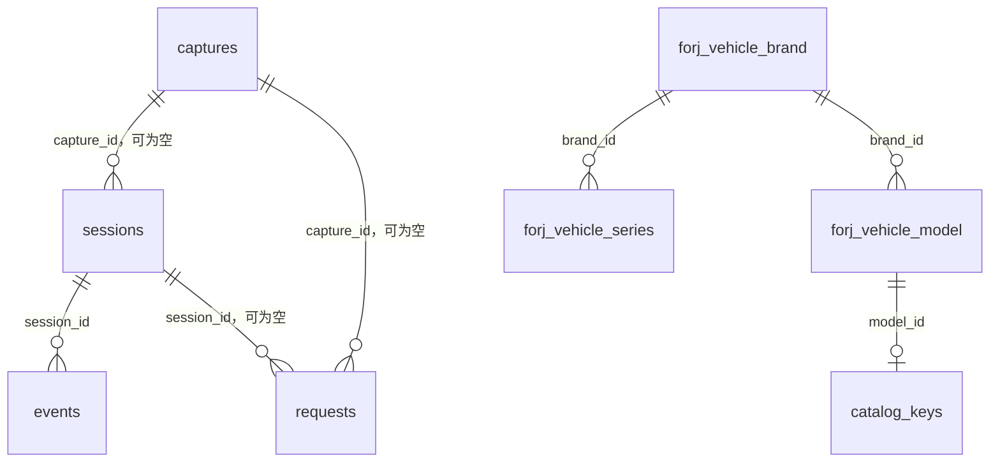

# 数据库设计与数据字典

本系统的 PostgreSQL 数据用于页面配置、配置助手会话、车型目录和发动机排放对应表。审核任务、识别结果及审核结论在内存中短期保存，不建立长期任务结果表。

## 数据库与维护边界

本项目业务库为 `forj_review`，使用默认 Schema `public`，共 18 张表、198 个字段。审核服务和本机审核配置服务共用同一套数据；不再分 `local` / `production`。层级是 **PostgreSQL 实例 → forj_review 数据库 → public Schema → 表 → 字段**，Schema 是数据库内部的命名空间，不是另一个数据库。

实例可以承载其他项目，各项目独立建库，共用现有 `postgres` 账号；本项目数据库及恢复表由 `postgres` 持有。默认 `postgres` 库用于维护，`template0`、`template1` 保持系统用途。连接变量使用 PostgreSQL/libpq 标准 `PG*` 名称，实际密码由使用者填写。共用超级管理员账号意味着项目之间没有权限隔离。

实际表和字段均写有 PostgreSQL `COMMENT`。在 IDEA Database 中刷新表结构后，可以查看注释。本文件解释设计、关系和每个字段；业务字段释义来自原业务库实体的 `@Schema` 注解，而不是根据英文缩写猜测。

- 自建标识符采用小写英文和下划线，主键一般为 `id`，外部关联为 `对象_id`。现有 `sessions`、`events` 等采用复数名；单例版本表保留既有名称，不为追求形式重复改名。
- 四张 `forj_vehicle_*` 表保留源表名、全部既有字段名及数据类型，包含源库缩写和历史拼写。字符串规格、缺失值和时间文本不擅自转成数字或时间类型。
- LangGraph 的四张 `checkpoint*` 表按框架约定管理，保留字段、索引和版本记录。框架升级应先验证其迁移与本应用的兼容性。
- 主键、唯一约束和现有自增序列继续保留。序列号只用于唯一性或顺序，不保证连续，不用作业务版本。
- 当前存储契约为 2；代码拒绝不兼容的契约以避免连接错误库。服务启动不建库、不自动升级结构，也不写注释。

## 结构速览

层级统一为 `forj_review → public → 表 → 字段`。以下为目录初次核对时的参考行数，日常使用后会变化。

| 表名 | 用途 | 验收行数 |
| --- | --- | ---: |
| `page_snapshots` | 整套页面配置、版本历史及提交回执 | 1 |
| `captures` | 页面现场采集 | 1 |
| `sessions` | 配置助手会话与草稿 | 0 |
| `events` | 配置会话事件流 | 0 |
| `requests` | 请求幂等凭据 | 1 |
| `forj_vehicle_brand` | 品牌目录 | 416 |
| `forj_vehicle_series` | 车系目录 | 4,199 |
| `forj_vehicle_model` | 车型目录 | 148,082 |
| `forj_vehicle_model_config` | 车型规格参数 | 148,084 |
| `catalog_keys` | 车型规范化查询键 | 147,270 |
| `catalog_metadata` | 目录格式与完整性信息 | 1 |
| `engine_emission_standards` | 完整发动机型号与唯一国三至国六值的对应关系（2026-10-19 新增） | 3,123 |
| `checkpoints` | 配置流程恢复检查点 | 0 |
| `checkpoint_blobs` | 检查点通道数据 | 0 |
| `checkpoint_writes` | 节点中间写入 | 0 |
| `checkpoint_migrations` | 框架结构版本 | 10 |
| `storage_version` | 应用存储契约版本（当前为 2） | 1 |
| `imports` | 历史导入凭据 | 4 |

35 条应用和框架 SQL 已通过真实表结构的 PREPARE 检查（不执行写入）；会话、采集、配置加载及同步/异步检查点读取已实测。旧库删除前再次核验全部 34 张旧表摘要，新库原业务字段与合并备份一致。

## 关系与数据一致性

图中的关系由真实外键约束；源目录中的品牌关联字段允许为空。外键使用 `RESTRICT`，不会因为删除父记录而自动丢失会话、事件或历史凭据。应用在同一个事务中按事件、请求凭据、会话的顺序显式清理；仍被会话引用的采集不允许删除。已确认提交的会话还受应用层保留规则保护。

以下关系只作逻辑关联，不强加外键：

| 关系 | 原因 |
| --- | --- |
| `forj_vehicle_model.s_id → forj_vehicle_series.id` | 源快照有 952 条车型找不到对应车系；保留原值，查询使用 LEFT JOIN，缺失关系不自动补造 |
| `forj_vehicle_model_config.model_id → forj_vehicle_model.model_id` | 源快照有 9 条孤立配置；源数据必须保留，不能通过删除或虚构车型满足外键 |
| `sessions.id → checkpoints.thread_id` | 两者在本应用语义上对应，但框架自行管理检查点、通道版本、中间写入及历史裁剪，不加跨层外键 |
| `checkpoints.parent_checkpoint_id → checkpoints.checkpoint_id` | 历史可能被框架裁剪，且完整标识还包含线程和命名空间，不能只按检查点 ID 建外键 |

上述源数据统计在合并前两个 Schema 中一致，为 2026-10-18 核对结果。它们是源数据的完整性边界，不代表后续可以忽略新增异常。以后更新目录时，先检查缺失关系和查询键完整性，并在单个事务中刷新源表与派生键。

### JSONB 与关系字段的分工

`sessions.body` 是 `SessionRecord` 的完整版本化文档。消息、动态草稿、待处理交互、验证报告和保存回执的形状会演进，适合 JSONB；需要关联、筛选和并发控制的 `capture_id`、`state`、`turn_status`、`revision` 是数据库 **STORED GENERATED** 列，由文档自动计算，禁止双份独立写入。

`requests` 的 `(scope,id)` 是防重复操作的联合主键，不等于审核任务。其 `session_id`、`capture_id` 也由数据库生成：`create` 从返回结果取会话 ID，`会话ID:操作` 从 scope 取会话 ID，`capture` 从返回结果取采集 ID。新增请求范围时，必须同步检查这项约定和外键，不要随意用冒号拼接无关范围。

数据库检查 JSONB 的对象类型、会话/采集文档 ID 与行主键一致、已知状态和非负会话版本；应用的 Pydantic 契约继续校验完整文档。新增状态枚举时，必须在同次发布中更新契约、数据库 CHECK、本文和测试。

`page_snapshots` 保留单行配置集合，`id=1`，`files` 保存相对路径到文件文本的映射。历史版本和提交凭据也在集合内，使用事务、行锁和整体 revision 保证多文件配置原子更新。当前使用规模下保留该设计；不要只拆成“每页一行”而丢失跨文件提交一致性。业务页版本、会话 revision、配置集合 revision、存储版本、框架版本含义不同。

### 索引与时间语义

事件使用 `(session_id,seq)` 索引增量读取；会话的 `capture_id` 和请求的两个关联列建立索引，避免外键检查及清理时扫描整表。现有 position 唯一索引支持稳定倒序列表。车型查询沿用整车型号/发动机型号联合索引及品牌/车系/车型名称索引，未给所有 JSONB 字段盲目添加 GIN 索引。

会话更新时间在 `body.updated_at`，采集创建时间在 `body.created_at`，由应用写入 ISO 8601 UTC 时间。原业务目录时间列保留源字符串，不能按本机时区自行解释。事件新增 `created_at timestamptz`，默认记录写入事务的时间，供后续按时段排查或制定保留策略；事件顺序仍以 `seq` 为准。本次合并前的旧事件均为 0 行，无需伪造历史时间。

## 数据字典

### `engine_emission_standards`

显式从车型配置目录生成的排放参考表。型号为主键，排放值仅允许国三、国四、国五、国六。只有在这四类值中唯一对应一个值的型号入库；多值和没有有效值的型号不导入。其他排放类别不转换成国几，也不计入候选值。服务启动检查表存在，但不创建或重建表；存储版本仍为 2，该表为显式增加的参考数据依赖。审核先精确查此表，未命中才按已维护的系列规则推导；推导结果不自动入表，数据库不可用不绕过查表。

| 字段 | 类型 | 含义 |
|---|---|---|
| `engine_model` | `text`，主键 | 规范化完整型号，保留后缀；统一格式并去掉前置品牌文字 |
| `emission_standard` | `text` | 该型号在国三至国六记录中的唯一值 |
| `source_config_count` | `bigint` | 支持该对应值的源配置条数 |
| `created_at` | `timestamptz` | 导入批次时间 |

不与整车品牌关联；不使用源码中的厂家后缀映射。显式重建时在一个事务中替换全部参考映射，因此目录中新出现多值的型号会从参考表移除。重建前的映射与本次候选保存在导入报告中。详见 [发动机排放对应表](发动机排放对应表.md)。

以下定义适用于统一的 `forj_review.public`。JSONB 内部字段以对应 Pydantic 契约为准。标记“生成”的列不能在 INSERT/UPDATE 中赋值。

### `captures`

审核配置的页面现场采集；保存页面结构及候选字段，供后续会话引用。

| 字段 | PostgreSQL 类型 | 说明 |
| --- | --- | --- |
| `id` | `text` | 页面采集唯一标识，与 body.capture_id 一致 |
| `body` | `jsonb` | 采集现场 JSON 对象：扩展 ID、页面 URL/结构、候选字段、样本和创建时间；不存原图二进制 |
| `position` | `bigint` | 数据库递增排序号，仅用于稳定排序，不作为采集业务标识 |

### `catalog_keys`

车型规范化查询键；按整车型号和发动机型号精确检索，由车型源数据派生。

| 字段 | PostgreSQL 类型 | 说明 |
| --- | --- | --- |
| `model_id` | `bigint` | 关联 forj_vehicle_model.model_id 的车型主键，每车型最多一条规范化查询记录 |
| `announcement_code` | `text` | 规范化后的整车型号，用于完整型号精确匹配 |
| `engine_code` | `text` | 规范化后的发动机型号，用于与整车型号联合精确匹配 |

### `catalog_metadata`

车型目录格式、来源及完整性统计；manifest 用于运行时兼容检查。

| 字段 | PostgreSQL 类型 | 说明 |
| --- | --- | --- |
| `key` | `text` | 目录元信息键；manifest 表示目录格式、来源及统计信息 |
| `value` | `text` | 目录元信息文本；manifest 保存 JSON 文本，保持现有读取格式 |

### `checkpoint_blobs`

LangGraph 检查点状态通道的序列化数据；由框架管理。

| 字段 | PostgreSQL 类型 | 说明 |
| --- | --- | --- |
| `thread_id` | `text` | 所属 LangGraph 线程标识，由框架管理 |
| `checkpoint_ns` | `text` | 所属检查点命名空间 |
| `channel` | `text` | 流程状态通道名称 |
| `version` | `text` | 该通道数据版本，与线程、命名空间及通道组成联合主键 |
| `type` | `text` | 框架序列化格式标记 |
| `blob` | `bytea` | 该通道版本的序列化状态字节；空值由框架解释，不是原始材料图片存储表 |

### `checkpoint_migrations`

LangGraph 检查点表结构版本登记；框架基础设施，不是一次性迁移脚本。

| 字段 | PostgreSQL 类型 | 说明 |
| --- | --- | --- |
| `v` | `integer` | LangGraph 检查点表结构迁移版本，由框架管理，不是旧业务数据迁移次数 |

### `checkpoint_writes`

LangGraph 节点任务的中间写入；支持中断恢复，由框架管理。

| 字段 | PostgreSQL 类型 | 说明 |
| --- | --- | --- |
| `thread_id` | `text` | 所属 LangGraph 线程标识，由框架管理 |
| `checkpoint_ns` | `text` | 所属检查点命名空间 |
| `checkpoint_id` | `text` | 所属检查点 ID，与任务及写入序号定位中间结果 |
| `task_id` | `text` | 框架节点任务标识 |
| `idx` | `integer` | 任务内的写入序号；框架可能使用负数特殊值，不强制非负 |
| `channel` | `text` | 中间写入所对应的状态通道 |
| `type` | `text` | 中间结果的序列化格式标记，可为空 |
| `blob` | `bytea` | 中间写入结果的序列化字节 |
| `task_path` | `text` | 框架任务路径，用于定位子图或节点执行位置 |

### `checkpoints`

LangGraph 配置流程检查点；由框架读写，不自行改名或增加跨表外键。

| 字段 | PostgreSQL 类型 | 说明 |
| --- | --- | --- |
| `thread_id` | `text` | LangGraph 线程标识；本应用通常等于配置会话 ID，由框架管理生命周期 |
| `checkpoint_ns` | `text` | 检查点命名空间，区分主图和子图等执行范围 |
| `checkpoint_id` | `text` | 框架生成的检查点 ID，与线程及命名空间组成联合主键 |
| `parent_checkpoint_id` | `text` | 上一个检查点 ID；框架可能裁剪历史，不强制父检查点物理外键 |
| `type` | `text` | 框架序列化类型标记，可为空 |
| `checkpoint` | `jsonb` | 检查点 JSON 对象：通道版本及执行进度等框架状态 |
| `metadata` | `jsonb` | 检查点元信息 JSON 对象，例如来源及执行步骤 |

### `events`

配置会话事件流；供前端进度展示和断线后按序号补取。

| 字段 | PostgreSQL 类型 | 说明 |
| --- | --- | --- |
| `seq` | `bigint` | 全局递增事件序号；客户端按会话及此序号增量补取，允许序号有间隙 |
| `session_id` | `text` | 所属配置会话 ID，关联 sessions.id |
| `kind` | `text` | 事件类型，例如 session_created、progress、configuration_saved；不是审核业务结论 |
| `body` | `jsonb` | 该事件的 JSON 对象载荷；不等同于完整会话文档 |
| `created_at` | `timestamp with time zone` | 数据库登记事件的时间，默认当前事务时间；带时区，不替代事件排序序号 |

### `forj_vehicle_brand`

原业务库车辆品牌目录快照；原表名、字段名、业务 ID 与历史数据保持不变。

| 字段 | PostgreSQL 类型 | 说明 |
| --- | --- | --- |
| `id` | `bigint` | 品牌内部主键；被车系及车型的 brand_id 引用 |
| `brand_name` | `text` | 品牌名称 |
| `sort_field` | `bigint` | 排序字段 |
| `top_sort_field` | `bigint` | 顶部品牌排序 |
| `initial` | `text` | 首字母 |
| `visibility` | `bigint` | 是否常用0-常用1-不常用 |
| `url` | `text` | 链接 |
| `logo` | `text` | 品牌标识（Logo）；保留源业务值 |
| `mark` | `text` | 是否手动添加；取值保持源库语义 |
| `trailer_flag` | `bigint` | 是否挂车：0-非挂车，1-挂车 |
| `create_time` | `text` | 创建时间；保留源库时间文本及原始精度，不做时区推断 |
| `update_time` | `text` | 修改时间；保留源库时间文本及原始精度，不做时区推断 |
| `del_flag` | `bigint` | 源库逻辑删除标记；0 为未删除，其他取值保持源语义 |

### `forj_vehicle_model`

原业务库车型目录快照；保留所有源记录和历史缺失关联，不推断修复。

| 字段 | PostgreSQL 类型 | 说明 |
| --- | --- | --- |
| `model_id` | `bigint` | 车型主键；车型配置和规范化查询键通过该 ID 关联 |
| `model_name` | `text` | 车型名称 |
| `brand_id` | `bigint` | 所属品牌内部主键，关联 forj_vehicle_brand.id |
| `s_id` | `bigint` | 车系内部主键，逻辑关联 forj_vehicle_series.id；历史数据含缺失关联，保留原值 |
| `series_id` | `bigint` | 源业务对外车系 ID，用于业务页面回填，不替代内部关联字段 s_id |
| `url` | `text` | 链接 |
| `visibility` | `bigint` | 常用字段：0 --> 是，1-->否 |
| `type_level` | `text` | 车辆类型 |
| `mark` | `text` | 添加方式：0 ->采集，1->后台录入, 2->用户上报 |
| `operate` | `bigint` | 操作; 0 -->待审核 ,1-->入库 ,2-->忽略 |
| `announcement_model` | `text` | 公告型号 |
| `create_time` | `text` | 创建时间；保留源库时间文本及原始精度，不做时区推断 |
| `update_time` | `text` | 修改时间；保留源库时间文本及原始精度，不做时区推断 |
| `del_flag` | `bigint` | 源库逻辑删除标记；0 为未删除，其他取值保持源语义 |

### `forj_vehicle_model_config`

原业务库车型规格参数快照；按 model_id 逻辑关联车型，保留历史孤立配置。

| 字段 | PostgreSQL 类型 | 说明 |
| --- | --- | --- |
| `model_id` | `bigint` | 车型配置主键；逻辑关联 forj_vehicle_model.model_id，历史孤立配置保留原值 |
| `brand_id` | `bigint` | 源业务品牌 ID；保留原值 |
| `series_id` | `bigint` | 源业务车系 ID；保留原值，不推断为车系表内部主键 |
| `speed_ratio` | `text` | 速比 |
| `gearbox` | `text` | 变速箱 |
| `gearbox_brand` | `text` | 变速箱品牌 |
| `fuel_tank` | `text` | 油箱容量 |
| `aluminum_alloy_wheel` | `text` | 铝合金车轮 |
| `tank` | `text` | 油箱/气罐材质 |
| `max_output` | `text` | 最大输出功率 |
| `eba` | `text` | 紧急制动辅助系统 |
| `steering_engine` | `text` | 转向机 |
| `rear_axle` | `text` | 后桥描述 |
| `passengers` | `text` | 准乘人数 |
| `bodywork_length` | `text` | 车身长度 |
| `market_segment` | `text` | 细分市场 |
| `seat_rows` | `text` | 座位排数 |
| `drl` | `text` | 日间行车灯 |
| `shift_way` | `text` | 换挡方式 |
| `body_width` | `text` | 车身宽度 |
| `packing_case_length` | `text` | 货箱长度 |
| `aux` | `text` | 外接音源接口(AUX/USB/iPod等) |
| `cruise_control` | `text` | 定速巡航 |
| `rear_axle_ratio` | `text` | 后桥速比 |
| `fairing` | `text` | 导流罩 |
| `fwb` | `text` | 前轮制动器 |
| `max_hp` | `text` | 最大马力 |
| `esp` | `text` | 车身稳定系统 |
| `saddle` | `text` | 鞍座 |
| `mfl` | `text` | 多功能方向盘 |
| `rear_axle_allows_loads` | `text` | 后桥允许载荷 |
| `max_torque` | `text` | 最大扭矩 |
| `tonnage_level` | `text` | 吨位级别 |
| `reverse_gear` | `text` | 倒挡数 |
| `alloy_gas` | `text` | 铝合金储气罐 |
| `cab` | `text` | 驾驶室 |
| `rear_wheel_brake` | `text` | 后轮制动器 |
| `spring_leaf_number` | `text` | 弹簧片数 |
| `cylinder_arrangemen` | `text` | 汽缸排列形式 |
| `tyre_size` | `text` | 轮胎规格 |
| `technical_route` | `text` | 技术路线 |
| `front_axle` | `text` | 前桥描述 |
| `steering_wheel_adjustment` | `text` | 方向盘调节 |
| `brake_light_led` | `text` | LED尾灯 |
| `fuel_type` | `text` | 燃料种类 |
| `emission_standard` | `text` | 排放标准 |
| `heating_rearview_mirror` | `text` | 后视镜电加热 |
| `ride_height` | `text` | 车身高度 |
| `power_window` | `text` | 电动车窗 |
| `asr` | `text` | ASR驱动防滑 |
| `engine_brand` | `text` | 发动机品牌 |
| `electronic_central_lock` | `text` | 电子中控锁 |
| `number_cylinders` | `text` | 汽缸数 |
| `radio` | `text` | 收音机 |
| `total_mass` | `text` | 总质量 |
| `front_axle_allows_loads` | `text` | 前桥允许载荷 |
| `rated_speed` | `text` | 额定转速 |
| `remote_key` | `text` | 遥控钥匙 |
| `weight_kg` | `text` | 整车重量 |
| `air_conditioning_regulation` | `text` | 空调调节形式 |
| `vehicle_brake_type` | `text` | 整车制动类型 |
| `announcement_model` | `text` | 公告型号 |
| `place_origin` | `text` | 产地 |
| `parking_braking` | `text` | 驻车制动 |
| `bluetooth` | `text` | 蓝牙/车载电话 |
| `forward_collision_warning` | `text` | 正向碰撞预警系统 |
| `engine` | `text` | 发动机 |
| `sensus` | `text` | 中控台彩色大屏 |
| `forward_gears` | `text` | 前进挡位 |
| `bridge_suspension` | `text` | 驾驶室悬挂 |
| `engine_type` | `text` | 发动机型号 |
| `track_rear` | `text` | 后轮距 |
| `displacement` | `text` | 排量 |
| `drive_form` | `text` | 驱动形式 |
| `gearbox_model` | `text` | 变速箱型号 |
| `wheel_base` | `text` | 轴距 |
| `max_speed` | `text` | 最高车速 |
| `abs` | `text` | ABS防抱死 |
| `headlamp_height_adjustable` | `text` | 大灯高度可调 |
| `total_traction_mass` | `text` | 牵引总质量 |
| `power_mirror` | `text` | 电动后视镜 |
| `front_fog_lamp` | `text` | 前雾灯 |
| `front_gauge` | `text` | 前轮距 |
| `number_tires` | `text` | 轮胎数 |
| `ebs` | `text` | EBS电子制动系统 |
| `max_torque_speed` | `text` | 最大扭矩转速 |
| `model_name` | `text` | 车型 |
| `mark` | `text` | 是否为手动添加 |
| `type` | `text` | 类型 |
| `fuel_tank_material` | `text` | 油箱材质 |
| `gps` | `text` | GPS 卫星定位配置；保留源业务值 |
| `approach_angle` | `text` | 接近角 |
| `departure_angle` | `text` | 离去角 |
| `cooler_rademark` | `text` | 冷机品牌 |
| `container_form` | `text` | 货箱形式 |
| `create_time` | `text` | 创建时间；保留源库时间文本及原始精度，不做时区推断 |
| `update_time` | `text` | 修改时间；保留源库时间文本及原始精度，不做时区推断 |

### `forj_vehicle_series`

原业务库车系目录快照；内部 id 与对外 series_id 含义不同，保持原值。

| 字段 | PostgreSQL 类型 | 说明 |
| --- | --- | --- |
| `id` | `bigint` | 车系内部主键；车型 s_id 关联此字段 |
| `series_id` | `bigint` | 源业务对外车系 ID；页面回填使用，不等同于本表内部主键 id |
| `series_name` | `text` | 车系名称 |
| `type` | `text` | 车辆类型 |
| `type_level` | `text` | 类型级别 |
| `brand_id` | `bigint` | 所属品牌内部主键，关联 forj_vehicle_brand.id |
| `url` | `text` | 链接 |
| `purpose` | `text` | 用途 |
| `mark` | `text` | 是否手动添加；取值保持源库语义 |
| `sort_field` | `text` | 排序字段 |
| `commonly_used_series` | `text` | 常用车系;0-是1-否 |
| `create_time` | `text` | 创建时间；保留源库时间文本及原始精度，不做时区推断 |
| `update_time` | `text` | 修改时间；保留源库时间文本及原始精度，不做时区推断 |
| `del_flag` | `bigint` | 源库逻辑删除标记；0 为未删除，其他取值保持源语义 |

### `imports`

旧数据导入的历史凭据；保留来源摘要与统计，不参与日常运行。

| 字段 | PostgreSQL 类型 | 说明 |
| --- | --- | --- |
| `component` | `text` | 历史数据导入组件标识，主键；一组件对应一次已确认导入 |
| `digest` | `text` | 原始导入数据的内容摘要，用于核验来源、防止重复或错误覆盖 |
| `summary` | `jsonb` | 导入统计与核验结果 JSON 对象；历史迁移凭据，正常服务不读写 |

### `page_snapshots`

当前页面配置集合及版本文件；单行整套原子更新，供审核服务读取。

| 字段 | PostgreSQL 类型 | 说明 |
| --- | --- | --- |
| `id` | `integer` | 当前配置集合单例主键，固定为 1；不是页面 ID |
| `files` | `jsonb` | 相对文件路径到 UTF-8 内容的 JSON 对象，含页面定义、历史版本索引及提交回执；支持整套配置原子提交 |
| `revision` | `bigint` | 整个配置集合的并发版本，修改时递增且必须大于 0；不是具体页面的业务版本 |

### `requests`

配置操作的防重复执行凭据；同一业务范围与请求 ID 只能产生一次持久化结果。

| 字段 | PostgreSQL 类型 | 说明 |
| --- | --- | --- |
| `scope` | `text` | 防重复请求的业务范围：capture、create 或 会话ID:操作名；与 id 组成联合主键 |
| `id` | `text` | 客户端请求唯一标识，同一 scope 下不可重复，用于安全重试 |
| `fingerprint` | `text` | 请求内容摘要；相同请求 ID 携带不同内容时拒绝执行 |
| `result` | `jsonb` | 首次成功操作返回的 JSON 对象；重复请求直接返回该结果 |
| `session_id` | `text（生成）` | 所属配置会话 ID；从 create 的 result.session_id 或会话操作 scope 自动生成；采集请求为空 |
| `capture_id` | `text（生成）` | 所属页面采集 ID；仅 capture 范围从 result.capture_id 自动生成，其他请求为空 |

### `sessions`

审核配置助手会话；保存消息、草稿、交互与提交状态，不保存审核员的审核任务。

| 字段 | PostgreSQL 类型 | 说明 |
| --- | --- | --- |
| `id` | `text` | 审核配置会话唯一标识，与 body.session_id 及 LangGraph thread_id 对应；不是登录会话 |
| `body` | `jsonb` | 配置会话完整 JSON 文档：消息、草稿、交互、验证报告及保存回执；由 SessionRecord 定义版本 |
| `position` | `bigint` | 数据库递增排序号，仅用于稳定排序，不代表业务版本 |
| `capture_id` | `text（生成）` | 关联采集 ID；由 body.capture_id 自动生成，空字符串视为未关联，不可单独写入 |
| `state` | `text（生成）` | 配置业务状态（从 body.state 自动生成）：DRAFTING 草拟、NEEDS_INPUT 待补充、READY_FOR_CONFIRMATION 待确认、SAVED_PENDING_RESTART 已保存待加载、EFFECTIVE 已生效、BLOCKED 受阻 |
| `turn_status` | `text（生成）` | 模型回合状态（从 body.turn_status 自动生成）：COMPLETED 完成、RUNNING 执行、QUEUED 排队、WAITING 待交互、INTERRUPTED 中断、CANCELLED 取消、FAILED 失败 |
| `revision` | `bigint（生成）` | 配置会话并发控制版本；从 body.revision 自动生成，必须非负；不是页面配置版本 |

### `storage_version`

应用存储契约版本登记；正常启动仅校验，不自动建库或执行结构迁移。

| 字段 | PostgreSQL 类型 | 说明 |
| --- | --- | --- |
| `version` | `integer` | 本系统持久化存储契约版本；当前为 2，应用启动检查；不是业务配置版本 |

## 变更与验收

本次采用先备份、在隔离 PostgreSQL 中完整恢复、试运行相同变更、验证后再提交正式事务的流程。合并前对两套旧数据逐表计算 SHA-256；合并后对原有列逐表验证相同摘要，再增加生成列和升级存储契约元数据。旧库在提交前再次核对，防止复制期间漏掉变化。数据库注释覆盖率要求为所有业务表和字段 100%，有效关系由已验证外键约束保证。

数据库变更必须同步测试构造结构（`tests/support/postgres.py`）和数据完整性测试；测试仅连接本机隔离实例，不对服务器业务 Schema 创建测试记录。应用写入使用显式列名，便于新增生成列及后续演进。一次性维护脚本不放入运行代码或应用镜像，备份保存在项目外。

本次完整备份及核验记录位于项目旁的 `forj-review-backups/20261018-213753-database-design/`；不随发布包上传。包含二进制 COPY 备份、恢复结构、逐表摘要、原始结构及合并验收记录。修改前备份已在隔离 PostgreSQL 16 中完整恢复并验证。一次性维护工具在完成后移出日常代码。
