# 系统架构与边界

系统由浏览器扩展、审核服务和可注册业务能力组成。扩展采集页面事实并展示任务；服务端负责证据解释、规则判断、外部核验和最终建议。

本文中的 `Profile`（业务配置档案）描述一个业务版本，`Registry`（注册表）负责按稳定 ID 查找实现，`PageAdapter`（页面适配器）负责网页采集，`Workbench`（审核工作台）负责任务展示。完整术语请参阅[英文术语对照表](../参考/术语表.md)。

```mermaid
flowchart LR
  Page[审核页面] --> Adapter[PageAdapter]
  Adapter --> Manifest[页面字段 + 图片清单]
  Manifest --> API[图片 URL Review Job API]
  API --> Scheduler[公平识别调度器]
  Scheduler --> Graph[统一 LangGraph 主图]
  Graph --> Profile[Profile]
  Profile --> Registry[Capability Registry]
  Registry --> Subgraph[能力子图/Handler]
  Subgraph --> Tasks[ReviewTask + EvidenceFact]
  Tasks --> UI[Workbench Renderer Registry]
  UI --> Action[PageActionRegistry]
  Action --> Page
```

## 前后端边界

后端拥有业务规则、材料完整性、字段比较、主体关系、外部核验、置信度和建议语义。前端拥有 DOM 采集、页面身份识别、任务展示、用户交互和白名单写回。前端可以格式化后端结果，但不能重新计算资格或覆盖服务端结论；后端不能依赖浏览器 DOM 选择器。

## 数据链路

`PageData → URL Review Job → AgentBatchResult → ReviewState → EvidenceFact/CheckResult → ReviewTask → EvidenceReviewWorkbench → PageAction`。二维码内容优先来自同次模型提取的 `qr_codes`；没有可靠结果时，二维码专用读取器对候选图片 URL 在内存中按 ZXing → OpenCV 解码，再由后端执行官网域名和字段核验。普通材料链路仍只提交 URL，不写盘、不上传；二维码读取失败或官网不可用时明确转人工复核。

字段任务可以同时携带 `page_field`（页面字段展示键）和 `page_target_field`（页面定位字段）。`page_field` 仅表示任务在页面字段区域的展示归属；当任务需要在助手区域展示但仍要回填真实页面控件时，必须使用 `page_target_field`，不能把助手任务伪装成 `PAGE_FIELD`。后端只输出稳定字段键和 `page_fill_intent`（页面填写意图），不输出 CSS 选择器、DOM 节点或浏览器对象；前端适配器根据字段键解析 DOM，并负责定位、高亮、回读和回滚。

## 目录原则

引擎放 `app/workflow`、`app/capabilities`、`app/compare`、`app/presentation`、`app/services`，协议放 `app/contracts`；业务声明放 `app/businesses/packs`，该业务自己的规则放 `app/businesses/rules`。前端页面差异放 `src/adapters`，写回放 `src/session`，展示放 `src/components`。禁止跨层复制同一规则。

## 变更边界

增加审核业务使用 Profile、CapabilitySpec 和子图。只有状态契约、错误语义或生命周期发生变化时才修改主图，并需要补充架构审查和迁移说明。

增加页面的目标形态是 Adapter（页面适配器）和 Action Registry（页面动作注册表）。**当前实现的页面适配已经接入主流程**：`business-detector.ts` 通过 `buildPageAdapterRegistry()` 解析页面，`ScrapReplacementPageAdapter` 等适配器负责识别，新增页面只需在 `src/adapters/` 加一个适配器并注册。

字段采集是**通用的**：字段别名、页面分区、材料分组和图片筛选依据由后端通过采集清单下发（见[新增业务与页面](../指南/新增业务与页面.md)），不需要写进适配器。

## 关键术语

- **PageData**：浏览器从当前页面采集的原始、带来源信息的数据。它可以不完整，也可能包含 OCR 低置信度结果。
- **ReviewRequest**：发送给后端的版本化请求，包含页面身份、业务候选、材料索引、字段值、采集批次和请求 ID。
- **EvidenceFact**：后端确认过的事实，必须带字段路径、值、来源、置信度、时间和证据引用。
- **CheckResult**：一个能力或规则的机器结果，包含状态、理由、输入事实和降级信息。
- **ReviewTask**：面向审核员的可操作任务，说明需要看什么、为什么需要看、完成后影响什么。组合字段任务通过 `page_target_fields` 和 `page_values` 明确两个页面控件及其原始值，后端负责页面双值与材料值的比较，前端只执行受控的双字段写回。
- **Workbench**：前端统一任务工作台。它只根据任务类型选择 Renderer，不知道业务规则如何计算。

这些对象有不同生命周期，不能用一个“大而全”的 JSON 在层之间透传。新增字段必须说明生产者、消费者、默认值、兼容策略和脱敏要求。

## 不变量

1. 重复执行不能绕过页面身份和原值校验。当前扩展防止并发重复启动，同批自动动作按 ID 去重；服务端创建每次产生新任务，`trace_id` 不是幂等键，跨请求去重仍待实现。
2. 后端建议只能由证据和规则推导，前端展示不得改变建议语义。
3. 任何自动判定都能追溯到至少一个事实、规则版本和能力版本；无法追溯时降级为人工复核。
4. 页面写回必须绑定 `page_instance_id` 和采集批次，旧页面上的任务不能写入新页面。
5. Profile、能力、协议和页面动作都可独立停用；停用结果必须可见且可解释。

## 一次请求的完整生命周期

扩展采集页面字段及图片 URL；模型提取材料字段和 qr_codes；正式审核图复用提取结果完成材料、官网、比较、规则及建议汇总。前端轮询任务快照并呈现证据；受控动作执行前核对记录身份、唯一定位及原值，执行后回读并在失败时恢复。

## 反模式

- 在 API 路由中根据城市名称直接调用某个规则函数，导致业务选择绕过 Profile。
- 在前端看到字段为空时自行判断“符合条件”，造成前后端结论不一致。
- 为一个新页面复制完整组件树和主图，最终修复需要同步多份代码。
- 把 OCR 原文、DOM 节点或第三方响应直接作为公开协议字段，导致协议不可稳定演进。
- 通过异常消息向用户暴露密钥、内部 URL 或完整材料内容。

## 展示层的职责边界

展示层可以把 `MATCH` 渲染为绿色、`CONFLICT` 渲染为红色、`INSUFFICIENT` 渲染为橙色，可以把证据片段做差异高亮，也可以提供查看原图、手工选择候选值和标记人工复核的交互。这些都是对后端结果的呈现和操作入口。

展示层不能把红色改成绿色、把缺失改成通过、把一条证据选为“正确值”、把失败的回填显示为成功，或根据绿色字段数量自行推导整单通过。前端展示规范中的视觉规则必须与 `ReviewTask.result_status`、`CheckResult.status` 和 `ReviewResponse.recommendation` 一一对应。

政策日期属于后端规则结论：例如发票日期窗口和报废车交车截止日直接合并到对应字段任务的政策结果中，前端只展示理由和范围，不再创建重复的页面外日期核验。主体关系成功后，后端通过 `page_fill_intent` 给出“个人/公司”的受控填写意图，前端只执行注册动作，不根据客户名称或页面文本自行推断主体类型。
