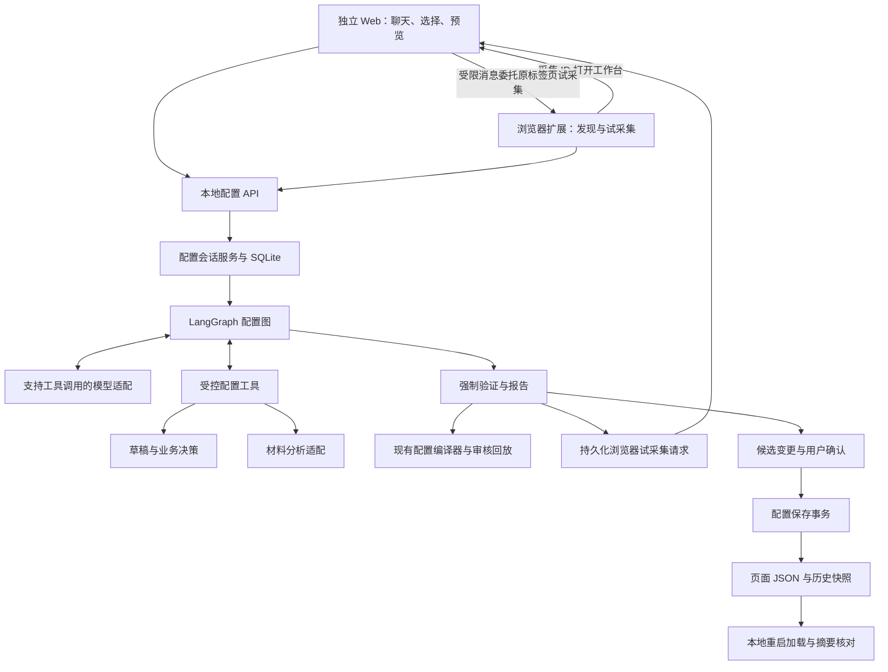

# 聊天审核配置 Agent 开发计划

状态：**已审阅并授权开发；首版本地实现已接入，真实业务页验收待完成**。  
日期：2026-10-15。  
适用项目：FORJ Review Assistant 当前业务底座。  
交付范围：两个本地后端、Chrome 扩展、独立配置 Web、本地页面配置与会话数据。  
本文保留经确认的设计与阶段验收目标；当前实现、操作方式及未验证范围见[聊天配置指南](../指南/聊天审核配置Agent.md)，不能仅凭计划内容推断已验收。

## 1. 先看结论

开发一个面向审核业务的配置 Agent：用户打开页面、选择材料和审核字段，并用聊天表达要求；模型主动理解材料、推理字段映射、查询已有规则、修改配置草稿和调用验证工具；只有业务含义不明确或信息不足时才询问用户。

普通页面的交付物仍是一份受严格 Schema 约束的页面 JSON。现有审核主图负责执行配置，不为每个页面复制图，不让模型日常修改前端或 Python 业务代码。

建议采用以下第一版方案：

| 决策 | 第一版选择 |
| --- | --- |
| 后端业务隔离 | 配置 Agent 使用独立 Python 业务包，与当前审核包分开 |
| 后端启动与进程 | 两个独立后端入口、两个本地后端进程；按需启动 |
| 前端隔离 | 浏览器扩展与独立 Web 两个前端；扩展采集，Web 选择、聊天、验证和确认 |
| Agent 运行方式 | 一个主 Agent，模型自主选择工具、观察结果并继续迭代 |
| 编排与恢复 | 独立的小型 LangGraph 配置图，增加本地持久化 checkpointer |
| 正式审核 | 保留现有审核主图、业务编译器和统一工作台 |
| 配置修改 | 受限的结构化草稿操作，由程序编译和写入 JSON |
| 人工介入 | 必要业务澄清，以及验证完成后的变更确认 |
| 状态存储 | SQLite 保存会话、决策、草稿和执行记录；正式配置继续使用 JSON 和现有快照 |
| 浏览器能力 | 一次性增加通用配置入口、页面发现和候选配置试采集 |
| 启用方式 | 保存后标为等待重启；用户重启本地后端后核对实际加载版本 |
| 模型接入 | 增加支持原生工具调用的会话适配，材料分析作为独立工具 |
| 暂不纳入 | 公网发布、多租户、自动修改程序代码、多 Agent、自进化、通用插件市场 |

“前端不需要改”指功能开发完成后，普通页面配置不用逐页修改前端。首次实现聊天、选择和通用发现界面，需要一次通用前端开发。

## 2. 目标、范围与完成定义

### 2.1 用户最终获得什么

1. 一个新页面，通过选择和聊天完成受支持的审核配置。
2. 一个已配置页面，通过聊天新增、修改或删除审核字段、材料和来源。
3. 模型先自行分析；能通过资料、当前配置和工具确定的内容，不逐项追问用户。
4. 每条关键规则能说明来源、比较对象、缺失处理和是否允许回填。
5. 配置启用前能看到准确差异及验证结果，启用后可以退回原版本。
6. 关闭插件、断线或重启后端后，能找回会话、草稿和待回答问题；不重复执行已确认的配置写入。

### 2.2 第一版必须覆盖的用户故事

| 编号 | 场景 | 预期结果 |
| --- | --- | --- |
| U01 | 打开没有配置的新页面 | 可发现字段和图片分组，不要求先有 manifest |
| U02 | 选择必传材料和待审核字段 | 形成可修改的审核范围，不把样本图片地址写成材料规则 |
| U03 | 模型分析图片与页面 | 生成有证据引用的材料字段与页面字段映射 |
| U04 | 存在同名字段或多种业务解释 | 模型进一步查证，仍不明确则提供选项或接受自然语言说明 |
| U05 | 为已有页面新增字段 | 继承原版本，只修改相关配置并验证受影响范围 |
| U06 | 修改来源、别名、必传要求或时效 | 旧派生提取项被清理，新配置与差异可预览 |
| U07 | 删除字段或材料 | 检查依赖，拒绝留下断开的规则、身份或材料引用 |
| U08 | 页面上某个字段本轮没有出现 | 标为缺失或待核实，不自动推断为应删除 |
| U09 | 中断后继续 | 重新核对页面与配置基线，保留已明确要求和草稿 |
| U10 | 确认保存并重启 | 实际加载摘要与已验证候选一致，插件重新获取目录及清单 |
| U11 | 需要新算法或新控件能力 | 明确报告能力缺口，保留草稿，不虚构为已支持 |

U01—U11 全部验收后，才称为第一版本地功能完成。中间里程碑可以演示，但不能当作完整交付。

### 2.3 计划编写与开发阶段的边界

计划编写阶段仅新增文档和索引。用户已审阅并授权开发，现已接入独立服务、持久配置图、扩展入口和受控保存；测试不替用户修改真实业务配置。

后续开发默认保持本地使用，不修改服务器部署方案，不自动启动或停止服务器，不把“保存配置”称为“已发布公网服务”。

## 3. 当前代码能复用什么，还缺什么

以下以当前源码为准，后续实现开始时重新核对基线。

| 能力 | 当前依据 | 本次处理 |
| --- | --- | --- |
| 页面 JSON 契约 | `businesses/configuration/schema.py` 的 `PageDefinition` | 复用，不建立平行的正式配置格式 |
| 模板继承与依赖校验 | `compiler.py`、`loader.py` | 复用，补草稿适配及提交事务保护 |
| 有效配置、差异与摘要 | `inspection.py` | 复用，用于上下文、验证绑定和展示 |
| 历史快照与版本内容保护 | `history.py` | 复用，纳入受控保存流程 |
| 固定识别结果的真实主图回放 | `interfaces/page_tools.py` | 下移可复用编排逻辑，CLI 保留入口兼容 |
| 配置 Schema 和规则元数据接口 | `interfaces/http/catalog.py` | 复用目录事实，不让模型猜规则 ID |
| 正式审核执行 | `runtime/workflow/graph.py` | 保持既有职责和拓扑，不加入配置聊天步骤 |
| 动态目录与精确采集清单 | 浏览器 `catalog/`、`features/review/api/collect-page.ts` | 复用正式采集，另补发现和试采集模式 |
| 页面控件回填 | 浏览器 `form-controls.ts`、`actions/`、身份校验 | 继续复用；配置 Agent 本身不填写真实申请 |
| 模型材料识别 | `integrations/recognition/client.py` | 保留正式白名单提取，新增配置阶段材料分析适配 |
| 多轮模型工具调用 | 当前无通用 Agent 会话适配 | 新增 |
| 聊天、持久化问题和恢复 | 当前无配置会话 | 新增 |
| 配置写接口与启用状态核对 | 当前以 CLI 和启动加载为主 | 新增本地受控接口，不做热更新 |

当前 `ReviewJobManager` 使用内存任务和过期清理，不能直接充当配置会话存储。配置会话与实际审核作业分开管理；本次不顺便改造既有审核作业的跨重启恢复。

## 4. 业务表达能力与明确边界

### 4.1 优先支持当前底座已经能执行的配置

| 要求 | 第一版表达方式 | 限制 |
| --- | --- | --- |
| 新页面与地区差异 | page_id、business_type、region、路径、锚点、分区和模板继承 | 页面识别必须能够区分，不用带申请编号的 URL 作为永久身份 |
| 页面字段定位 | aliases、页面分区、ID/name 辅助条件、occurrence | ID/name 不能代替 aliases；DOM 句柄留在浏览器 |
| 图片与材料 | 材料类型、提示词、分组、scope、槽位、数量和页码 | 配置绑定材料类别及上传位置，不绑定一张样本图片 |
| 字段来源映射 | evidence 中的材料字段、分区与槽位 | 标签相同或样本值相同，不足以证明业务语义相同 |
| 比较方式 | 当前 EvidenceMode、normalizer、已有权威链 | 不创造现有引擎不认识的操作符 |
| 缺失与不确定 | required、allow_single_evidence、uncertain_requires_review 等 | 不能为获得通过而自动放松必审条件 |
| 材料内部字段 | page_evidence_required=false | 必须仍有可验证的材料或规则依据 |
| 时效 | 现有 max_age_days 及已注册规则 | 日期含义和边界需明确；测试固定审核日期 |
| 已注册业务检查 | enable_rules、disable_rules、checks | 规则有固定语义和字段依赖，不是任意公式执行器 |
| 回填配置 | writable、页面动作、控件类型、记录身份字段 | 支持的控件仍须实际验证，不自动授权真实页面写入 |

### 4.2 必须识别为能力缺口的情况

- 新的自定义公式、任意条件表达式、未注册的跨字段算法。
- 未有对应处理器的外部接口、任意二维码网站或网页抓取规则。
- 当前 Schema 或注册规则不能表达的条件必传，例如随意声明“某任意字段满足某表达式时必传”。已有具体业务能力可满足时才允许绑定。
- 未支持的复杂控件、跨 iframe 或特殊组件结构。
- 需要执行 Python、JavaScript、Shell 或自行安装依赖才能完成的要求。

遇到缺口，输出结构化 `CapabilityGap`：用户要求、缺少的能力、已完成部分和建议扩展位置。允许保存未就绪草稿，不允许把它作为验证通过的配置提交。

## 5. 用户操作流程

### 5.1 新页面配置

1. 用户在扩展中点击“采集并打开配置工作台”，启动通用发现模式，将现场保存到配置后端后打开独立 Web。
2. Web 展示字段目录、分组和材料缩略图，提示尚未识别或存在歧义的条目。
3. 用户勾选审核字段、必传或可选材料，并可直接聊天描述要求。
4. Agent 查看页面现场和样本，按需调用材料分析、模板查询、草稿编辑等工具。
5. 模型给出映射和规则，并保存来源；信息不足时请求补充样本或提出具体问题。
6. 用户可随时修改范围或纠正规则；修改会使相关旧结论和验证失效。
7. Agent 形成候选配置，程序强制执行校验、浏览器试采集和回放要求。
8. 展示业务摘要、准确差异、验证结果和已知限制。
9. 用户确认该候选后，后端受控保存新版本，显示“已保存，等待本地后端重启”。
10. 用户结束当前审核作业并重启本地后端；插件重新采集，核对实际生效版本。

界面不强制用户按固定表单走完十步。以上是完整责任链；模型可在分析、查证、提问和修正之间循环。

### 5.2 已配置页面修改

1. 加载精确 page_id、地区、版本、有效配置与源配置摘要。
2. 将自然语言变更转成草稿操作，标识涉及的字段、材料和依赖。
3. 未受影响的规则继承；只对有必要的材料重新识别。
4. 增删改后验证完整有效配置，并运行受影响样例及保留业务回归。
5. 新版本依赖的模板版本固定；历史版本内容不覆盖。
6. 与新页面共用候选确认、保存和启用核对流程。

材料实例中的空值、临时隐藏控件和本次采集失败，不是字段删除指令。删除必须来自用户要求或经用户确认的页面结构变更。

### 5.3 一个贯穿开发的例子

用户：“增加注册日期审核，使用行驶证上的注册日期，允许回填；发动机号不再审核。”

Agent 应完成：发现日期控件 → 核对“注册日期”与“发证日期”的区别 → 读取当前字段及依赖 → 增加注册日期映射 → 删除发动机号及无用派生提取项 → 检查日期控件与写回身份声明 → 校验及试采集 → 回放正确、冲突、缺失和不确定样例 → 展示新版本差异。

只有无法确定材料日期或删除涉及关键规则时才提问。浏览器控件不支持或依赖无法满足时，保留问题，不能把日期当文本框强行通过。

## 6. 架构与职责划分

### 6.1 总体结构



### 6.2 各层拥有的职责

| 层 | 负责 | 不承担 |
| --- | --- | --- |
| 配置 Web UI | 选择、聊天、展示问题和差异、用户确认 | 字段语义推理、材料完整性或最终审核裁决 |
| 扩展配置入口 | 采集并打开独立 Web，提供受限的原标签页试采集桥 | 配置聊天界面、规则编辑和验证结论 |
| 浏览器平台 | DOM 发现、候选 ID 与控件绑定、页面身份、只读试采集 | 推断必传规则、在页面运行模型生成脚本 |
| HTTP 接口 | 参数和本地访问校验、状态码、事件传输 | 模型循环、业务规则、直接文件写入 |
| 配置会话运行时 | 会话串行、取消、上下文、工具调度、暂停恢复 | 具体城市规则、浏览器 DOM 操作 |
| 业务配置层 | Schema、合并、编译、依赖、有效配置和差异 | 网络、模型调用、HTTP、SQLite 或浏览器连接 |
| 集成适配 | 模型传输、SQLite、文件事务 IO | 审核政策和前端展示 |
| 正式审核引擎 | 按指定候选或正式配置执行审核 | 聊天、修改配置、解释用户授权 |

后端可以接收有限的采集绑定元数据，如 ID/name 和分区标签；不接收或生成可执行 DOM 脚本，不把 CSS/XPath 作为新的通用规则语言。DOM 节点和浏览器对象始终留在浏览器。

### 6.3 独立业务包与两个启动入口

按本轮讨论，后端采用同一仓库中的两个业务包、两个独立进程。保持同一开发环境和依赖锁文件，第一版不要求独立仓库、容器或发布流水线。

| 进程 | 拟议启动命令 | 本地默认端口 | 生命周期责任 |
| --- | --- | --- | --- |
| 审核服务 | `uv run forj-review-assistant`，保留现有入口 | 8010，保留现状 | 审核主图、审核作业、正式配置快照与审核模型资源 |
| 配置 Agent 服务 | `uv run forj-configuration-agent`，开发时新增 | 8011，拟议值且可配置 | 配置图、聊天会话、草稿、验证、保存及会话模型资源 |

第二条命令现已实现。两个应用分别拥有 app factory、CLI、健康检查、日志文件和资源关闭流程；启动审核服务不初始化配置 Agent 数据库或模型，启动配置服务不启动审核 HTTP 应用或后台审核作业管理器。停止一个进程不停止另一个。

| 启动组合 | 应支持的行为 |
| --- | --- |
| 只启动审核服务 | 按已加载正式配置正常审核；配置入口提示配置服务未启动 |
| 只启动配置服务 | 发现页面、聊天推理、读取本地配置、编辑草稿、编译、进程内离线回放、保存版本；启用状态显示待审核服务核对 |
| 同时启动两个 | 使用各自功能；配置服务可只读查询审核服务实际加载版本，保存后现有审核进程仍使用旧快照，重启审核服务后核对 |

配置服务的编译、规则查询和固定样例回放通过共享代码的显式库接口执行，不以调用审核 HTTP 服务为前置条件。复用审核图构建器时注入隔离的候选注册表和测试依赖，不导入 `main:app`、不复用全局审核作业状态，不启动真实核验副作用。

第一版先在现有审核包内提炼公共配置/验证库接口，通过配置 Agent 的适配器调用，避免复制 Schema、编译器或审核引擎。此时配置包仍有对共享代码的安装依赖，但没有对审核进程的运行依赖。只有公共能力边界稳定且提取收益明确时，再考虑独立公共 Python 包；不为形成三个包而全面搬迁现有代码。

两个服务显式指向同一个正式配置目录；草稿数据库仅归配置服务所有，审核服务不读取它。Agent 保存是应用配置写入的统一入口；既有 CLI 中会写快照/版本的入口也遵守同一文件锁和事务协议，保留命令兼容。锁必须跨进程，不能用单进程 `asyncio.Lock` 代替。

前端按用户后续确认拆成两个包：`apps/extension` 保留原审核界面和单个配置采集按钮，`apps/configuration-web` 承担配置交互，独立 Vite 进程默认 5174。后端不托管 Web 静态资源；Web 通过同源代理访问 8011。两前端仅共享 `packages/configuration-contracts` 的纯类型契约，不互相引用业务实现。扩展独立构建并由 Chrome 运行；Web 独立启动和停止。

配置发现与试采集不依赖先请求审核服务目录；两个后端的离线状态独立处理，不能因为审核服务不可用而阻断配置。Web 使用采集 ID 读取后端持久化快照；试采集仅通过扩展桥委托原业务标签页，核对快照、页面实例和结构，不使用当前活动 Web 标签页。启用核对是可选的只读跨进程调用；审核服务从不回调配置 Agent。

两边使用同一版本的配置契约与验证能力。启用核对同时检查 page_id、version、有效摘要和兼容性标识；连接到不同配置目录或不同程序版本时给出不匹配原因，不按“已保存”推断“已生效”。

## 7. LangGraph 配置图设计

### 7.1 与现有审核图的关系

新增独立配置图。现有 `runtime/workflow/graph.py` 继续执行审核，配置图通过验证服务调用它，不把聊天节点插入审核生命周期。

配置图不按城市、页面或字段复制。材料分析、模板查询、字段编辑是工具，不各自建立一个必须经过的业务节点。

### 7.2 拟议节点

| 节点 | 职责 | 后继 |
| --- | --- | --- |
| `load_context` | 读取会话、工作状态、基线与预算；恢复时检查漂移 | `reason` 或等待状态 |
| `reason` | 调用模型，得到工具意图、澄清请求、候选提交或普通回复 | 由类型化决策路由 |
| `execute_tools` | 校验工具参数与范围、执行并保存结果 | `reason` |
| `await_user` | 持久化必要问题并 interrupt | 回答后进入 `load_context` |
| `await_browser` | 持久化只读浏览器请求并 interrupt | 合法回执后进入原验证步骤或 `load_context` |
| `verify_candidate` | 程序强制检查候选、范围和验证证据 | 修正回 `reason`；通过进入确认 |
| `await_confirmation` | 展示固定候选及报告，等待用户确认或修改 | 修改回 `reason`；确认进入保存 |
| `commit_configuration` | 调用有幂等和基线校验的保存服务 | 保存回执或明确失败 |

节点数量不是优化目标；以上按持久状态与副作用边界拆分，具体业务探索保持在模型与工具循环中。

`commit_configuration` 必须消费接口收到的可信确认事件。模型输出中的 `approved=true`、聊天中的引用文本、材料 OCR 都不能制造确认事实。

### 7.3 执行预算与终态

- 分别记录模型请求、工具调用、材料分析、失败重试、时间和可获得的 token 用量。
- 设置有界预算，数值在 M0/M3 通过实际用例校准；不照搬参考仓库的默认 40 轮。
- 同一工具在输入、状态和错误指纹均未改变时反复确定性失败，应停止该重复路径；允许新样本或修正参数后的有效重试。
- 工具超时、模型空响应、格式错误和上下文溢出各有有界处理；预算耗尽不能标记配置完成。
- 每次用户消息对应一个 turn；会话可跨多个 turn。turn 正常结束，不代表页面配置已经就绪。
- 取消请求应传播到模型和分析工具；已写入的草稿可保留，保存事务按恢复协议处理，不能假装撤回已提交文件。

## 8. Agent 的输入、上下文与推理责任

### 8.1 默认可见信息

1. 本会话的目标、已明确要求、待解决问题和当前用户输入。
2. 当前页面发现快照与选择结果；大图片和详细识别结果通过引用按需读取。
3. 当前有效配置、编辑基线和相关模板，不默认读取整个代码仓库。
4. 可用 normalizer、规则 ID、证据模式和工具参数说明。
5. 本轮相关工具结果、错误、配置差异和验证报告摘要。

模型不默认获得任意文件读取、Shell、Cookie、浏览器登录状态导出或代码修改工具。模型服务凭据由适配器读取，不进入模型上下文。

### 8.2 模型负责的推理

- 判断材料类别、页面字段语义与候选对应关系。
- 区分新旧车、申请主体、登记所有人、发票购买方、注册日期与发证日期等上下文差异。
- 根据用户要求和已登记能力，选择可表达的比较方式与规则。
- 发现证据冲突、缺少业务依据或能力缺口，决定查证或询问。
- 根据结构化错误修正候选，不为消除错误而擅自减少审核范围。

判断不能只依赖模型自报置信度。映射必须关联页面候选、材料观察、用户要求或模板依据；材料样本值一致只是一条辅助线索。

### 8.3 上下文治理

- SQLite 会话记录是事实账本；模型窗口是按当前任务选出的视图，两者分开。
- 保留当前要求、确认规则、必要问题和验证失败原因；大工具输出按摘要加引用读取。
- 历史压缩必须保留工具调用及结果的协议配对，不制造孤立 `tool_call_id`。
- 长期可复用经验以 page_id、地区、材料类型和版本限定作用范围；第一版先复用正式配置模板，不自动推广推测为跨页面规则。
- 材料 OCR、网页内容和外部工具文本作为数据输入；不能覆盖开发约束或被解释为用户确认。

## 9. 数据契约与状态所有权

所有新增公开契约带 `schema_version`。时间使用 UTC 存储，界面按用户本地时间显示；字段排序、摘要和回放日期可复现。

### 9.1 核心对象

| 对象 | 关键内容 |
| --- | --- |
| `ConfigurationSession` | session_id、目标页面、创建/更新时间、工作状态、当前 draft_id、当前 turn_id |
| `PageDiscoverySnapshot` | snapshot_id、page_instance_id、采集批次、规范化页面身份、结构摘要、字段与图片候选、发现诊断 |
| `DiscoveredField` | snapshot 内稳定 candidate_id、标签、分区、控件类型、可编辑性、有限绑定元数据、可选当前值 |
| `MaterialSample` | sample_id、snapshot 引用、分组/槽位、图片 URL 的受控引用、有效性状态 |
| `MaterialObservation` | 材料名称候选、原始字段标签、值类型、可选值、位置、sample_id、不确定标记 |
| `Requirement` | requirement_id、用户来源消息、要求、影响对象、是否必要、处理状态及对应变更 |
| `RuleDecision` | decision_id、适用范围、候选或确定内容、来源引用、状态、替代关系 |
| `ConfigurationDraft` | draft_id、revision、基线摘要、变更操作、候选 PageDefinition、摘要与问题 |
| `PendingInteraction` | interaction_id、类型、问题或浏览器任务、绑定 revision、状态、回答/回执引用 |
| `ValidationReport` | report_id、候选及依赖摘要、快照/样例/验证器版本、各层结果、阻塞项 |
| `CommitReceipt` | operation_id、确认事件、候选摘要、保存结果、实际文件摘要、目标版本、启用状态 |
| `AgentEvent` | session_id、turn_id、递增序号、事件 ID、类型、脱敏载荷与时间 |

页面 `candidate_id` 只在对应快照中有意义；正式字段 key 独立且跨版本稳定。标签变更不能自动生成一个新 key，重采集也不能把旧 DOM 候选当成当前节点。

### 9.2 规则来源与状态

来源至少区分 `USER_EXPLICIT`、`EXISTING_CONFIGURATION`、`SAMPLE_OBSERVATION`、`MODEL_PROPOSAL`。来源由可信消息或工具记录建立，不能让模型自由伪造“用户已确认”。

决策状态区分 `PROPOSED`、`RESOLVED`、`NEEDS_INPUT`、`SUPERSEDED`、`UNSUPPORTED`。`RESOLVED` 代表存在足够依据，不表示所有内容都要求用户逐条点击确认。

用户新要求与旧决策冲突时，保留替代链和来源；不能同时保留两条互相矛盾的生效规则。

### 9.3 三个状态域

| 状态域 | 拟议状态 | 说明 |
| --- | --- | --- |
| turn 执行 | QUEUED、RUNNING、WAITING、COMPLETED、INTERRUPTED、FAILED、CANCELLED | 描述这轮执行如何停止 |
| 配置工作 | DRAFTING、NEEDS_INPUT、VERIFYING、READY_FOR_CONFIRMATION、SAVED_PENDING_RESTART、EFFECTIVE、BLOCKED、ARCHIVED | 描述目标页面配置进度；BLOCKED 不自动恢复为成功 |
| 必要交互 | PENDING、ANSWERED、CANCELLED、STALE | 刷新或时间经过不等于已经回答 |

状态迁移由服务和真实事件驱动。模型可以提出动作，不能直接写状态枚举。

## 10. 持久化、并发与恢复

### 10.1 本地目录建议

```text
.review-agent/                         # 新增本地运行数据，加入 gitignore
├── configuration.sqlite3             # 会话、要求、决策、草稿、交互、事件、执行回执
├── checkpoints.sqlite3               # LangGraph checkpointer 管理，不手写其内部表
└── commits/                          # 文件保存事务的日志和备份

review-pages/
├── <page-id>.<version>.json           # 已保存的正式配置
└── .history/                         # 复用现有配置快照
```

草稿保存在数据库，不放在 `review-pages/` 根目录，避免被现有启动加载器误加载。运行目录可通过配置设置；默认不在样本目录保存真实图片或完整截图。

### 10.2 所有权和一致性

- 业务事实由会话服务的 SQLite 表拥有；LangGraph checkpoint 保存执行位置及业务记录引用，不再保存一套可独立修改的配置事实。
- 草稿每次变更增加 revision；写请求带 expected_revision，过期请求返回 409。
- 同一会话只运行一个活动 turn；后续输入排队。正在等待问题时，回答走交互接口，不能排在等待它自己的普通消息后面。
- 同一页面的不同会话可以独立分析；正式保存时串行并核对配置目录与目标页面基线。
- SQLite 使用事务和合适的 busy timeout/WAL，数据库升级带 schema migration 和备份；不把 WAL 当作跨文件事务保证。
- 对结构化工具结果先持久化再推进后续决策；浏览器重连可以重新读取已存事件。

### 10.3 恢复策略

| 现场 | 恢复行为 |
| --- | --- |
| 关闭插件，问题仍待回答 | 重开后展示同一问题，不生成默认回答 |
| 后端在模型分析期间退出 | 标记中断，恢复业务记录后重新组装上下文；说明上次结果未知 |
| 浏览器试采集回执丢失 | 查询任务状态；可以重试只读试采集，但旧页面实例回执不被接受 |
| 图片签名 URL 已过期 | 请求重新采集样本，已明确的业务规则继续保留 |
| 基础配置或模板改变 | 标记基线漂移，重新生成差异和验证；不得静默覆盖 |
| 配置文件已写，数据库回执未保存 | 按 operation_id、事务日志和实际文件摘要对账，不盲目再写 |
| 验证完成后用户修改草稿 | 原报告失效，不能用旧确认保存新内容 |

LangGraph 恢复可能重新进入节点，因此副作用工具必须具有稳定调用 ID 和执行回执。对已完成调用返回已有结果；对未知结果先核对。模型请求不保证只发生一次，不能承诺中断恢复完全不产生额外 token 消耗。

## 11. 工具契约与草稿编辑

以下工具名是拟议接口；实现时固定名称、参数和错误契约，模型只看实际注册能力。

| 工具 | 主要参数 | 返回与约束 |
| --- | --- | --- |
| `get_page_snapshot` | snapshot_id、候选范围 | 当前页面事实与诊断，只读 |
| `get_configuration` | page_id、region、version | 源声明、有效配置和摘要，只读 |
| `find_templates` | 业务、材料、字段语义 | 有作用范围和版本的候选模板，只读 |
| `get_configuration_capabilities` | 可选能力类别 | Schema、规则、normalizer 等真实目录 |
| `analyze_materials` | sample_ids、关注字段 | 材料发现观察；模型调用，有预算和来源 |
| `inspect_material_region` | observation_id 或 sample_id + 区域 | 使用现有支持的图片查看方式重读；不恢复退役的通用裁剪上传链路 |
| `edit_draft` | draft_id、expected_revision、类型化操作 | 新 revision、影响范围、候选或编译错误；只改本草稿 |
| `inspect_candidate` | draft_id、revision | 有效配置与相对基线差异 |
| `validate_candidate` | draft_id、revision | 配置层诊断，可在探索中提前调用 |
| `request_collection_trial` | draft_id、revision、snapshot_id | 创建只读浏览器任务，返回任务引用 |
| `run_replay` | draft_id、revision、case_set_id | 固定样例报告，默认不访问真实外部核验 |
| `ask_user` | 问题、选项、关联要求与必要性 | 创建持久交互，回答为新的用户事实 |
| `submit_candidate` | draft_id、revision | 请求进入强制验证；不等于保存成功 |

正式保存由可信确认后的服务执行，不作为模型可随意调用的文件写工具。

### 11.1 草稿操作

第一版支持 create_page、set_page_metadata、upsert_field、remove_field、upsert_material、remove_material、set_rule_bindings、set_material_requirements、set_collection_binding、set_write_policy 等类型化操作。

每项操作只能修改已声明的配置属性，复用现有编译器处理继承和引用；不引入任意 JSON 路径写入、动态表达式或代码片段。材料来源列表的替换与追加语义明确区分，避免残留旧来源。

允许暂存尚未完整的草稿操作；未通过编译时不产生可提交候选。模型修复原始草稿，不靠丢弃用户要求“修复”错误。

### 11.2 统一结果

工具结果包含 call_id、status、结构化 data、errors、evidence_refs、相关 revision 和耗时。错误至少包含 code、字段位置、可解释原因和是否允许重试。

初始错误目录包含：AMBIGUOUS_BINDING、MISSING_EVIDENCE、UNSUPPORTED_CAPABILITY、INVALID_CONFIGURATION、STALE_REVISION、BASELINE_CHANGED、STALE_PAGE、SAMPLE_EXPIRED、MODEL_UNAVAILABLE、BUDGET_EXCEEDED、COMMIT_INCOMPLETE。

纯读取可在声明安全时并行；草稿修改、必要提问、候选提交和配置保存保持顺序。工具返回成功只说明该操作成功，不代表整项配置任务完成。

## 12. 模型接入与材料发现

### 12.1 分开两类模型职责

- 会话模型：理解请求、选择工具、字段映射推理、澄清和解释变更。
- 材料分析工具：查看图片，返回材料与字段观察；可以与会话模型使用同一服务，也可以独立配置。

新增模型接口必须支持 messages、tools、tool_call_id、结构化结果、超时和取消。第一版优先实现当前可用且支持原生工具调用的兼容端点，不复制 pico 实习版的文本 XML 工具解析。

当前 OCR 客户端不是通用聊天客户端。保留其正式审核行为，不直接修改其全局 `enable_thinking` 或输出格式来承载 Agent。

### 12.2 配置阶段的材料发现

材料发现返回原始标签、候选语义、类型、值、位置及不确定性，不要求一开始就命中正式提取白名单。Agent 把这些观察与页面候选关联后，再生成标准字段 key 和正式 evidence。

这一步避免“没有配置就不能提取新字段，没有新字段又无法生成配置”的循环依赖。正式审核阶段仍按当前编译后的白名单提取。

首版继续使用现有受支持的 HTTP(S) 图片输入与证据区域。图片不可访问时显示分析失败或请求重新采集；不顺带新增上传服务、任意本地文件读取或登录代理。

### 12.3 拟议本地设置

新增设置集中在 config 层，名称以实现前登记为准：

- 配置服务独立启动并独立读取设置；不启动其进程时，不创建 Agent 数据库或启动模型任务。可保留配置服务内的模型执行开关。
- 配置服务的监听地址、独立端口，以及可选的审核服务只读探测地址；默认仅监听 loopback。
- 本地状态目录。
- 会话模型的 endpoint、model、API key 引用、超时和执行预算。
- 可选材料分析模型覆盖；未覆盖时显式复用当前识别连接。
- 模型并发和材料分析配额，避免挤占实际审核任务。

凭据复用必须明确且只在后端完成，不自动调用另一家供应商作为隐式降级。M0 先验证当前选择模型的工具调用能力，再冻结适配契约。

## 13. 独立 Web 与浏览器扩展协作

### 13.1 通用配置界面

在当前扩展中保留“审核”和“配置”两个工作入口。配置入口仅保留采集按钮；独立 Web 包含页面信息、材料与字段选择、聊天、待回答问题、草稿摘要、变更预览、验证报告和保存状态。

沿用通用组件，不为青岛、长春等建立不同聊天页面。前端根据后端状态展示处理阶段，不根据模型文本推断“通过”或“已生效”。

两个入口分别调用各自后端地址。审核服务未启动时，配置入口仍能发现、选择和试采集页面；配置服务未启动时，审核入口沿用现有审核流程。

### 13.2 通用发现模式

- 从当前用户选择的标签页发现现有支持结构中的控件、表格/只读字段、标签、分组和图片。
- 未配置页面也能返回候选；不依赖既有字段 key 或已知业务 Adapter 才开始发现。
- 复用已有 DOM 读取和控件分类，返回重复标签、未知控件、缺少标签等诊断。
- 用户可以选择候选的分组和语义；无法可靠定位的候选留为未解决，不使用模型生成选择器兜底。
- 绑定到当前页面实例和采集批次；切换记录或标签页后重新采集。

### 13.3 浏览器工具请求

后端创建 CollectionTrial 任务，携带候选 manifest、draft revision、页面快照和预期结构摘要。Web 展示任务并委托扩展，扩展使用既有采集器在原采集标签页只读采集，Web 回传命中数量、歧义、未找到字段、控件类型与页面身份。不得使用当前活动的 Web 标签页替代原业务页。

后端不主动控制 Chrome、不运行 DOM，也不把浏览器断开当作验证通过。任务有稳定 ID、有效期和幂等回执；断线后可重新读取任务，过期或不匹配回执拒绝。

试采集不修改页面值，不点击提交或审批按钮。开启 writable 只改变候选写回声明；既有真实回填能力另外按其身份、唯一性、原值和回读测试验收。

## 14. 本地 HTTP 与事件接口

第一版使用 HTTP 命令加可续读事件轮询，减少新增长连接复杂度。接口处理后立即返回任务或状态，不在一次 HTTP 请求内等待完整模型循环。

拟议前缀：`/api/configuration-agent`，与现有 `/api/review` 区分。

该路由只注册到独立配置服务；审核服务保留原有路由。两边各有健康检查。审核服务补充最小只读加载状态接口，返回进程实例标识、加载版本/摘要和兼容性标识，供配置服务或扩展核对；不可用时显示待核对，不影响配置服务其他功能。

| 方法与路径 | 用途 |
| --- | --- |
| `POST /captures` | 保存页面现场并返回采集 ID，用于扩展到 Web 的交接 |
| `GET /captures` | 最近采集摘要 |
| `GET /captures/{id}` | 读取持久化页面现场 |
| `DELETE /captures/{id}` | 清理未被会话引用的采集 |
| `POST /sessions` | 从页面快照创建会话，指定新建或修改模式 |
| `GET /sessions` | 查找本地会话 |
| `GET /sessions/{id}` | 读取工作状态、草稿引用和待交互 |
| `POST /sessions/{id}/messages` | 提交聊天消息，返回 turn_id |
| `GET /sessions/{id}/events?after_seq=N` | 重连后增量读取持久事件 |
| `POST /sessions/{id}/interactions/{interaction_id}/answer` | 回答指定问题 |
| `POST /sessions/{id}/browser-tasks/{task_id}/result` | 提交只读试采集回执 |
| `GET /sessions/{id}/draft` | 获取草稿、差异和报告 |
| `POST /sessions/{id}/validate` | 主动触发指定 revision 的验证 |
| `POST /sessions/{id}/confirm` | 确认指定候选摘要和报告，执行受控保存 |
| `GET /sessions/{id}/activation` | 比较已保存目标与当前实际加载摘要 |
| `POST /sessions/{id}/cancel` | 取消当前 turn 或等待，草稿保留 |
| `POST /sessions/{id}/resume` | 核对基线后恢复中断会话 |

消息和确认等变更请求带 client_request_id；重复 ID 返回原结果，同 ID 不同内容返回 409。回答、浏览器回执和确认绑定 session、交互 ID、revision 和候选摘要，不能串用。

事件类型包括 turn_started、progress、tool_started、tool_completed、draft_changed、question_pending、browser_task_pending、validation_completed、confirmation_pending、configuration_saved、activation_checked、turn_stopped。

事件按会话递增序号，重连重读不重复应用副作用。网络状态和模型执行状态独立；HTTP 200 或收到最终文本都不能表示配置就绪。

### 14.1 本地写入口的访问约束

按用户确认的本机使用方式，配置服务无需登录、凭证或安装配对。保持 loopback 使用范围，限制 Host/Origin，直接接受 Chrome 扩展和本地 HTTP 页面的请求，不开放通配 CORS。

扩展 Origin 和直接连接流程在 M0 用当前 Chrome 开发插件验证；CLI 也必须使用同等配置验证和保存流程，不能存在绕过业务校验的第二条写入口。公网账号与访问控制另行设计。

## 15. 配置保存、启用与回退

### 15.1 保存前的强制条件

1. 必要要求全部有实现映射，未解决的业务歧义和能力缺口为零。
2. 完整配置目录可以编译和装配，而不只是当前一个字段能解析。
3. 必审字段、材料、规则及可写字段的实际集合符合用户确认的范围。
4. 候选 manifest 已在匹配页面上完成试采集，必要字段无歧义。
5. 当前候选的审核样例和受影响回归通过。
6. 用户确认的是该 revision、候选摘要及报告；基线和依赖未漂移。

确认不替代验证。变更候选、样例预期、模板依赖或关键页面绑定后，关联报告和确认自动失效。

### 15.2 保存事务

现有加载器读取目录中的多个 JSON，多个 `os.replace` 不能提供跨文件原子性。因此本次增加受控事务服务，避免一次重启读到新旧文件混合状态：

1. 在跨进程配置写锁内重新读取基线，并核对 expected digest。审核进程启动读取配置时遵守同一锁协议，保证不会在检查标记与读取文件之间撞上提交。
2. 在工作目录外准备完整候选目录，保留所需模板与 `.history`，执行最终完整校验。
3. 写入 operation_id、文件前后摘要、备份和 PREPARED 日志；在正式目录建立待完成事务标记。
4. 逐文件原子替换新配置和必要 active 标记，按现有快照接口更新历史；全程保留可恢复证据。
5. 重新读取正式目录核对目标、摘要、历史和单活动版本约束。
6. 持久化文件层提交结果，清理待完成标记，再保存或补齐数据库回执。

加载器启动时检测待完成事务标记，应拒绝正常加载并报告 COMMIT_INCOMPLETE，由专用恢复流程完成或恢复到一致基线。不能在启动时静默猜测应该保留哪个版本。

SQLite 与文件系统不宣称具有统一 ACID 事务。通过稳定操作 ID、日志、摘要和恢复流程解决两者之间的空窗；文件已提交但数据库回执缺失时查询对账，不能再生成新版本。

已有运行中的审核服务继续持有原不可变快照。保存失败不得修改其内存注册表。若用户绕过工具手工编辑目录，下一次保存和恢复必须检测到基线变化。

### 15.3 启用与回退

- 第一版不自动重启服务、不在 HTTP 请求中退出后端，不做配置热加载。
- 保存后状态为 SAVED_PENDING_RESTART，界面提供当前项目适用的本地重启说明。
- 审核服务未启动时，允许保留已保存配置，显示“等待审核服务启动并核对”；审核服务已运行时，仅重启审核服务，配置会话与配置服务继续运行。
- 启动后按已保存目标 page_id、version 和有效配置摘要核对当前加载结果；匹配才标记 EFFECTIVE。
- 插件重新获取页面目录和精确 manifest，旧采集批次不能继续操作新配置。
- 回退使用同一受控流程切回已记录版本的 active 选择；保留历史内容，不复制旧内容覆盖新版本号。
- 若本地未启用 REVIEW_PAGES_DIR，界面明确提示配置尚未被服务加载，不能显示已启用。

## 16. 怎样证明功能完成

### 16.1 一次配置的验证层次

| 层次 | 验什么 | 证明范围 |
| --- | --- | --- |
| 要求覆盖 | 每项必要要求都有实现或阻塞说明 | 没有为了通过校验漏掉用户要求 |
| Schema 与编译 | 类型、来源、继承、依赖、规则生产者 | 配置可被当前系统理解 |
| 目录与页面匹配 | 页面路径、锚点、稳定身份 | 配置不会被错误页面误选 |
| 真实试采集 | 字段唯一命中、分组、控件类型、诊断 | 候选采集规则适用于所测页面 |
| 固定 batch 回放 | 比较、材料、规则、任务及可写集合 | 审核引擎按配置执行预期语义 |
| 真实模型样本 | 模型实际识别、工具选择和映射 | 当前模型在代表性样本上可用 |
| 保存与重启 | 文件、版本、摘要、加载结果 | 交付版本确实被系统使用 |

回放 case 的预期来自人工确认的业务要求或独立基准；Agent 可以提出新 case，但不能修改受保护基准的评分规则来获得通过。少量样本通过不等于适用于所有未来页面，支持范围在界面和文档中明确。

### 16.2 第一版最小验收场景

| 编号 | 验收场景 | 必须观察到 |
| --- | --- | --- |
| A01 | 全新虚构页面，包含文本、下拉和日期控件 | 无旧 manifest 也可发现并配置，正式清单能复采 |
| A02 | 同一标签出现在新旧车分组 | 正确按分区映射；信息不足时询问，不能猜中一个就通过 |
| A03 | 注册日期与发证日期并存 | 映射有材料与业务依据，错误日期来源被样例识别 |
| A04 | 修改一个别名或来源 | 只产生必要差异，不丢失其他字段，不累积旧提取项 |
| A05 | 删除被规则或身份引用的字段 | 明确依赖诊断，解决后才能保存 |
| A06 | 材料缺失、冲突、模糊或不确定 | 按配置转人工复核，不自动降低必审条件 |
| A07 | 材料内部字段与页面字段混合 | 不错误要求内部字段有页面值，所有审核结果保留 |
| A08 | 超出能力的条件必传、新公式或未知控件 | 产生 CapabilityGap，阻止就绪 |
| A09 | 插件关闭、后端重启时有待回答问题 | 问题及草稿恢复，不伪造答案 |
| A10 | 重复消息、重复确认、重复回执 | 一个逻辑操作只产生一个保存结果 |
| A11 | 两会话编辑同页，或用户手工修改基线 | 后保存者收到漂移错误，不覆盖前者 |
| A12 | 验证后再次改草稿 | 旧报告和确认不可提交新内容 |
| A13 | 提交中途崩溃、磁盘失败或快照失败 | 无半份配置启动，恢复后版本一致 |
| A14 | 模型失败、预算耗尽和用户取消 | 有明确终态和可恢复草稿，不能显示配置完成 |
| A15 | 重启后实际版本不符，或目录未启用 | 显示未生效并给出可执行原因 |
| A16 | 保存后按真实审核入口复验，再切回旧版本 | 页面目录、比较、展示和既有回填路径一致 |
| A17 | 分别只启动审核、只启动配置，再同时启动 | 各自核心功能独立可用；停止一个不影响另一个；单配置服务可完成离线验证和保存 |
| A18 | 两服务目录/版本不一致，或提交时审核服务启动 | 明确显示不匹配；跨进程锁与事务标记防止加载部分配置 |

模拟模型测试只证明协议、循环和状态正确，不能代替实际模型能力验收。首次真实验收选择代表性业务页面和脱敏样本，分别记录失败原因，不用单一平均分掩盖错误映射或漏审。

## 17. 目录与代码改动清单

配置 Agent 的专属实现集中在独立业务包；现有审核包仅提炼公共库接口、补充加载状态及文件读取保护。第一版不复制整套 pico，也不把现有审核代码整体迁移。

```text
src/
├── forj_review_assistant/                  # 现有审核业务与共享审核底座
│   ├── businesses/configuration/          # 唯一正式 Schema、编译与差异逻辑
│   ├── runtime/configuration/             # 提炼公共验证/离线回放库服务
│   ├── interfaces/page_tools.py           # CLI 包装，保留现有命令兼容
│   ├── interfaces/http/                   # 补最小只读加载状态
│   └── bootstrap/application.py           # 仅装配审核应用
└── forj_configuration_agent/               # 新增独立配置业务包
    ├── contracts/                         # 会话、发现、交互及结果契约
    ├── config/                            # 独立监听、模型与状态目录设置
    ├── application/                       # 会话、上下文、候选验证、确认与保存协调
    ├── workflow/                          # 配置图、调度与恢复
    ├── tools/                             # 工具定义、纯操作与依赖端口
    ├── integrations/
    │   ├── review_kernel/                 # 显式调用共享配置/验证库
    │   ├── conversation/                  # 原生工具调用模型适配
    │   └── configuration_store/           # SQLite、文件事务 IO 与迁移
    ├── interfaces/                        # 独立 HTTP、CLI 与健康检查
    └── bootstrap/                         # 自有 app factory、资源装配与关闭

apps/extension/src/
├── features/configuration-capture/        # 单个采集入口与受限原标签页桥
├── platform/browser/collection/           # 新增通用发现，复用采集工具
├── platform/extension/                    # 配置发现/试采集消息桥接
├── shared/contracts/                      # 兼容导出共享纯类型
├── entrypoints/content.ts                 # 登记通用发现和试采集消息
└── app/App.vue                            # 增加通用入口

apps/configuration-web/src/
├── app/                                   # 工作台装配与样式
├── features/                              # 范围选择、聊天、检查面板
├── model/                                 # 会话状态与呈现
├── api/                                   # 同源 API 客户端
├── browser/                               # 扩展试采集桥
└── ui/                                    # 通用图标

packages/configuration-contracts/src/      # 两前端共享的纯类型契约
```

`pyproject.toml` 增加配置服务 console script，并登记新包到 wheel 打包清单；仅创建目录不会自动使当前构建包含新包。增加对应本地启动说明/脚本和两服务地址设置，保留原审核入口及默认端口。此阶段不改服务器部署流程。

### 17.1 必须遵守的依赖约束

- 审核业务包不导入配置 Agent 包；两者的 bootstrap 分别装配资源，禁止循环依赖和导入时启动应用。
- 审核 runtime 不导入 interfaces；当前 `page_tools.py` 中需要复用的编排逻辑先移动到运行时库服务，CLI 通过包装保持现有命令兼容。
- Agent 的 application/workflow 依赖端口与本包契约；共享审核库调用集中在 review_kernel 适配器，由 bootstrap 注入，禁止散落导入对方内部模块。
- Agent tools 只定义工具契约、纯逻辑和依赖端口，不反向导入具体集成；共享业务契约在边界进行显式转换，不复制正式配置语义。
- 现有 businesses/configuration 继续保持纯编译与验证，不导入 runtime、integrations 或 HTTP；现有审核包内其他分层门禁继续生效。
- 两包的 contracts/config 不导入业务运行模块；集成适配不依赖 Agent 的 application/workflow，端口定义避免循环导入。
- 前端 platform 不导入 features 或 Vue；shared 不导入业务功能。

新增相关测试落在对应 unit、integration、浏览器 fixture 与契约目录。更新架构门禁覆盖新包、单向跨包依赖和无导入副作用；不得删除现有审核包门禁。新包适配器可调用的共享库接口先登记，禁止以忽略整个新包检查代替边界设计。

## 18. 分阶段开发任务

按依赖和可验收产物推进，不把“搭好了几个节点”作为阶段完成标准。先完成已有页面的纵向闭环，再扩展新页面发现；最终第一版仍必须覆盖两者。

### M0：基线与接入验证

- 核对本计划涉及的目录、公开契约、当前测试和本地启动方式。
- 固定独立业务包边界、两个入口与端口、共享库接口、两服务配置目录及扩展地址策略；确认各进程可单独启动的最小方案。
- 用脱敏请求验证拟选模型的原生工具调用、工具结果回传、图片分析和取消能力。
- 用当前 Chrome 开发扩展验证本机直接连接、请求 Origin、页面发现与后台轮询生命周期。
- 固定核心对象、状态迁移、首批错误码和 Schema 版本。
- 固定代表性现有页面及全新虚构页面的验收样本和预期，记录来源。
- 明确 SQLite checkpointer 包和异步接口，锁定兼容依赖，不直接改用内存 saver 代替恢复。

交付：接口契约草案、模型接入证据、样本清单与架构影响说明。阻塞项必须在扩展完整 UI 前暴露。

### M1：无模型也可运行的草稿与验证服务

- 将已有预览、验证、差异、回放编排提取到可复用服务，保留 CLI 行为和退出码。
- 实现 ConfigurationDraft、类型化操作、revision、要求与变更的关联。
- 增加候选目录、完整编译、有效配置预览和候选报告。
- 建立候选与基线、模板、样例和验证器摘要绑定。

交付：使用 API/测试能从一个现有版本生成增删改草稿并得到准确差异；失败候选不能进入保存。

### M2：本地会话、交互与事件存储

- 建立 SQLite migration、会话、消息、决策、草稿、交互、事件及执行回执。
- 实现会话串行、消息幂等、取消、事件续读和 revision 冲突处理。
- 持久化问题及回答，验证重启后同一 interaction 可继续。
- 实现独立配置 app/CLI、wheel 打包登记、资源启动关闭、本机访问范围和写入口业务校验；审核应用不初始化 Agent 资源。

交付：不调用模型也能验证会话恢复、事件续读和问题回答；旧审核入口继续可用。

### M3：模型与工具自主循环

- 实现会话模型适配、工具注册、参数校验、结果协议和预算。
- 搭建配置图的上下文、推理、工具、等待和强制验证路径，接入持久化 checkpointer。
- 实现材料分析工具及其受控引用；正式 OCR 行为保持原样。
- 把业务来源与推测分开记录，必要问题自动进入等待状态。
- 加入空响应、格式错误、连续失败、超时和预算耗尽测试。

交付：模型可以通过聊天修改现有页面草稿、纠错并解释差异；中断后能继续，不要求先有最终前端。

### M4：独立 Web 配置界面与已有页面闭环

- 扩展保留单个采集入口；在独立 Web 增加聊天、问题选项/自由文本、草稿摘要和差异报告。
- 接入现有页面快照、候选清单试采集和持久化浏览器任务。
- 实现断线重连、旧页面回执拒绝、取消和会话恢复。
- 支持两个后端地址和独立健康状态；审核服务离线时，配置发现、试采集及会话仍然可用。
- 打通已有页面字段新增、来源修改、删除和回填声明检查。

交付：在浏览器中完成一个已有页面的聊天增删改和验证，尚未完成提交事务时清楚标记为草稿演示。

### M5：全新页面发现与材料映射

- 新增不依赖 manifest 的通用发现及字段/图片选择。
- 建立候选标签、分组、控件与页面绑定，处理重复名称和未支持结构。
- 新增配置阶段材料字段发现，把观察转换为正式字段与 evidence。
- 完成稳定页面身份、材料槽位/分组和必传要求的生成与校验。
- 为字段语义歧义、样本缺失和能力缺口提供明确交互。

交付：全新虚构页面可从零形成可验证配置；受支持的代表性真实页面完成一次脱敏验收。

### M6：受控保存、重启核对与回退

- 实现确认事件绑定、全局写锁、基线摘要、暂存目录、事务标记、备份和日志。
- 写锁覆盖跨进程场景，审核启动加载遵守同一锁协议；增加只读加载状态及兼容性核对接口。
- 接入现有快照与历史版本保护；启动加载器识别未完成提交。
- 增加重复确认、部分写入、回执空窗和多会话冲突故障测试。
- 实现已保存/等待重启/已生效状态核对及旧版本回退。

交付：从聊天到保存、人工重启、实际审核和回退的完整本地闭环。

### M7：回归与实际使用验收

- 执行 A01—A18，覆盖现有代表性业务、新页面及两个独立进程的启动组合。
- 运行后端和前端检查，核对旧审核、日期/下拉回填、二维码及日志路径无回归。
- 使用真实选定模型评估映射正确性、澄清有效性、漏审、失败恢复和成本。
- 更新操作指南、接口文档、状态迁移说明、已知能力边界和本地排障。
- 开发构建作为最后一次扩展构建，避免本地输出停留在 public 模式。

交付：本地可用版本、验收记录、遗留问题清单和回退演示。仅在验收通过后把文档状态改为已实现。

### 18.1 依赖关系

```text
M0 → M1 → M2 → M3 → M4 → M5 → M6 → M7
```

实现时可以独立准备 UI fixture 或测试数据，但契约、持久化、工具、副作用和验收必须按依赖落地。每阶段先交付可运行的小闭环，再扩大范围；不要求一次提交全部功能。

## 19. 验证命令与交付要求

每阶段运行与变更相关的测试；完整功能交付前执行以下现有检查，再增加 Agent 专项集成和故障测试：

```powershell
uv run ruff check src tests scripts
uv run python -m compileall -q src
uv run pytest tests -q
uv run python scripts/ci/check_architecture.py
npm --prefix apps/extension test
npm --prefix apps/extension run lint
node scripts/ci/check-extension-architecture.mjs
npm --prefix apps/extension run build:public
npm --prefix apps/extension run build
git diff --check
```

本地配置 CLI 的 check、inspect、compare、replay、snapshot 需保留兼容回归。正式审核的协议和主图拓扑测试必须继续通过。

真实模型和浏览器验收单独记录环境、模型、配置版本、样本来源和结果；不把模拟模型测试的通过数当作智能效果指标。没有实际验证的场景明确标为未验证。

## 20. 日志、数据与排障

新增结构化事件关联 session_id、turn_id、tool_call_id、draft_id、revision、candidate_digest、page_id、interaction_id、operation_id 与 trace_id。

两进程分别使用日志文件和轮转配置，并带 service_name、process_instance_id；共享配置目录和版本摘要用于跨进程排障，不让两进程竞争同一个轮转文件。模型配额分别配置，同时运行时仍需核对供应商总额度，进程隔离不等于无限资源。

日志记录：模型调用耗时及可获得用量、工具结果状态、等待原因、版本漂移、验证通过/失败、确认接纳/拒绝、保存事务阶段、恢复判断和实际启用核对。

日志不默认记录整张图片、完整材料原文、证件值、签名 URL 查询参数或模型凭据。会话中为完成配置所需的样本观察存本地受控状态，提供会话删除和数据清理；删除不能破坏正式配置与必要保存回执的一致性。

SQLite 数据与日志有各自保留策略，第一版提供明确配置和清理入口；正式配置版本及回退证据不按短期会话 TTL 自动删除。保存事务日志只在完成对账且满足恢复保留要求后清理。

界面主要展示“正在核对材料”“需要你确认日期含义”“发现两个同名控件”等可理解进度，不展示数据库、内部图状态或模型原始异常堆栈。

## 21. 风险与处理原则

| 风险 | 第一版处理 |
| --- | --- |
| 字段映射看似合理但业务含义错误 | 保留观察和要求来源，歧义查证，使用独立样例和业务摘要确认 |
| 单个样本不足以确定普遍规则 | 不从缺失/相同值推导永久政策，要求代表性材料或明确业务依据 |
| 配置表达不了业务要求 | CapabilityGap 阻塞，不把自然语言塞进 prompt 当作已实现算法 |
| 模型不断重复失败或扩大范围 | 预算、错误指纹、要求覆盖、类型化草稿操作和受限工具 |
| 断线后回答丢失或确认串用 | 持久交互、稳定 ID、revision/digest 绑定与事件重读 |
| 保存时覆盖别人的修改 | 基线摘要、全局写锁、revision 与提交前重校验 |
| 多文件保存中断 | 事务日志、启动保护标记、备份、查询对账和恢复测试 |
| 宣布启用但进程仍用旧配置 | 区分保存与启用，重启后核对实际加载摘要 |
| 两服务使用不同目录或代码版本 | 显式目录设置、加载摘要/兼容性核对；不可用时保留待核对状态 |
| 目录已拆但仍互相依赖启动 | 单服务启动验收、只通过库执行离线验证、独立地址与健康状态 |
| 把本地使用扩大成服务器工程 | 第一版只交付本地能力，公网、账号、权限体系另立方案 |

## 22. 设计依据与后续审阅重点

参考材料是设计输入，不整套复制其实现，也不把笔记中描述的能力直接视为已接入运行时。

重点借鉴：

- pico：有预算的模型—工具循环、执行护栏、内容摘要与基线核对。
- pico-harness：工具调用上下文、保守并发、Session 与 Context 分离、明确终态和可观测事件。
- 学习笔记：工具意图不等于授权；会话恢复不等于副作用精确重放；Agent 运行与独立验证分开；模型推理与确定性交付组合。

本项目相关现行文档：

- [系统定位与职责边界](../概念/系统定位.md)
- [LangGraph 主图与能力](../概念/规则主图与能力.md)
- [声明式页面配置](../指南/声明式页面配置.md)
- [本地页面配置工作流](../指南/本地页面配置工作流.md)
- [改动与发布准则](../指南/改动与发布准则.md)
- [业务底座与配置 Agent 就绪审查](../参考/业务底座与配置Agent就绪审查.md)

审阅时优先看第 1—5 节的业务范围、第 7 节的 Agent 自主性、第 15—16 节的保存与完成标准、第 18 节的开发顺序。其余协议、目录和存储细节由开发按上述职责落实，不要求业务操作人员先掌握框架知识。

用户已确认按本计划开发。M0 的模型协议探测和脱敏配置任务已通过，真实 Chrome 页读取超时，浏览器实页验收仍待完成；M1—M6 的主路径实现和自动化已接入，M7 不能在实页验收前标为完成。任何超出本地范围、需要代码生成或新的业务算法的变更，单独补充影响和验收。
